> AI의 PASS는 PL/PM 승인이나 고객 검수 완료가 아닙니다.

# si-trace 실행 결과

상태: PARTIAL. 연결은 정적 소스 근거(증거 2단계)이며 실제 앱/DB 실행을 뜻하지 않는다.

## 개요

게시판 목록은 마스터와 조건부 옵션, 게시물·건수·공지를 조회한다.
인증 실패 redirect와 방명록 forward는 도착 URL에서 끝내며 일반 목록 응답 모델을 구별한다.

## 동작 흐름

POST 목록 폼 → Controller → 마스터 Service/DAO → 조건부 옵션 SQL → 페이지 설정 → 게시물 목록/count/공지 SQL → 모델과 목록 view.
자동 골격의 인증 Helper 2호출과 hasComponent static 호출 1개 누락은 함정·미검증에 기록했으며 점수를 올리는 연결 보완은 하지 않았다.

```text
src/main/webapp/WEB-INF/jsp/egovframework/com/cop/bbs/EgovArticleList.jsp
└─ requests [CONFIRMED] → ANY /cop/bbs/selectArticleList.do
   └─ maps_to [CONFIRMED] → egovframework.com.cop.bbs.web.EgovArticleController#selectArticleList
      └─ calls [CONFIRMED] → egovframework.com.cop.bbs.service.impl.EgovBBSMasterServiceImpl#selectBBSMasterInf
         └─ calls [CONFIRMED] → egovframework.com.cop.bbs.service.impl.EgovBBSMasterDAO#selectBBSMasterDetail
            └─ executes [CONFIRMED] → BBSMaster.selectBBSMasterDetail
               └─ reads [CONFIRMED] → COMTNBBSUSE
               └─ reads [CONFIRMED] → COMTNBBSMASTER
               └─ reads [CONFIRMED] → COMTCCMMNDETAILCODE
               └─ reads [CONFIRMED] → COMTNTMPLATINFO
               └─ reads [CONFIRMED] → COMVNUSERMASTER
               └─ maps_to [CONFIRMED] → BBSMaster.boardMasterDetail
         └─ calls [CONFIRMED] → egovframework.com.cop.bbs.service.impl.BBSAddedOptionsDAO#selectAddedOptionsInf
            └─ executes [CONFIRMED] → BBSAddedOptions.selectAddedOptionsInf
               └─ reads [CONFIRMED] → COMTNBBSMASTEROPTN
               └─ reads [CONFIRMED] → COMVNUSERMASTER
               └─ maps_to [CONFIRMED] → BBSAddedOptions.boardMasterDetail
      └─ calls [UNRESOLVED] → external-injection:src/main/java/egovframework/com/cop/bbs/web/EgovArticleController.java:171
      └─ calls [UNRESOLVED] → external-injection:src/main/java/egovframework/com/cop/bbs/web/EgovArticleController.java:172
      └─ calls [CONFIRMED] → egovframework.com.cop.bbs.service.impl.EgovArticleServiceImpl#selectArticleList
         └─ calls [CONFIRMED] → egovframework.com.cop.bbs.service.impl.EgovArticleDAO#selectArticleList
            └─ executes [CONFIRMED] → BBSArticle.selectArticleList
               └─ reads [CONFIRMED] → COMTNBBS
               └─ reads [CONFIRMED] → COMVNUSERMASTER
               └─ reads [CONFIRMED] → COMTNCOMMENT
               └─ maps_to [CONFIRMED] → BBSArticle.boardList
         └─ calls [CONFIRMED] → egovframework.com.cop.bbs.service.impl.EgovArticleDAO#selectArticleListCnt
            └─ executes [CONFIRMED] → BBSArticle.selectArticleListCnt
               └─ reads [CONFIRMED] → COMTNBBS
               └─ reads [CONFIRMED] → COMVNUSERMASTER
      └─ calls [CONFIRMED] → egovframework.com.cop.bbs.service.impl.EgovArticleServiceImpl#selectNoticeArticleList
         └─ calls [CONFIRMED] → egovframework.com.cop.bbs.service.impl.EgovArticleDAO#selectNoticeArticleList
            └─ executes [CONFIRMED] → BBSArticle.selectNoticeArticleList
               └─ reads [CONFIRMED] → COMTNBBS
               └─ reads [CONFIRMED] → COMVNUSERMASTER
               └─ reads [CONFIRMED] → COMTNCOMMENT
               └─ maps_to [CONFIRMED] → BBSArticle.boardList
src/main/webapp/WEB-INF/jsp/egovframework/com/cop/bbs/EgovArticleList.jsp#fn_egov_select_linkPage
└─ requests [CONFIRMED] → ANY /cop/bbs/selectArticleList.do
src/main/webapp/WEB-INF/jsp/egovframework/com/cop/bbs/EgovArticleList.jsp#fn_egov_search_article
└─ requests [CONFIRMED] → ANY /cop/bbs/selectArticleList.do
```

```mermaid
flowchart TD
  n0["COMTNBBSMASTER"]
  n1["COMTNBBS"]
  n2["COMTNCOMMENT"]
  n3["COMTCCMMNDETAILCODE"]
  n4["COMTNBBSUSE"]
  n5["COMTNBBSMASTEROPTN"]
  n6["COMTNTMPLATINFO"]
  n7["COMVNUSERMASTER"]
  n8["egovframework.com.cop.bbs.service.impl.BBSAddedOptionsDAO#selectAddedOptionsInf"]
  n9["egovframework.com.cop.bbs.service.impl.EgovArticleDAO#selectArticleList"]
  n10["egovframework.com.cop.bbs.service.impl.EgovArticleDAO#selectArticleListCnt"]
  n11["egovframework.com.cop.bbs.service.impl.EgovArticleDAO#selectNoticeArticleList"]
  n12["egovframework.com.cop.bbs.service.impl.EgovArticleServiceImpl#selectArticleList"]
  n13["egovframework.com.cop.bbs.service.impl.EgovArticleServiceImpl#selectNoticeArticleList"]
  n14["egovframework.com.cop.bbs.service.impl.EgovBBSMasterDAO#selectBBSMasterDetail"]
  n15["egovframework.com.cop.bbs.service.impl.EgovBBSMasterServiceImpl#selectBBSMasterInf"]
  n16["egovframework.com.cop.bbs.web.EgovArticleController#selectArticleList"]
  n17["BBSArticle.boardList"]
  n18["BBSArticle.selectArticleList"]
  n19["BBSArticle.selectArticleListCnt"]
  n20["BBSArticle.selectNoticeArticleList"]
  n21["BBSAddedOptions.boardMasterDetail"]
  n22["BBSAddedOptions.selectAddedOptionsInf"]
  n23["BBSMaster.boardMasterDetail"]
  n24["BBSMaster.selectBBSMasterDetail"]
  n25["src/main/webapp/WEB-INF/jsp/egovframework/com/cop/bbs/EgovArticleList.jsp"]
  n26["src/main/webapp/WEB-INF/jsp/egovframework/com/cop/bbs/EgovArticleList.jsp#fn_egov_select_linkPage"]
  n27["src/main/webapp/WEB-INF/jsp/egovframework/com/cop/bbs/EgovArticleList.jsp#fn_egov_search_article"]
  n28["ANY /cop/bbs/selectArticleList.do"]
  n29["external-injection:src/main/java/egovframework/com/cop/bbs/web/EgovArticleController.java:171"]
  n30["external-injection:src/main/java/egovframework/com/cop/bbs/web/EgovArticleController.java:172"]
  n28 -->|"maps_to CONFIRMED"| n16
  n16 -->|"calls CONFIRMED"| n15
  n16 -->|"calls UNRESOLVED"| n29
  n16 -->|"calls UNRESOLVED"| n30
  n16 -->|"calls CONFIRMED"| n12
  n16 -->|"calls CONFIRMED"| n13
  n15 -->|"calls CONFIRMED"| n14
  n15 -->|"calls CONFIRMED"| n8
  n12 -->|"calls CONFIRMED"| n9
  n12 -->|"calls CONFIRMED"| n10
  n13 -->|"calls CONFIRMED"| n11
  n14 -->|"executes CONFIRMED"| n24
  n8 -->|"executes CONFIRMED"| n22
  n9 -->|"executes CONFIRMED"| n18
  n10 -->|"executes CONFIRMED"| n19
  n11 -->|"executes CONFIRMED"| n20
  n24 -->|"reads CONFIRMED"| n4
  n24 -->|"reads CONFIRMED"| n0
  n24 -->|"reads CONFIRMED"| n3
  n24 -->|"reads CONFIRMED"| n6
  n24 -->|"reads CONFIRMED"| n7
  n24 -->|"maps_to CONFIRMED"| n23
  n22 -->|"reads CONFIRMED"| n5
  n22 -->|"reads CONFIRMED"| n7
  n22 -->|"maps_to CONFIRMED"| n21
  n18 -->|"reads CONFIRMED"| n1
  n18 -->|"reads CONFIRMED"| n7
  n18 -->|"reads CONFIRMED"| n2
  n18 -->|"maps_to CONFIRMED"| n17
  n19 -->|"reads CONFIRMED"| n1
  n19 -->|"reads CONFIRMED"| n7
  n20 -->|"reads CONFIRMED"| n1
  n20 -->|"reads CONFIRMED"| n7
  n20 -->|"reads CONFIRMED"| n2
  n20 -->|"maps_to CONFIRMED"| n17
  n25 -->|"requests CONFIRMED"| n28
  n26 -->|"requests CONFIRMED"| n28
  n27 -->|"requests CONFIRMED"| n28
```



## 파일 위치

| 계층 | 위치 | 이름 |
|---|---|---|
| table | `script/ddl/altibase/com_DDL_altibase.sql:401` | COMTNBBSMASTER |
| table | `script/ddl/altibase/com_DDL_altibase.sql:425` | COMTNBBS |
| table | `script/ddl/altibase/com_DDL_altibase.sql:463` | COMTNCOMMENT |
| table | `script/ddl/altibase/com_DDL_altibase.sql:828` | COMTCCMMNDETAILCODE |
| table | `script/ddl/altibase/com_DDL_altibase.sql:1233` | COMTNBBSUSE |
| table | `script/ddl/altibase/com_DDL_altibase.sql:1881` | COMTNBBSMASTEROPTN |
| table | `script/ddl/altibase/com_DDL_altibase.sql:2135` | COMTNTMPLATINFO |
| view | `script/ddl/altibase/com_DDL_altibase.sql:3294` | COMVNUSERMASTER |
| method | `src/main/java/egovframework/com/cop/bbs/service/impl/BBSAddedOptionsDAO.java:42` | egovframework.com.cop.bbs.service.impl.BBSAddedOptionsDAO#selectAddedOptionsInf |
| method | `src/main/java/egovframework/com/cop/bbs/service/impl/EgovArticleDAO.java:15` | egovframework.com.cop.bbs.service.impl.EgovArticleDAO#selectArticleList |
| method | `src/main/java/egovframework/com/cop/bbs/service/impl/EgovArticleDAO.java:19` | egovframework.com.cop.bbs.service.impl.EgovArticleDAO#selectArticleListCnt |
| method | `src/main/java/egovframework/com/cop/bbs/service/impl/EgovArticleDAO.java:52` | egovframework.com.cop.bbs.service.impl.EgovArticleDAO#selectNoticeArticleList |
| method | `src/main/java/egovframework/com/cop/bbs/service/impl/EgovArticleServiceImpl.java:38` | egovframework.com.cop.bbs.service.impl.EgovArticleServiceImpl#selectArticleList |
| method | `src/main/java/egovframework/com/cop/bbs/service/impl/EgovArticleServiceImpl.java:125` | egovframework.com.cop.bbs.service.impl.EgovArticleServiceImpl#selectNoticeArticleList |
| method | `src/main/java/egovframework/com/cop/bbs/service/impl/EgovBBSMasterDAO.java:25` | egovframework.com.cop.bbs.service.impl.EgovBBSMasterDAO#selectBBSMasterDetail |
| method | `src/main/java/egovframework/com/cop/bbs/service/impl/EgovBBSMasterServiceImpl.java:64` | egovframework.com.cop.bbs.service.impl.EgovBBSMasterServiceImpl#selectBBSMasterInf |
| method | `src/main/java/egovframework/com/cop/bbs/web/EgovArticleController.java:150` | egovframework.com.cop.bbs.web.EgovArticleController#selectArticleList |
| resultMap | `src/main/resources/egovframework/mapper/com/cop/bbs/EgovArticle_SQL_mysql.xml:10` | BBSArticle.boardList |
| sql | `src/main/resources/egovframework/mapper/com/cop/bbs/EgovArticle_SQL_mysql.xml:208` | BBSArticle.selectArticleList |
| sql | `src/main/resources/egovframework/mapper/com/cop/bbs/EgovArticle_SQL_mysql.xml:246` | BBSArticle.selectArticleListCnt |
| sql | `src/main/resources/egovframework/mapper/com/cop/bbs/EgovArticle_SQL_mysql.xml:379` | BBSArticle.selectNoticeArticleList |
| resultMap | `src/main/resources/egovframework/mapper/com/cop/bbs/EgovBBSAddedOptions_SQL_mysql.xml:6` | BBSAddedOptions.boardMasterDetail |
| sql | `src/main/resources/egovframework/mapper/com/cop/bbs/EgovBBSAddedOptions_SQL_mysql.xml:38` | BBSAddedOptions.selectAddedOptionsInf |
| resultMap | `src/main/resources/egovframework/mapper/com/cop/bbs/EgovBBSMaster_SQL_mysql.xml:20` | BBSMaster.boardMasterDetail |
| sql | `src/main/resources/egovframework/mapper/com/cop/bbs/EgovBBSMaster_SQL_mysql.xml:156` | BBSMaster.selectBBSMasterDetail |
| jsp | `src/main/webapp/WEB-INF/jsp/egovframework/com/cop/bbs/EgovArticleList.jsp:1` | src/main/webapp/WEB-INF/jsp/egovframework/com/cop/bbs/EgovArticleList.jsp |
| js | `src/main/webapp/WEB-INF/jsp/egovframework/com/cop/bbs/EgovArticleList.jsp:76` | src/main/webapp/WEB-INF/jsp/egovframework/com/cop/bbs/EgovArticleList.jsp#fn_egov_select_linkPage |
| js | `src/main/webapp/WEB-INF/jsp/egovframework/com/cop/bbs/EgovArticleList.jsp:84` | src/main/webapp/WEB-INF/jsp/egovframework/com/cop/bbs/EgovArticleList.jsp#fn_egov_search_article |
| endpoint | `src/main/java/egovframework/com/cop/bbs/web/EgovArticleController.java:149` | ANY /cop/bbs/selectArticleList.do |
| unknown | `src/main/java/egovframework/com/cop/bbs/web/EgovArticleController.java:171` | external-injection:src/main/java/egovframework/com/cop/bbs/web/EgovArticleController.java:171 |
| unknown | `src/main/java/egovframework/com/cop/bbs/web/EgovArticleController.java:172` | external-injection:src/main/java/egovframework/com/cop/bbs/web/EgovArticleController.java:172 |

## 연결 근거

| 출발 → 도착 | 관계·상태 | 소스 근거 |
|---|---|---|
| ANY /cop/bbs/selectArticleList.do → egovframework.com.cop.bbs.web.EgovArticleController#selectArticleList | maps_to / CONFIRMED | `src/main/java/egovframework/com/cop/bbs/web/EgovArticleController.java:149`, `src/main/java/egovframework/com/cop/bbs/web/EgovArticleController.java:150`, `src/main/java/egovframework/com/cop/bbs/web/EgovArticleController.java:73` |
| egovframework.com.cop.bbs.web.EgovArticleController#selectArticleList → egovframework.com.cop.bbs.service.impl.EgovBBSMasterServiceImpl#selectBBSMasterInf | calls / CONFIRMED | `src/main/java/egovframework/com/cop/bbs/web/EgovArticleController.java:163`, `src/main/java/egovframework/com/cop/bbs/service/impl/EgovBBSMasterServiceImpl.java:64`, `src/main/java/egovframework/com/cop/bbs/web/EgovArticleController.java:81` |
| egovframework.com.cop.bbs.web.EgovArticleController#selectArticleList → external-injection:src/main/java/egovframework/com/cop/bbs/web/EgovArticleController.java:171 | calls / UNRESOLVED | `src/main/java/egovframework/com/cop/bbs/web/EgovArticleController.java:171` |
| egovframework.com.cop.bbs.web.EgovArticleController#selectArticleList → external-injection:src/main/java/egovframework/com/cop/bbs/web/EgovArticleController.java:172 | calls / UNRESOLVED | `src/main/java/egovframework/com/cop/bbs/web/EgovArticleController.java:172` |
| egovframework.com.cop.bbs.web.EgovArticleController#selectArticleList → egovframework.com.cop.bbs.service.impl.EgovArticleServiceImpl#selectArticleList | calls / CONFIRMED | `src/main/java/egovframework/com/cop/bbs/web/EgovArticleController.java:184`, `src/main/java/egovframework/com/cop/bbs/service/impl/EgovArticleServiceImpl.java:38`, `src/main/java/egovframework/com/cop/bbs/web/EgovArticleController.java:78` |
| egovframework.com.cop.bbs.web.EgovArticleController#selectArticleList → egovframework.com.cop.bbs.service.impl.EgovArticleServiceImpl#selectNoticeArticleList | calls / CONFIRMED | `src/main/java/egovframework/com/cop/bbs/web/EgovArticleController.java:188`, `src/main/java/egovframework/com/cop/bbs/service/impl/EgovArticleServiceImpl.java:125`, `src/main/java/egovframework/com/cop/bbs/web/EgovArticleController.java:78` |
| egovframework.com.cop.bbs.service.impl.EgovBBSMasterServiceImpl#selectBBSMasterInf → egovframework.com.cop.bbs.service.impl.EgovBBSMasterDAO#selectBBSMasterDetail | calls / CONFIRMED | `src/main/java/egovframework/com/cop/bbs/service/impl/EgovBBSMasterServiceImpl.java:65`, `src/main/java/egovframework/com/cop/bbs/service/impl/EgovBBSMasterDAO.java:25`, `src/main/java/egovframework/com/cop/bbs/service/impl/EgovBBSMasterServiceImpl.java:27` |
| egovframework.com.cop.bbs.service.impl.EgovBBSMasterServiceImpl#selectBBSMasterInf → egovframework.com.cop.bbs.service.impl.BBSAddedOptionsDAO#selectAddedOptionsInf | calls / CONFIRMED | `src/main/java/egovframework/com/cop/bbs/service/impl/EgovBBSMasterServiceImpl.java:70`, `src/main/java/egovframework/com/cop/bbs/service/impl/BBSAddedOptionsDAO.java:42`, `src/main/java/egovframework/com/cop/bbs/service/impl/EgovBBSMasterServiceImpl.java:36` |
| egovframework.com.cop.bbs.service.impl.EgovArticleServiceImpl#selectArticleList → egovframework.com.cop.bbs.service.impl.EgovArticleDAO#selectArticleList | calls / CONFIRMED | `src/main/java/egovframework/com/cop/bbs/service/impl/EgovArticleServiceImpl.java:39`, `src/main/java/egovframework/com/cop/bbs/service/impl/EgovArticleDAO.java:15`, `src/main/java/egovframework/com/cop/bbs/service/impl/EgovArticleServiceImpl.java:26` |
| egovframework.com.cop.bbs.service.impl.EgovArticleServiceImpl#selectArticleList → egovframework.com.cop.bbs.service.impl.EgovArticleDAO#selectArticleListCnt | calls / CONFIRMED | `src/main/java/egovframework/com/cop/bbs/service/impl/EgovArticleServiceImpl.java:42`, `src/main/java/egovframework/com/cop/bbs/service/impl/EgovArticleDAO.java:19`, `src/main/java/egovframework/com/cop/bbs/service/impl/EgovArticleServiceImpl.java:26` |
| egovframework.com.cop.bbs.service.impl.EgovArticleServiceImpl#selectNoticeArticleList → egovframework.com.cop.bbs.service.impl.EgovArticleDAO#selectNoticeArticleList | calls / CONFIRMED | `src/main/java/egovframework/com/cop/bbs/service/impl/EgovArticleServiceImpl.java:126`, `src/main/java/egovframework/com/cop/bbs/service/impl/EgovArticleDAO.java:52`, `src/main/java/egovframework/com/cop/bbs/service/impl/EgovArticleServiceImpl.java:26` |
| egovframework.com.cop.bbs.service.impl.EgovBBSMasterDAO#selectBBSMasterDetail → BBSMaster.selectBBSMasterDetail | executes / CONFIRMED | `src/main/java/egovframework/com/cop/bbs/service/impl/EgovBBSMasterDAO.java:26`, `src/main/resources/egovframework/mapper/com/cop/bbs/EgovBBSMaster_SQL_mysql.xml:156`, `src/main/resources/egovframework/spring/com/context-mapper.xml:15`, `src/main/resources/egovframework/spring/com/context-datasource.xml:12`, `src/main/resources/egovframework/egovProps/globals.properties:20` |
| egovframework.com.cop.bbs.service.impl.BBSAddedOptionsDAO#selectAddedOptionsInf → BBSAddedOptions.selectAddedOptionsInf | executes / CONFIRMED | `src/main/java/egovframework/com/cop/bbs/service/impl/BBSAddedOptionsDAO.java:43`, `src/main/resources/egovframework/mapper/com/cop/bbs/EgovBBSAddedOptions_SQL_mysql.xml:38`, `src/main/resources/egovframework/spring/com/context-mapper.xml:15`, `src/main/resources/egovframework/spring/com/context-datasource.xml:12`, `src/main/resources/egovframework/egovProps/globals.properties:20` |
| egovframework.com.cop.bbs.service.impl.EgovArticleDAO#selectArticleList → BBSArticle.selectArticleList | executes / CONFIRMED | `src/main/java/egovframework/com/cop/bbs/service/impl/EgovArticleDAO.java:16`, `src/main/resources/egovframework/mapper/com/cop/bbs/EgovArticle_SQL_mysql.xml:208`, `src/main/resources/egovframework/spring/com/context-mapper.xml:15`, `src/main/resources/egovframework/spring/com/context-datasource.xml:12`, `src/main/resources/egovframework/egovProps/globals.properties:20` |
| egovframework.com.cop.bbs.service.impl.EgovArticleDAO#selectArticleListCnt → BBSArticle.selectArticleListCnt | executes / CONFIRMED | `src/main/java/egovframework/com/cop/bbs/service/impl/EgovArticleDAO.java:20`, `src/main/resources/egovframework/mapper/com/cop/bbs/EgovArticle_SQL_mysql.xml:246`, `src/main/resources/egovframework/spring/com/context-mapper.xml:15`, `src/main/resources/egovframework/spring/com/context-datasource.xml:12`, `src/main/resources/egovframework/egovProps/globals.properties:20` |
| egovframework.com.cop.bbs.service.impl.EgovArticleDAO#selectNoticeArticleList → BBSArticle.selectNoticeArticleList | executes / CONFIRMED | `src/main/java/egovframework/com/cop/bbs/service/impl/EgovArticleDAO.java:53`, `src/main/resources/egovframework/mapper/com/cop/bbs/EgovArticle_SQL_mysql.xml:379`, `src/main/resources/egovframework/spring/com/context-mapper.xml:15`, `src/main/resources/egovframework/spring/com/context-datasource.xml:12`, `src/main/resources/egovframework/egovProps/globals.properties:20` |
| BBSMaster.selectBBSMasterDetail → COMTNBBSUSE | reads / CONFIRMED | `src/main/resources/egovframework/mapper/com/cop/bbs/EgovBBSMaster_SQL_mysql.xml:164` |
| BBSMaster.selectBBSMasterDetail → COMTNBBSMASTER | reads / CONFIRMED | `src/main/resources/egovframework/mapper/com/cop/bbs/EgovBBSMaster_SQL_mysql.xml:168` |
| BBSMaster.selectBBSMasterDetail → COMTCCMMNDETAILCODE | reads / CONFIRMED | `src/main/resources/egovframework/mapper/com/cop/bbs/EgovBBSMaster_SQL_mysql.xml:171` |
| BBSMaster.selectBBSMasterDetail → COMTNTMPLATINFO | reads / CONFIRMED | `src/main/resources/egovframework/mapper/com/cop/bbs/EgovBBSMaster_SQL_mysql.xml:173` |
| BBSMaster.selectBBSMasterDetail → COMVNUSERMASTER | reads / CONFIRMED | `src/main/resources/egovframework/mapper/com/cop/bbs/EgovBBSMaster_SQL_mysql.xml:175` |
| BBSMaster.selectBBSMasterDetail → BBSMaster.boardMasterDetail | maps_to / CONFIRMED | `src/main/resources/egovframework/mapper/com/cop/bbs/EgovBBSMaster_SQL_mysql.xml:156`, `src/main/resources/egovframework/mapper/com/cop/bbs/EgovBBSMaster_SQL_mysql.xml:20` |
| BBSAddedOptions.selectAddedOptionsInf → COMTNBBSMASTEROPTN | reads / CONFIRMED | `src/main/resources/egovframework/mapper/com/cop/bbs/EgovBBSAddedOptions_SQL_mysql.xml:44` |
| BBSAddedOptions.selectAddedOptionsInf → COMVNUSERMASTER | reads / CONFIRMED | `src/main/resources/egovframework/mapper/com/cop/bbs/EgovBBSAddedOptions_SQL_mysql.xml:46` |
| BBSAddedOptions.selectAddedOptionsInf → BBSAddedOptions.boardMasterDetail | maps_to / CONFIRMED | `src/main/resources/egovframework/mapper/com/cop/bbs/EgovBBSAddedOptions_SQL_mysql.xml:38`, `src/main/resources/egovframework/mapper/com/cop/bbs/EgovBBSAddedOptions_SQL_mysql.xml:6` |
| BBSArticle.selectArticleList → COMTNBBS | reads / CONFIRMED | `src/main/resources/egovframework/mapper/com/cop/bbs/EgovArticle_SQL_mysql.xml:215` |
| BBSArticle.selectArticleList → COMVNUSERMASTER | reads / CONFIRMED | `src/main/resources/egovframework/mapper/com/cop/bbs/EgovArticle_SQL_mysql.xml:217` |
| BBSArticle.selectArticleList → COMTNCOMMENT | reads / CONFIRMED | `src/main/resources/egovframework/mapper/com/cop/bbs/EgovArticle_SQL_mysql.xml:222` |
| BBSArticle.selectArticleList → BBSArticle.boardList | maps_to / CONFIRMED | `src/main/resources/egovframework/mapper/com/cop/bbs/EgovArticle_SQL_mysql.xml:208`, `src/main/resources/egovframework/mapper/com/cop/bbs/EgovArticle_SQL_mysql.xml:10` |
| BBSArticle.selectArticleListCnt → COMTNBBS | reads / CONFIRMED | `src/main/resources/egovframework/mapper/com/cop/bbs/EgovArticle_SQL_mysql.xml:250` |
| BBSArticle.selectArticleListCnt → COMVNUSERMASTER | reads / CONFIRMED | `src/main/resources/egovframework/mapper/com/cop/bbs/EgovArticle_SQL_mysql.xml:252` |
| BBSArticle.selectNoticeArticleList → COMTNBBS | reads / CONFIRMED | `src/main/resources/egovframework/mapper/com/cop/bbs/EgovArticle_SQL_mysql.xml:386` |
| BBSArticle.selectNoticeArticleList → COMVNUSERMASTER | reads / CONFIRMED | `src/main/resources/egovframework/mapper/com/cop/bbs/EgovArticle_SQL_mysql.xml:388` |
| BBSArticle.selectNoticeArticleList → COMTNCOMMENT | reads / CONFIRMED | `src/main/resources/egovframework/mapper/com/cop/bbs/EgovArticle_SQL_mysql.xml:393` |
| BBSArticle.selectNoticeArticleList → BBSArticle.boardList | maps_to / CONFIRMED | `src/main/resources/egovframework/mapper/com/cop/bbs/EgovArticle_SQL_mysql.xml:379`, `src/main/resources/egovframework/mapper/com/cop/bbs/EgovArticle_SQL_mysql.xml:10` |
| src/main/webapp/WEB-INF/jsp/egovframework/com/cop/bbs/EgovArticleList.jsp → ANY /cop/bbs/selectArticleList.do | requests / CONFIRMED | `src/main/webapp/WEB-INF/jsp/egovframework/com/cop/bbs/EgovArticleList.jsp:108`, `src/main/java/egovframework/com/cop/bbs/web/EgovArticleController.java:149` |
| src/main/webapp/WEB-INF/jsp/egovframework/com/cop/bbs/EgovArticleList.jsp#fn_egov_select_linkPage → ANY /cop/bbs/selectArticleList.do | requests / CONFIRMED | `src/main/webapp/WEB-INF/jsp/egovframework/com/cop/bbs/EgovArticleList.jsp:79`, `src/main/java/egovframework/com/cop/bbs/web/EgovArticleController.java:149` |
| src/main/webapp/WEB-INF/jsp/egovframework/com/cop/bbs/EgovArticleList.jsp#fn_egov_search_article → ANY /cop/bbs/selectArticleList.do | requests / CONFIRMED | `src/main/webapp/WEB-INF/jsp/egovframework/com/cop/bbs/EgovArticleList.jsp:86`, `src/main/java/egovframework/com/cop/bbs/web/EgovArticleController.java:149` |

## 관련 테이블

- 읽기: COMTNBBSUSE — CONFIRMED, `src/main/resources/egovframework/mapper/com/cop/bbs/EgovBBSMaster_SQL_mysql.xml:164`
- 읽기: COMTNBBSMASTER — CONFIRMED, `src/main/resources/egovframework/mapper/com/cop/bbs/EgovBBSMaster_SQL_mysql.xml:168`
- 읽기: COMTCCMMNDETAILCODE — CONFIRMED, `src/main/resources/egovframework/mapper/com/cop/bbs/EgovBBSMaster_SQL_mysql.xml:171`
- 읽기: COMTNTMPLATINFO — CONFIRMED, `src/main/resources/egovframework/mapper/com/cop/bbs/EgovBBSMaster_SQL_mysql.xml:173`
- 읽기: COMVNUSERMASTER — CONFIRMED, `src/main/resources/egovframework/mapper/com/cop/bbs/EgovBBSMaster_SQL_mysql.xml:175`
- 읽기: COMTNBBSMASTEROPTN — CONFIRMED, `src/main/resources/egovframework/mapper/com/cop/bbs/EgovBBSAddedOptions_SQL_mysql.xml:44`
- 읽기: COMVNUSERMASTER — CONFIRMED, `src/main/resources/egovframework/mapper/com/cop/bbs/EgovBBSAddedOptions_SQL_mysql.xml:46`
- 읽기: COMTNBBS — CONFIRMED, `src/main/resources/egovframework/mapper/com/cop/bbs/EgovArticle_SQL_mysql.xml:215`
- 읽기: COMVNUSERMASTER — CONFIRMED, `src/main/resources/egovframework/mapper/com/cop/bbs/EgovArticle_SQL_mysql.xml:217`
- 읽기: COMTNCOMMENT — CONFIRMED, `src/main/resources/egovframework/mapper/com/cop/bbs/EgovArticle_SQL_mysql.xml:222`
- 읽기: COMTNBBS — CONFIRMED, `src/main/resources/egovframework/mapper/com/cop/bbs/EgovArticle_SQL_mysql.xml:250`
- 읽기: COMVNUSERMASTER — CONFIRMED, `src/main/resources/egovframework/mapper/com/cop/bbs/EgovArticle_SQL_mysql.xml:252`
- 읽기: COMTNBBS — CONFIRMED, `src/main/resources/egovframework/mapper/com/cop/bbs/EgovArticle_SQL_mysql.xml:386`
- 읽기: COMVNUSERMASTER — CONFIRMED, `src/main/resources/egovframework/mapper/com/cop/bbs/EgovArticle_SQL_mysql.xml:388`
- 읽기: COMTNCOMMENT — CONFIRMED, `src/main/resources/egovframework/mapper/com/cop/bbs/EgovArticle_SQL_mysql.xml:393`

## 함정

- mysql-selection / CONFIRMED: DB 기본 선택은 mapperLocations + Globals.DbType=mysql이다. 다른 DB XML은 후보이며 서버 override는 미검증이다. (`src/main/resources/egovframework/spring/com/context-mapper.xml:15`, `src/main/resources/egovframework/spring/com/context-datasource.xml:12`, `src/main/resources/egovframework/egovProps/globals.properties:20`)
- profile-boundary / UNRESOLVED: AuthenticInterceptor는 dummy 프로필 전용이다. 기본 Auth=security이므로 현재 요청 적용으로 확정하지 않는다. 시스템 프로필 override와 실제 기동은 미확인이다. (`src/main/webapp/WEB-INF/config/egovframework/springmvc/egov-com-interceptor.xml:19`, `src/main/java/egovframework/com/cmm/context/EgovWebServletContextListener.java:43`, `src/main/java/egovframework/com/cmm/context/EgovWebServletContextListener.java:58`, `src/main/resources/egovframework/egovProps/globals.properties:26`)
- ddl-location / CONFIRMED: 골격 table/view의 Altibase DDL 위치는 이름 병합 대표 선언이다. 활성 mysql DDL 위치로 해석하지 않으며 선택된 mysql SQL과 별도 mysql DDL을 확인했다. (`script/ddl/mysql/com_DDL_mysql.sql:184`, `script/ddl/mysql/com_DDL_mysql.sql:598`, `script/ddl/mysql/com_DDL_mysql.sql:5050`)
- redirect-unauthenticated / CONFIRMED: 인증 실패는 redirect:/uat/uia/egovLoginUsr.do 도착 URL에서 종료한다. (`src/main/java/egovframework/com/cop/bbs/web/EgovArticleController.java:153`, `src/main/java/egovframework/com/cop/bbs/web/EgovArticleController.java:156`)
- forward-guest-board / CONFIRMED: 게시판 타입 BBST03이면 forward:/cop/bbs/selectGuestArticleList.do에서 종료하고 그 이후 요청은 범위 밖이다. (`src/main/java/egovframework/com/cop/bbs/web/EgovArticleController.java:166`, `src/main/java/egovframework/com/cop/bbs/web/EgovArticleController.java:167`)
- view-and-model / CONFIRMED: 기본 응답 view는 egovframework/com/cop/bbs/EgovArticleList이며 resultList/resultCnt/articleVO/boardMasterVO/paginationInfo/noticeList를 모델에 넣는다. (`src/main/java/egovframework/com/cop/bbs/web/EgovArticleController.java:204`, `src/main/java/egovframework/com/cop/bbs/web/EgovArticleController.java:210`)
- property-service-boundary / UNRESOLVED: propertyService.getInt(pageUnit/pageSize) 두 호출은 확인했으며 외부 구현 내부는 미확정이다. 이 calls는 골격에 UNRESOLVED로 기록돼 있다. 설정 기본값은 각각 10이다. (`src/main/java/egovframework/com/cop/bbs/web/EgovArticleController.java:89`, `src/main/java/egovframework/com/cop/bbs/web/EgovArticleController.java:171`, `src/main/java/egovframework/com/cop/bbs/web/EgovArticleController.java:172`, `src/main/resources/egovframework/spring/com/context-properties.xml:8`, `src/main/resources/egovframework/spring/com/context-properties.xml:9`)
- pagination-boundary / UNRESOLVED: Controller가 PaginationInfo로 first/last/recordCountPerPage를 설정하고 SQL LIMIT/OFFSET으로 전달한다. 외부 PaginationInfo 내부 계산·실행은 미검증이다. (`src/main/java/egovframework/com/cop/bbs/web/EgovArticleController.java:174`, `src/main/java/egovframework/com/cop/bbs/web/EgovArticleController.java:180`, `src/main/resources/egovframework/mapper/com/cop/bbs/EgovArticle_SQL_mysql.xml:242`)
- no-master-exception / UNRESOLVED: 마스터가 null이면 상속 processException(info.nodata.msg)을 throw한다. 외부 상속 구현 내부는 미확정이다. (`src/main/java/egovframework/com/cop/bbs/service/impl/EgovBBSMasterServiceImpl.java:66`, `src/main/java/egovframework/com/cop/bbs/service/impl/EgovBBSMasterServiceImpl.java:67`)
- security-library-boundary / UNRESOLVED: security 서비스는 org.egovframe.rte.fdl.security.userdetails.util.EgovUserDetailsHelper에 위임한다. 외부 동명 Helper 내부는 미확정이며 로컬 재귀 호출로 해석하지 않는다. (`src/main/java/egovframework/com/sec/ram/service/impl/EgovUserDetailsSecurityServiceImpl.java:8`, `src/main/java/egovframework/com/sec/ram/service/impl/EgovUserDetailsSecurityServiceImpl.java:40`, `src/main/java/egovframework/com/sec/ram/service/impl/EgovUserDetailsSecurityServiceImpl.java:62`)
- component-options-condition / UNRESOLVED: 마스터 추가옵션은 comment 또는 satisfaction 컴포넌트 존재 조건에 달려 있다. hasComponent의 빈 조회 소스는 확인했지만 실제 배포 조건의 참/거짓은 실행하지 않았다. 이 static 호출은 자동 골격에서 누락됐다. (`src/main/java/egovframework/com/cop/bbs/service/impl/EgovBBSMasterServiceImpl.java:69`, `src/main/java/egovframework/com/cmm/EgovComponentChecker.java:48`)
- view-base-tables / CONFIRMED: COMVNUSERMASTER는 VIEW이며 COMTNGNRLMBER/COMTNEMPLYRINFO/COMTNENTRPRSMBER를 UNION ALL한다. SQL→VIEW는 그래프에 있고 VIEW 내부 기반 테이블은 보충 근거로 구별한다. (`script/ddl/mysql/com_DDL_mysql.sql:5050`, `script/ddl/mysql/com_DDL_mysql.sql:5053`, `script/ddl/mysql/com_DDL_mysql.sql:5057`, `script/ddl/mysql/com_DDL_mysql.sql:5060`)
- mysql-ddl-location / CONFIRMED: mysql DDL에서 게시판·게시물·댓글·상세코드·사용·옵션·템플릿 선언을 확인했다. table 대표 노드의 다른 DB 위치와 구별한다. (`script/ddl/mysql/com_DDL_mysql.sql:598`, `script/ddl/mysql/com_DDL_mysql.sql:631`, `script/ddl/mysql/com_DDL_mysql.sql:682`, `script/ddl/mysql/com_DDL_mysql.sql:1263`, `script/ddl/mysql/com_DDL_mysql.sql:1882`, `script/ddl/mysql/com_DDL_mysql.sql:2904`, `script/ddl/mysql/com_DDL_mysql.sql:3287`)
- notice-and-count-semantics / CONFIRMED: 목록/공지의 사용자뷰와 댓글 집계 JOIN, 건수 SQL의 댓글 집계 제외를 확인했다. 공지는 NOTICE_AT=Y/USE_AT=Y/LIMIT 5다. 5개 본흐름 statement는 SELECT이며 include와 writes가 없다. (`src/main/resources/egovframework/mapper/com/cop/bbs/EgovArticle_SQL_mysql.xml:208`, `src/main/resources/egovframework/mapper/com/cop/bbs/EgovArticle_SQL_mysql.xml:246`, `src/main/resources/egovframework/mapper/com/cop/bbs/EgovArticle_SQL_mysql.xml:379`, `src/main/resources/egovframework/mapper/com/cop/bbs/EgovArticle_SQL_mysql.xml:404`)
- auth-helper-internal-getAuthenticatedUser / CONFIRMED: 공통 Helper#getAuthenticatedUser → 기본 security 서비스#getAuthenticatedUser의 설정·위임을 보충 근거로만 기록한다. Helper 내부는 연결 점수에서 제외한다. (`src/main/java/egovframework/com/cmm/util/EgovUserDetailsHelper.java:27`, `src/main/java/egovframework/com/cmm/util/EgovUserDetailsHelper.java:34`, `src/main/resources/egovframework/spring/com/context-egovuserdetailshelper.xml:36`, `src/main/java/egovframework/com/cmm/util/EgovUserDetailsHelper.java:42`, `src/main/java/egovframework/com/sec/ram/service/impl/EgovUserDetailsSecurityServiceImpl.java:34`)
- auth-helper-internal-isAuthenticated / CONFIRMED: 공통 Helper#isAuthenticated → 기본 security 서비스#isAuthenticated의 설정·위임을 보충 근거로만 기록한다. Helper 내부는 연결 점수에서 제외한다. (`src/main/java/egovframework/com/cmm/util/EgovUserDetailsHelper.java:27`, `src/main/java/egovframework/com/cmm/util/EgovUserDetailsHelper.java:34`, `src/main/resources/egovframework/spring/com/context-egovuserdetailshelper.xml:36`, `src/main/java/egovframework/com/cmm/util/EgovUserDetailsHelper.java:59`, `src/main/java/egovframework/com/sec/ram/service/impl/EgovUserDetailsSecurityServiceImpl.java:61`)
- preview-and-scope / CONFIRMED: preview=true 분기는 조회/페이징 함수가 비어 있다. otherwise에서만 요청 코드가 있으며 상세·등록 링크의 SQL과 조회수 UPDATE는 목록 본흐름에서 제외한다. (`src/main/webapp/WEB-INF/jsp/egovframework/com/cop/bbs/EgovArticleList.jsp:34`, `src/main/webapp/WEB-INF/jsp/egovframework/com/cop/bbs/EgovArticleList.jsp:76`, `src/main/webapp/WEB-INF/jsp/egovframework/com/cop/bbs/EgovArticleList.jsp:84`, `src/main/webapp/WEB-INF/jsp/egovframework/com/cop/bbs/EgovArticleList.jsp:125`)
- unrepaired-static-gaps / CONFIRMED: Controller의 getAuthenticatedUser/isAuthenticated 및 마스터 Service의 hasComponent는 원문에 있지만 자동 골격에는 없다. 첫 점수를 유지하기 위해 연결을 추가하지 않았으며 누락 3건으로 남긴다. (`src/main/java/egovframework/com/cop/bbs/web/EgovArticleController.java:151`, `src/main/java/egovframework/com/cop/bbs/web/EgovArticleController.java:153`, `src/main/java/egovframework/com/cop/bbs/service/impl/EgovBBSMasterServiceImpl.java:69`)

## 숨은 경로 확인

- interceptor: UNRESOLVED — locale/web-log 선언은 확인. dummy AuthenticInterceptor는 기본 security와 다르며 실제 프로필/순서/실행은 미확인이다. (`src/main/webapp/WEB-INF/config/egovframework/springmvc/egov-com-servlet.xml:44`, `src/main/webapp/WEB-INF/config/egovframework/springmvc/egov-com-interceptor.xml:19`, `src/main/java/egovframework/com/cmm/context/EgovWebServletContextListener.java:43`)
- filter: CONFIRMED — Java initializer가 인코딩·security 조건·multipart·HTMLTag·session timeout 필터를 등록한다. 내부실행은 미검증이다. (`src/main/java/egovframework/com/cmm/config/EgovWebApplicationInitializer.java:66`, `src/main/java/egovframework/com/cmm/config/EgovWebApplicationInitializer.java:98`, `src/main/java/egovframework/com/cmm/config/EgovWebApplicationInitializer.java:149`)
- aop: CONFIRMED — transaction REQUIRED/Exception rollback, syslog/개인정보/예외 AOP 선언을 확인했다. 조건부 로그의 DB 접근을 본 업무 SQL과 합산하지 않는다. (`src/main/resources/egovframework/spring/com/context-transaction.xml:13`, `src/main/resources/egovframework/spring/com/context-syslogaop.xml:19`, `src/main/resources/egovframework/spring/com/context-privacylogaop.xml:24`, `src/main/resources/egovframework/spring/com/context-aspect.xml:8`)
- paging: CONFIRMED — 외부 PropertyService 호출→PaginationInfo 설정→LIMIT/OFFSET. 외부 계산 내부는 미검증이다. (`src/main/java/egovframework/com/cop/bbs/web/EgovArticleController.java:171`, `src/main/java/egovframework/com/cop/bbs/web/EgovArticleController.java:180`, `src/main/resources/egovframework/mapper/com/cop/bbs/EgovArticle_SQL_mysql.xml:242`)
- common-code: CONFIRMED — 마스터 SQL 내부의 COMTCCMMNDETAILCODE JOIN이며 별도 공통코드 Service 호출과 구별한다. (`src/main/resources/egovframework/mapper/com/cop/bbs/EgovBBSMaster_SQL_mysql.xml:171`)
- exception: CONFIRMED — Service after-throwing AOP와 MVC 예외별 view mapping이 있다. 실제 예외 발생·응답은 실행하지 않았다. (`src/main/resources/egovframework/spring/com/context-aspect.xml:8`, `src/main/webapp/WEB-INF/config/egovframework/springmvc/egov-com-servlet.xml:63`)

## 확정 못 한 경로

- egovframework.com.cop.bbs.web.EgovArticleController#selectArticleList → external-injection:src/main/java/egovframework/com/cop/bbs/web/EgovArticleController.java:171: UNRESOLVED — 주입 필드의 호출 대상 구현이 소스 범위에 없음
- egovframework.com.cop.bbs.web.EgovArticleController#selectArticleList → external-injection:src/main/java/egovframework/com/cop/bbs/web/EgovArticleController.java:172: UNRESOLVED — 주입 필드의 호출 대상 구현이 소스 범위에 없음
- 실제 앱·HTTP·DB 요청은 실행하지 않았다. 외부 라이브러리·프로필 override·조건 참/거짓은 미검증이다.
- 첫 자동 골격은 별도 원본으로 보존했다. 이 보고용 그래프는 사용자 요청 범위만 남겼으며 누락 연결을 추가해 첫 점수를 바꾸지 않았다.
- 자동 골격 누락 3건: Controller→getAuthenticatedUser/isAuthenticated, 마스터Service→hasComponent.

## 실행 방식

complex / parallel. Codex screen/server/sql 탐색자를 같은 모델로 실제 병렬 실행했다. 정답·점수를 보지 않은 원문 요약을 종합했다.

## 다음 확인

- 수정 전 첫 점수와 원본을 사용자에게 보고한다.
- 그 보고 전에는 사례 대응 인덱서/스킬 수정을 하지 않는다.
