> AI의 PASS는 PL/PM 승인이나 고객 검수 완료가 아닙니다.

# si-trace 실행 결과

상태: PARTIAL. 연결은 정적 소스 근거(증거 2단계)이며 실제 앱/DB 실행을 뜻하지 않는다.

## 개요

아이디 중복확인 AJAX는 세 사용자 유형에서 같은 ID의 건수를 조회한다.
JSON usedCnt/checkId를 반환하며 역방향으로 호출하는 다섯 JSP를 확인한다.

## 동작 흐름

POST checkId → checkIdDplctAjax → 이름 주입 Service → DAO sqlId → mysql의 세 테이블 UNION ALL count → jsonView.
첫 --to URL 역방향 질의의 요청 연결을 합쳐 5개 JSP/10개 함수 호출을 보존했다. 전방 2함수만으로는 다른 4개 JSP의 8호출을 볼 수 없다.

```text
src/main/webapp/WEB-INF/jsp/egovframework/com/uss/umt/EgovUserInsert.jsp#fn_id_check
└─ requests [CONFIRMED] → ANY /uss/umt/EgovIdDplctCnfirmAjax.do
   └─ maps_to [CONFIRMED] → egovframework.com.uss.umt.web.EgovUserManageController#checkIdDplctAjax
      └─ calls [CONFIRMED] → egovframework.com.uss.umt.service.impl.EgovUserManageServiceImpl#checkIdDplct
         └─ calls [CONFIRMED] → egovframework.com.uss.umt.service.impl.UserManageDAO#checkIdDplct
            └─ executes [CONFIRMED] → userManageDAO.checkIdDplct_S
               └─ reads [CONFIRMED] → COMTNEMPLYRINFO
               └─ reads [CONFIRMED] → COMTNENTRPRSMBER
               └─ reads [CONFIRMED] → COMTNGNRLMBER
src/main/webapp/WEB-INF/jsp/egovframework/com/uss/umt/EgovUserInsert.jsp#fn_id_checkOk
└─ requests [CONFIRMED] → ANY /uss/umt/EgovIdDplctCnfirmAjax.do
src/main/webapp/WEB-INF/jsp/egovframework/com/uss/umt/EgovEntrprsMberInsert.jsp#fn_id_check
└─ requests [CONFIRMED] → ANY /uss/umt/EgovIdDplctCnfirmAjax.do
src/main/webapp/WEB-INF/jsp/egovframework/com/uss/umt/EgovEntrprsMberInsert.jsp#fn_id_checkOk
└─ requests [CONFIRMED] → ANY /uss/umt/EgovIdDplctCnfirmAjax.do
src/main/webapp/WEB-INF/jsp/egovframework/com/uss/umt/EgovEntrprsMberSbscrb.jsp#fn_id_check
└─ requests [CONFIRMED] → ANY /uss/umt/EgovIdDplctCnfirmAjax.do
src/main/webapp/WEB-INF/jsp/egovframework/com/uss/umt/EgovEntrprsMberSbscrb.jsp#fn_id_checkOk
└─ requests [CONFIRMED] → ANY /uss/umt/EgovIdDplctCnfirmAjax.do
src/main/webapp/WEB-INF/jsp/egovframework/com/uss/umt/EgovMberInsert.jsp#fn_id_check
└─ requests [CONFIRMED] → ANY /uss/umt/EgovIdDplctCnfirmAjax.do
src/main/webapp/WEB-INF/jsp/egovframework/com/uss/umt/EgovMberInsert.jsp#fn_id_checkOk
└─ requests [CONFIRMED] → ANY /uss/umt/EgovIdDplctCnfirmAjax.do
src/main/webapp/WEB-INF/jsp/egovframework/com/uss/umt/EgovMberSbscrb.jsp#fn_id_check
└─ requests [CONFIRMED] → ANY /uss/umt/EgovIdDplctCnfirmAjax.do
src/main/webapp/WEB-INF/jsp/egovframework/com/uss/umt/EgovMberSbscrb.jsp#fn_id_checkOk
└─ requests [CONFIRMED] → ANY /uss/umt/EgovIdDplctCnfirmAjax.do
```

```mermaid
flowchart TD
  n0["COMTNEMPLYRINFO"]
  n1["COMTNENTRPRSMBER"]
  n2["COMTNGNRLMBER"]
  n3["egovframework.com.uss.umt.service.impl.EgovUserManageServiceImpl#checkIdDplct"]
  n4["egovframework.com.uss.umt.service.impl.UserManageDAO#checkIdDplct"]
  n5["egovframework.com.uss.umt.web.EgovUserManageController#checkIdDplctAjax"]
  n6["userManageDAO.checkIdDplct_S"]
  n7["src/main/webapp/WEB-INF/jsp/egovframework/com/uss/umt/EgovUserInsert.jsp#fn_id_check"]
  n8["ANY /uss/umt/EgovIdDplctCnfirmAjax.do"]
  n9["src/main/webapp/WEB-INF/jsp/egovframework/com/uss/umt/EgovUserInsert.jsp#fn_id_checkOk"]
  n10["src/main/webapp/WEB-INF/jsp/egovframework/com/uss/umt/EgovEntrprsMberInsert.jsp#fn_id_check"]
  n11["src/main/webapp/WEB-INF/jsp/egovframework/com/uss/umt/EgovEntrprsMberInsert.jsp#fn_id_checkOk"]
  n12["src/main/webapp/WEB-INF/jsp/egovframework/com/uss/umt/EgovEntrprsMberSbscrb.jsp#fn_id_check"]
  n13["src/main/webapp/WEB-INF/jsp/egovframework/com/uss/umt/EgovEntrprsMberSbscrb.jsp#fn_id_checkOk"]
  n14["src/main/webapp/WEB-INF/jsp/egovframework/com/uss/umt/EgovMberInsert.jsp#fn_id_check"]
  n15["src/main/webapp/WEB-INF/jsp/egovframework/com/uss/umt/EgovMberInsert.jsp#fn_id_checkOk"]
  n16["src/main/webapp/WEB-INF/jsp/egovframework/com/uss/umt/EgovMberSbscrb.jsp#fn_id_check"]
  n17["src/main/webapp/WEB-INF/jsp/egovframework/com/uss/umt/EgovMberSbscrb.jsp#fn_id_checkOk"]
  n8 -->|"maps_to CONFIRMED"| n5
  n5 -->|"calls CONFIRMED"| n3
  n3 -->|"calls CONFIRMED"| n4
  n4 -->|"executes CONFIRMED"| n6
  n6 -->|"reads CONFIRMED"| n0
  n6 -->|"reads CONFIRMED"| n1
  n6 -->|"reads CONFIRMED"| n2
  n7 -->|"requests CONFIRMED"| n8
  n9 -->|"requests CONFIRMED"| n8
  n10 -->|"requests CONFIRMED"| n8
  n11 -->|"requests CONFIRMED"| n8
  n12 -->|"requests CONFIRMED"| n8
  n13 -->|"requests CONFIRMED"| n8
  n14 -->|"requests CONFIRMED"| n8
  n15 -->|"requests CONFIRMED"| n8
  n16 -->|"requests CONFIRMED"| n8
  n17 -->|"requests CONFIRMED"| n8
```



## 파일 위치

| 계층 | 위치 | 이름 |
|---|---|---|
| table | `script/ddl/altibase/com_DDL_altibase.sql:129` | COMTNEMPLYRINFO |
| table | `script/ddl/altibase/com_DDL_altibase.sql:956` | COMTNENTRPRSMBER |
| table | `script/ddl/altibase/com_DDL_altibase.sql:997` | COMTNGNRLMBER |
| method | `src/main/java/egovframework/com/uss/umt/service/impl/EgovUserManageServiceImpl.java:62` | egovframework.com.uss.umt.service.impl.EgovUserManageServiceImpl#checkIdDplct |
| method | `src/main/java/egovframework/com/uss/umt/service/impl/UserManageDAO.java:37` | egovframework.com.uss.umt.service.impl.UserManageDAO#checkIdDplct |
| method | `src/main/java/egovframework/com/uss/umt/web/EgovUserManageController.java:403` | egovframework.com.uss.umt.web.EgovUserManageController#checkIdDplctAjax |
| sql | `src/main/resources/egovframework/mapper/com/uss/umt/EgovUserManage_SQL_mysql.xml:261` | userManageDAO.checkIdDplct_S |
| js | `src/main/webapp/WEB-INF/jsp/egovframework/com/uss/umt/EgovUserInsert.jsp:86` | src/main/webapp/WEB-INF/jsp/egovframework/com/uss/umt/EgovUserInsert.jsp#fn_id_check |
| endpoint | `src/main/java/egovframework/com/uss/umt/web/EgovUserManageController.java:402` | ANY /uss/umt/EgovIdDplctCnfirmAjax.do |
| js | `src/main/webapp/WEB-INF/jsp/egovframework/com/uss/umt/EgovUserInsert.jsp:112` | src/main/webapp/WEB-INF/jsp/egovframework/com/uss/umt/EgovUserInsert.jsp#fn_id_checkOk |
| js | `src/main/webapp/WEB-INF/jsp/egovframework/com/uss/umt/EgovEntrprsMberInsert.jsp:90` | src/main/webapp/WEB-INF/jsp/egovframework/com/uss/umt/EgovEntrprsMberInsert.jsp#fn_id_check |
| js | `src/main/webapp/WEB-INF/jsp/egovframework/com/uss/umt/EgovEntrprsMberInsert.jsp:116` | src/main/webapp/WEB-INF/jsp/egovframework/com/uss/umt/EgovEntrprsMberInsert.jsp#fn_id_checkOk |
| js | `src/main/webapp/WEB-INF/jsp/egovframework/com/uss/umt/EgovEntrprsMberSbscrb.jsp:89` | src/main/webapp/WEB-INF/jsp/egovframework/com/uss/umt/EgovEntrprsMberSbscrb.jsp#fn_id_check |
| js | `src/main/webapp/WEB-INF/jsp/egovframework/com/uss/umt/EgovEntrprsMberSbscrb.jsp:115` | src/main/webapp/WEB-INF/jsp/egovframework/com/uss/umt/EgovEntrprsMberSbscrb.jsp#fn_id_checkOk |
| js | `src/main/webapp/WEB-INF/jsp/egovframework/com/uss/umt/EgovMberInsert.jsp:85` | src/main/webapp/WEB-INF/jsp/egovframework/com/uss/umt/EgovMberInsert.jsp#fn_id_check |
| js | `src/main/webapp/WEB-INF/jsp/egovframework/com/uss/umt/EgovMberInsert.jsp:112` | src/main/webapp/WEB-INF/jsp/egovframework/com/uss/umt/EgovMberInsert.jsp#fn_id_checkOk |
| js | `src/main/webapp/WEB-INF/jsp/egovframework/com/uss/umt/EgovMberSbscrb.jsp:85` | src/main/webapp/WEB-INF/jsp/egovframework/com/uss/umt/EgovMberSbscrb.jsp#fn_id_check |
| js | `src/main/webapp/WEB-INF/jsp/egovframework/com/uss/umt/EgovMberSbscrb.jsp:112` | src/main/webapp/WEB-INF/jsp/egovframework/com/uss/umt/EgovMberSbscrb.jsp#fn_id_checkOk |

## 연결 근거

| 출발 → 도착 | 관계·상태 | 소스 근거 |
|---|---|---|
| ANY /uss/umt/EgovIdDplctCnfirmAjax.do → egovframework.com.uss.umt.web.EgovUserManageController#checkIdDplctAjax | maps_to / CONFIRMED | `src/main/java/egovframework/com/uss/umt/web/EgovUserManageController.java:402`, `src/main/java/egovframework/com/uss/umt/web/EgovUserManageController.java:403`, `src/main/java/egovframework/com/uss/umt/web/EgovUserManageController.java:57` |
| egovframework.com.uss.umt.web.EgovUserManageController#checkIdDplctAjax → egovframework.com.uss.umt.service.impl.EgovUserManageServiceImpl#checkIdDplct | calls / CONFIRMED | `src/main/java/egovframework/com/uss/umt/web/EgovUserManageController.java:411`, `src/main/java/egovframework/com/uss/umt/service/impl/EgovUserManageServiceImpl.java:62`, `src/main/java/egovframework/com/uss/umt/web/EgovUserManageController.java:61` |
| egovframework.com.uss.umt.service.impl.EgovUserManageServiceImpl#checkIdDplct → egovframework.com.uss.umt.service.impl.UserManageDAO#checkIdDplct | calls / CONFIRMED | `src/main/java/egovframework/com/uss/umt/service/impl/EgovUserManageServiceImpl.java:63`, `src/main/java/egovframework/com/uss/umt/service/impl/UserManageDAO.java:37`, `src/main/java/egovframework/com/uss/umt/service/impl/EgovUserManageServiceImpl.java:41` |
| egovframework.com.uss.umt.service.impl.UserManageDAO#checkIdDplct → userManageDAO.checkIdDplct_S | executes / CONFIRMED | `src/main/java/egovframework/com/uss/umt/service/impl/UserManageDAO.java:38`, `src/main/resources/egovframework/mapper/com/uss/umt/EgovUserManage_SQL_mysql.xml:261`, `src/main/resources/egovframework/spring/com/context-mapper.xml:15`, `src/main/resources/egovframework/spring/com/context-datasource.xml:12`, `src/main/resources/egovframework/egovProps/globals.properties:20` |
| userManageDAO.checkIdDplct_S → COMTNEMPLYRINFO | reads / CONFIRMED | `src/main/resources/egovframework/mapper/com/uss/umt/EgovUserManage_SQL_mysql.xml:267` |
| userManageDAO.checkIdDplct_S → COMTNENTRPRSMBER | reads / CONFIRMED | `src/main/resources/egovframework/mapper/com/uss/umt/EgovUserManage_SQL_mysql.xml:271` |
| userManageDAO.checkIdDplct_S → COMTNGNRLMBER | reads / CONFIRMED | `src/main/resources/egovframework/mapper/com/uss/umt/EgovUserManage_SQL_mysql.xml:275` |
| src/main/webapp/WEB-INF/jsp/egovframework/com/uss/umt/EgovUserInsert.jsp#fn_id_check → ANY /uss/umt/EgovIdDplctCnfirmAjax.do | requests / CONFIRMED | `src/main/webapp/WEB-INF/jsp/egovframework/com/uss/umt/EgovUserInsert.jsp:89`, `src/main/java/egovframework/com/uss/umt/web/EgovUserManageController.java:402` |
| src/main/webapp/WEB-INF/jsp/egovframework/com/uss/umt/EgovUserInsert.jsp#fn_id_checkOk → ANY /uss/umt/EgovIdDplctCnfirmAjax.do | requests / CONFIRMED | `src/main/webapp/WEB-INF/jsp/egovframework/com/uss/umt/EgovUserInsert.jsp:115`, `src/main/java/egovframework/com/uss/umt/web/EgovUserManageController.java:402` |
| src/main/webapp/WEB-INF/jsp/egovframework/com/uss/umt/EgovEntrprsMberInsert.jsp#fn_id_check → ANY /uss/umt/EgovIdDplctCnfirmAjax.do | requests / CONFIRMED | `src/main/webapp/WEB-INF/jsp/egovframework/com/uss/umt/EgovEntrprsMberInsert.jsp:93`, `src/main/java/egovframework/com/uss/umt/web/EgovUserManageController.java:402` |
| src/main/webapp/WEB-INF/jsp/egovframework/com/uss/umt/EgovEntrprsMberInsert.jsp#fn_id_checkOk → ANY /uss/umt/EgovIdDplctCnfirmAjax.do | requests / CONFIRMED | `src/main/webapp/WEB-INF/jsp/egovframework/com/uss/umt/EgovEntrprsMberInsert.jsp:119`, `src/main/java/egovframework/com/uss/umt/web/EgovUserManageController.java:402` |
| src/main/webapp/WEB-INF/jsp/egovframework/com/uss/umt/EgovEntrprsMberSbscrb.jsp#fn_id_check → ANY /uss/umt/EgovIdDplctCnfirmAjax.do | requests / CONFIRMED | `src/main/webapp/WEB-INF/jsp/egovframework/com/uss/umt/EgovEntrprsMberSbscrb.jsp:92`, `src/main/java/egovframework/com/uss/umt/web/EgovUserManageController.java:402` |
| src/main/webapp/WEB-INF/jsp/egovframework/com/uss/umt/EgovEntrprsMberSbscrb.jsp#fn_id_checkOk → ANY /uss/umt/EgovIdDplctCnfirmAjax.do | requests / CONFIRMED | `src/main/webapp/WEB-INF/jsp/egovframework/com/uss/umt/EgovEntrprsMberSbscrb.jsp:118`, `src/main/java/egovframework/com/uss/umt/web/EgovUserManageController.java:402` |
| src/main/webapp/WEB-INF/jsp/egovframework/com/uss/umt/EgovMberInsert.jsp#fn_id_check → ANY /uss/umt/EgovIdDplctCnfirmAjax.do | requests / CONFIRMED | `src/main/webapp/WEB-INF/jsp/egovframework/com/uss/umt/EgovMberInsert.jsp:88`, `src/main/java/egovframework/com/uss/umt/web/EgovUserManageController.java:402` |
| src/main/webapp/WEB-INF/jsp/egovframework/com/uss/umt/EgovMberInsert.jsp#fn_id_checkOk → ANY /uss/umt/EgovIdDplctCnfirmAjax.do | requests / CONFIRMED | `src/main/webapp/WEB-INF/jsp/egovframework/com/uss/umt/EgovMberInsert.jsp:115`, `src/main/java/egovframework/com/uss/umt/web/EgovUserManageController.java:402` |
| src/main/webapp/WEB-INF/jsp/egovframework/com/uss/umt/EgovMberSbscrb.jsp#fn_id_check → ANY /uss/umt/EgovIdDplctCnfirmAjax.do | requests / CONFIRMED | `src/main/webapp/WEB-INF/jsp/egovframework/com/uss/umt/EgovMberSbscrb.jsp:88`, `src/main/java/egovframework/com/uss/umt/web/EgovUserManageController.java:402` |
| src/main/webapp/WEB-INF/jsp/egovframework/com/uss/umt/EgovMberSbscrb.jsp#fn_id_checkOk → ANY /uss/umt/EgovIdDplctCnfirmAjax.do | requests / CONFIRMED | `src/main/webapp/WEB-INF/jsp/egovframework/com/uss/umt/EgovMberSbscrb.jsp:115`, `src/main/java/egovframework/com/uss/umt/web/EgovUserManageController.java:402` |

## 관련 테이블

- 읽기: COMTNEMPLYRINFO — CONFIRMED, `src/main/resources/egovframework/mapper/com/uss/umt/EgovUserManage_SQL_mysql.xml:267`
- 읽기: COMTNENTRPRSMBER — CONFIRMED, `src/main/resources/egovframework/mapper/com/uss/umt/EgovUserManage_SQL_mysql.xml:271`
- 읽기: COMTNGNRLMBER — CONFIRMED, `src/main/resources/egovframework/mapper/com/uss/umt/EgovUserManage_SQL_mysql.xml:275`

## 함정

- mysql-selection / CONFIRMED: DB 기본 선택은 mapperLocations + Globals.DbType=mysql이다. 다른 DB XML은 후보이며 서버 override는 미검증이다. (`src/main/resources/egovframework/spring/com/context-mapper.xml:15`, `src/main/resources/egovframework/spring/com/context-datasource.xml:12`, `src/main/resources/egovframework/egovProps/globals.properties:20`)
- profile-boundary / UNRESOLVED: AuthenticInterceptor는 dummy 프로필 전용이다. 기본 Auth=security이므로 현재 요청 적용으로 확정하지 않는다. 시스템 프로필 override와 실제 기동은 미확인이다. (`src/main/webapp/WEB-INF/config/egovframework/springmvc/egov-com-interceptor.xml:19`, `src/main/java/egovframework/com/cmm/context/EgovWebServletContextListener.java:43`, `src/main/java/egovframework/com/cmm/context/EgovWebServletContextListener.java:58`, `src/main/resources/egovframework/egovProps/globals.properties:26`)
- ddl-location / CONFIRMED: 골격 table/view의 Altibase DDL 위치는 이름 병합 대표 선언이다. 활성 mysql DDL 위치로 해석하지 않으며 선택된 mysql SQL과 별도 mysql DDL을 확인했다. (`script/ddl/mysql/com_DDL_mysql.sql:184`, `script/ddl/mysql/com_DDL_mysql.sql:598`, `script/ddl/mysql/com_DDL_mysql.sql:5050`)
- response-json-view / CONFIRMED: 응답은 주석의 JSP가 아닌 jsonView다. ModelAndView→usedCnt/checkId→BeanNameViewResolver(order0)→MappingJackson2JsonView application/json;charset=UTF-8 설정을 확인했다. 자동 그래프에는 view 관계가 없다. (`src/main/java/egovframework/com/uss/umt/web/EgovUserManageController.java:405`, `src/main/java/egovframework/com/uss/umt/web/EgovUserManageController.java:406`, `src/main/java/egovframework/com/uss/umt/web/EgovUserManageController.java:412`, `src/main/java/egovframework/com/uss/umt/web/EgovUserManageController.java:415`, `src/main/webapp/WEB-INF/config/egovframework/springmvc/egov-com-servlet.xml:78`, `src/main/webapp/WEB-INF/config/egovframework/springmvc/egov-com-servlet.xml:84`, `src/main/webapp/WEB-INF/config/egovframework/springmvc/egov-com-servlet.xml:85`)
- request-response-contract / CONFIRMED: 두 AJAX 함수는 POST/checkId를 보내고 JSON usedCnt/checkId를 소비한다. 중복이 없으면 반환 ID를 emplyrId에 넣고 모달을 닫는다. Controller는 method 제한이 없어 endpoint 표시는 ANY다. (`src/main/webapp/WEB-INF/jsp/egovframework/com/uss/umt/EgovUserInsert.jsp:88`, `src/main/webapp/WEB-INF/jsp/egovframework/com/uss/umt/EgovUserInsert.jsp:91`, `src/main/webapp/WEB-INF/jsp/egovframework/com/uss/umt/EgovUserInsert.jsp:97`, `src/main/webapp/WEB-INF/jsp/egovframework/com/uss/umt/EgovUserInsert.jsp:128`, `src/main/webapp/WEB-INF/jsp/egovframework/com/uss/umt/EgovUserInsert.jsp:129`, `src/main/java/egovframework/com/uss/umt/web/EgovUserManageController.java:402`, `src/main/java/egovframework/com/uss/umt/web/EgovUserManageController.java:408`)
- union-count-semantics / CONFIRMED: 업무사용자/기업회원/일반회원 ID의 UNION ALL count다. COMTNEMPLYRINFO/COMTNENTRPRSMBER/COMTNGNRLMBER를 읽고 alias A는 물리 테이블이 아니며 쓰기 SQL이 없다. (`src/main/resources/egovframework/mapper/com/uss/umt/EgovUserManage_SQL_mysql.xml:263`, `src/main/resources/egovframework/mapper/com/uss/umt/EgovUserManage_SQL_mysql.xml:267`, `src/main/resources/egovframework/mapper/com/uss/umt/EgovUserManage_SQL_mysql.xml:271`, `src/main/resources/egovframework/mapper/com/uss/umt/EgovUserManage_SQL_mysql.xml:275`, `src/main/resources/egovframework/mapper/com/uss/umt/EgovUserManage_SQL_mysql.xml:277`)
- placeholder-anchor / CONFIRMED: 모달 footer의 href=#는 fragment 링크다. 네트워크 동작은 바깥 onclick의 AJAX 함수에서 발생한다. 전체 등록 JSP 골격의 unknown requests 두 개는 이 anchor를 요청으로 잘못 수집한 결과다. (`src/main/webapp/WEB-INF/jsp/egovframework/com/uss/umt/EgovUserInsert.jsp:68`, `src/main/webapp/WEB-INF/jsp/egovframework/com/uss/umt/EgovUserInsert.jsp:69`, `src/main/webapp/WEB-INF/jsp/egovframework/com/uss/umt/EgovUserInsert.jsp:89`, `src/main/webapp/WEB-INF/jsp/egovframework/com/uss/umt/EgovUserInsert.jsp:115`)
- framework-internals / UNRESOLVED: ModelAndView/BeanNameViewResolver/MappingJackson2JsonView/EgovAbstractMapper는 외부 라이브러리다. 호출·빈 선언 이상 내부 구현·실제 HTTP/DB 실행을 확정하지 않는다. (`src/main/java/egovframework/com/uss/umt/web/EgovUserManageController.java:405`, `src/main/webapp/WEB-INF/config/egovframework/springmvc/egov-com-servlet.xml:84`, `src/main/java/egovframework/com/cmm/service/impl/EgovComAbstractDAO.java:34`)

## 숨은 경로 확인

- interceptor: UNRESOLVED — locale/web-log 선언은 확인. dummy AuthenticInterceptor는 기본 security와 다르며 실제 프로필/순서/실행은 미확인이다. (`src/main/webapp/WEB-INF/config/egovframework/springmvc/egov-com-servlet.xml:44`, `src/main/webapp/WEB-INF/config/egovframework/springmvc/egov-com-interceptor.xml:19`, `src/main/java/egovframework/com/cmm/context/EgovWebServletContextListener.java:43`)
- filter: CONFIRMED — Java initializer가 인코딩·security 조건·multipart·HTMLTag·session timeout 필터를 등록한다. 내부실행은 미검증이다. (`src/main/java/egovframework/com/cmm/config/EgovWebApplicationInitializer.java:66`, `src/main/java/egovframework/com/cmm/config/EgovWebApplicationInitializer.java:98`, `src/main/java/egovframework/com/cmm/config/EgovWebApplicationInitializer.java:149`)
- aop: CONFIRMED — transaction REQUIRED/Exception rollback, syslog/개인정보/예외 AOP 선언을 확인했다. 조건부 로그의 DB 접근을 본 업무 SQL과 합산하지 않는다. (`src/main/resources/egovframework/spring/com/context-transaction.xml:13`, `src/main/resources/egovframework/spring/com/context-syslogaop.xml:19`, `src/main/resources/egovframework/spring/com/context-privacylogaop.xml:24`, `src/main/resources/egovframework/spring/com/context-aspect.xml:8`)
- paging: NOT_FOUND — 선택한 등록/중복확인 본 메서드에서는 페이징이 없다. 등록 후 목록은 범위 밖이다.
- common-code: NOT_FOUND — 선택한 등록/중복확인 메서드 안에는 별도 공통코드 조회가 없다. 화면 준비/후속 목록은 범위 밖이다.
- exception: CONFIRMED — Service after-throwing AOP와 MVC 예외별 view mapping이 있다. 실제 예외 발생·응답은 실행하지 않았다. (`src/main/resources/egovframework/spring/com/context-aspect.xml:8`, `src/main/webapp/WEB-INF/config/egovframework/springmvc/egov-com-servlet.xml:63`)

## 확정 못 한 경로

- 실제 앱·HTTP·DB 요청은 실행하지 않았다. 외부 라이브러리·프로필 override·조건 참/거짓은 미검증이다.
- 첫 자동 골격은 별도 원본으로 보존했다. 이 보고용 그래프는 사용자 요청 범위만 남겼으며 누락 연결을 추가해 첫 점수를 바꾸지 않았다.
- 역방향 결과는 정적 리터럴 호출 범위다. 외부 호출자/임의 동적 URL의 부재를 보증하지 않는다.

## 실행 방식

simple / direct. 주 에이전트가 두 AJAX 함수·Controller·Service·DAO·SQL·JSON 빈을 직접 읽고 첫 역방향 질의를 대조했다. 다른 호출 JSP는 화면 탐색자의 독립 원문 검토와 함께 확인했다.

## 다음 확인

- 수정 전 첫 점수와 원본을 사용자에게 보고한다.
- 그 보고 전에는 사례 대응 인덱서/스킬 수정을 하지 않는다.
