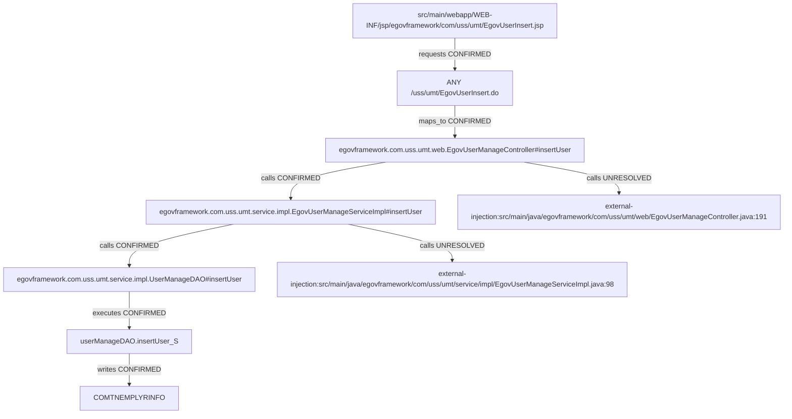

> AI의 PASS는 PL/PM 승인이나 고객 검수 완료가 아닙니다.

# si-trace 실행 결과

상태: PARTIAL. 연결은 정적 소스 근거(증거 2단계)이며 실제 앱/DB 실행을 뜻하지 않는다.

## 개요

업무사용자 등록은 입력·인증·검증 조건을 통과하면 식별자를 발급받고 저장한다.
외부 ID 생성기와 validator는 내부 구현을 확정하지 않고 등록 INSERT와 성공 forward를 구별한다.

## 동작 흐름

POST 등록 폼 → Controller 인증/외부 검증 → Service의 외부 ID 생성 → 로컬 비밀번호 변환 → DAO INSERT COMTNEMPLYRINFO → forward 도착 URL.
인증 Helper 및 암호화/문자열 static 호출 누락 3건은 원문 보충 설명으로만 기록했다. 목록/화면의 별도 AJAX는 등록 SQL 흐름에서 제외한다.

```text
src/main/webapp/WEB-INF/jsp/egovframework/com/uss/umt/EgovUserInsert.jsp
└─ requests [CONFIRMED] → ANY /uss/umt/EgovUserInsert.do
   └─ maps_to [CONFIRMED] → egovframework.com.uss.umt.web.EgovUserManageController#insertUser
      └─ calls [UNRESOLVED] → external-injection:src/main/java/egovframework/com/uss/umt/web/EgovUserManageController.java:191
      └─ calls [CONFIRMED] → egovframework.com.uss.umt.service.impl.EgovUserManageServiceImpl#insertUser
         └─ calls [UNRESOLVED] → external-injection:src/main/java/egovframework/com/uss/umt/service/impl/EgovUserManageServiceImpl.java:98
         └─ calls [CONFIRMED] → egovframework.com.uss.umt.service.impl.UserManageDAO#insertUser
            └─ executes [CONFIRMED] → userManageDAO.insertUser_S
               └─ writes [CONFIRMED] → COMTNEMPLYRINFO
```



## 파일 위치

| 계층 | 위치 | 이름 |
|---|---|---|
| table | `script/ddl/altibase/com_DDL_altibase.sql:129` | COMTNEMPLYRINFO |
| method | `src/main/java/egovframework/com/uss/umt/service/impl/EgovUserManageServiceImpl.java:96` | egovframework.com.uss.umt.service.impl.EgovUserManageServiceImpl#insertUser |
| method | `src/main/java/egovframework/com/uss/umt/service/impl/UserManageDAO.java:55` | egovframework.com.uss.umt.service.impl.UserManageDAO#insertUser |
| method | `src/main/java/egovframework/com/uss/umt/web/EgovUserManageController.java:183` | egovframework.com.uss.umt.web.EgovUserManageController#insertUser |
| sql | `src/main/resources/egovframework/mapper/com/uss/umt/EgovUserManage_SQL_mysql.xml:74` | userManageDAO.insertUser_S |
| jsp | `src/main/webapp/WEB-INF/jsp/egovframework/com/uss/umt/EgovUserInsert.jsp:1` | src/main/webapp/WEB-INF/jsp/egovframework/com/uss/umt/EgovUserInsert.jsp |
| endpoint | `src/main/java/egovframework/com/uss/umt/web/EgovUserManageController.java:182` | ANY /uss/umt/EgovUserInsert.do |
| unknown | `src/main/java/egovframework/com/uss/umt/service/impl/EgovUserManageServiceImpl.java:98` | external-injection:src/main/java/egovframework/com/uss/umt/service/impl/EgovUserManageServiceImpl.java:98 |
| unknown | `src/main/java/egovframework/com/uss/umt/web/EgovUserManageController.java:191` | external-injection:src/main/java/egovframework/com/uss/umt/web/EgovUserManageController.java:191 |

## 연결 근거

| 출발 → 도착 | 관계·상태 | 소스 근거 |
|---|---|---|
| ANY /uss/umt/EgovUserInsert.do → egovframework.com.uss.umt.web.EgovUserManageController#insertUser | maps_to / CONFIRMED | `src/main/java/egovframework/com/uss/umt/web/EgovUserManageController.java:182`, `src/main/java/egovframework/com/uss/umt/web/EgovUserManageController.java:183`, `src/main/java/egovframework/com/uss/umt/web/EgovUserManageController.java:57` |
| egovframework.com.uss.umt.web.EgovUserManageController#insertUser → external-injection:src/main/java/egovframework/com/uss/umt/web/EgovUserManageController.java:191 | calls / UNRESOLVED | `src/main/java/egovframework/com/uss/umt/web/EgovUserManageController.java:191` |
| egovframework.com.uss.umt.web.EgovUserManageController#insertUser → egovframework.com.uss.umt.service.impl.EgovUserManageServiceImpl#insertUser | calls / CONFIRMED | `src/main/java/egovframework/com/uss/umt/web/EgovUserManageController.java:201`, `src/main/java/egovframework/com/uss/umt/service/impl/EgovUserManageServiceImpl.java:96`, `src/main/java/egovframework/com/uss/umt/web/EgovUserManageController.java:61` |
| egovframework.com.uss.umt.service.impl.EgovUserManageServiceImpl#insertUser → external-injection:src/main/java/egovframework/com/uss/umt/service/impl/EgovUserManageServiceImpl.java:98 | calls / UNRESOLVED | `src/main/java/egovframework/com/uss/umt/service/impl/EgovUserManageServiceImpl.java:98` |
| egovframework.com.uss.umt.service.impl.EgovUserManageServiceImpl#insertUser → egovframework.com.uss.umt.service.impl.UserManageDAO#insertUser | calls / CONFIRMED | `src/main/java/egovframework/com/uss/umt/service/impl/EgovUserManageServiceImpl.java:103`, `src/main/java/egovframework/com/uss/umt/service/impl/UserManageDAO.java:55`, `src/main/java/egovframework/com/uss/umt/service/impl/EgovUserManageServiceImpl.java:41` |
| egovframework.com.uss.umt.service.impl.UserManageDAO#insertUser → userManageDAO.insertUser_S | executes / CONFIRMED | `src/main/java/egovframework/com/uss/umt/service/impl/UserManageDAO.java:56`, `src/main/resources/egovframework/mapper/com/uss/umt/EgovUserManage_SQL_mysql.xml:74`, `src/main/resources/egovframework/spring/com/context-mapper.xml:15`, `src/main/resources/egovframework/spring/com/context-datasource.xml:12`, `src/main/resources/egovframework/egovProps/globals.properties:20` |
| userManageDAO.insertUser_S → COMTNEMPLYRINFO | writes / CONFIRMED | `src/main/resources/egovframework/mapper/com/uss/umt/EgovUserManage_SQL_mysql.xml:76` |
| src/main/webapp/WEB-INF/jsp/egovframework/com/uss/umt/EgovUserInsert.jsp → ANY /uss/umt/EgovUserInsert.do | requests / CONFIRMED | `src/main/webapp/WEB-INF/jsp/egovframework/com/uss/umt/EgovUserInsert.jsp:209`, `src/main/java/egovframework/com/uss/umt/web/EgovUserManageController.java:182` |

## 관련 테이블

- 쓰기: COMTNEMPLYRINFO — CONFIRMED, `src/main/resources/egovframework/mapper/com/uss/umt/EgovUserManage_SQL_mysql.xml:76`

## 함정

- mysql-selection / CONFIRMED: DB 기본 선택은 mapperLocations + Globals.DbType=mysql이다. 다른 DB XML은 후보이며 서버 override는 미검증이다. (`src/main/resources/egovframework/spring/com/context-mapper.xml:15`, `src/main/resources/egovframework/spring/com/context-datasource.xml:12`, `src/main/resources/egovframework/egovProps/globals.properties:20`)
- profile-boundary / UNRESOLVED: AuthenticInterceptor는 dummy 프로필 전용이다. 기본 Auth=security이므로 현재 요청 적용으로 확정하지 않는다. 시스템 프로필 override와 실제 기동은 미확인이다. (`src/main/webapp/WEB-INF/config/egovframework/springmvc/egov-com-interceptor.xml:19`, `src/main/java/egovframework/com/cmm/context/EgovWebServletContextListener.java:43`, `src/main/java/egovframework/com/cmm/context/EgovWebServletContextListener.java:58`, `src/main/resources/egovframework/egovProps/globals.properties:26`)
- ddl-location / CONFIRMED: 골격 table/view의 Altibase DDL 위치는 이름 병합 대표 선언이다. 활성 mysql DDL 위치로 해석하지 않으며 선택된 mysql SQL과 별도 mysql DDL을 확인했다. (`script/ddl/mysql/com_DDL_mysql.sql:184`, `script/ddl/mysql/com_DDL_mysql.sql:598`, `script/ddl/mysql/com_DDL_mysql.sql:5050`)
- submit-condition / CONFIRMED: 등록은 form:form POST→fnInsert→confirm/validate/비밀번호 일치→form.submit이다. fnInsert가 목록 URL을 호출한다고 확정한 골격 연결은 잘못이다. fnListPage의 action이 다른 함수로 전파된 것으로 보이며 원본에 그대로 보존했다. (`src/main/webapp/WEB-INF/jsp/egovframework/com/uss/umt/EgovUserInsert.jsp:154`, `src/main/webapp/WEB-INF/jsp/egovframework/com/uss/umt/EgovUserInsert.jsp:159`, `src/main/webapp/WEB-INF/jsp/egovframework/com/uss/umt/EgovUserInsert.jsp:166`, `src/main/webapp/WEB-INF/jsp/egovframework/com/uss/umt/EgovUserInsert.jsp:209`, `src/main/webapp/WEB-INF/jsp/egovframework/com/uss/umt/EgovUserInsert.jsp:474`)
- authentication-and-validation-branches / CONFIRMED: 인증 실패는 index, 검증 실패는 등록 view로 반환하며 통과 시 빈 조직/그룹을 null로 바꾸고 Service를 호출한다. 외부 validator 구현·실제 결과는 미검증이다. (`src/main/java/egovframework/com/uss/umt/web/EgovUserManageController.java:186`, `src/main/java/egovframework/com/uss/umt/web/EgovUserManageController.java:191`, `src/main/java/egovframework/com/uss/umt/web/EgovUserManageController.java:195`, `src/main/java/egovframework/com/uss/umt/web/EgovUserManageController.java:201`)
- auth-helper-boundary / UNRESOLVED: isAuthenticated 진입 호출은 소스에서 확인했다. Helper의 static 주입 서비스 선택·외부 내부 실행은 별도 미확정 경계다. 첫 골격에는 Helper 진입이 누락돼 있으며 보충 근거로 남긴다. (`src/main/java/egovframework/com/uss/umt/web/EgovUserManageController.java:186`, `src/main/java/egovframework/com/cmm/util/EgovUserDetailsHelper.java:27`, `src/main/java/egovframework/com/cmm/util/EgovUserDetailsHelper.java:34`, `src/main/resources/egovframework/spring/com/context-egovuserdetailshelper.xml:36`, `src/main/java/egovframework/com/cmm/util/EgovUserDetailsHelper.java:58`)
- id-generation-config / CONFIRMED: 외부 테이블형 ID 생성기는 COMTECOPSEQ, 논리 tableName USRCNFRM_ID, blockSize 10과 USRCNFRM_ 접두 전략을 사용하도록 설정돼 있다. Oracle 시퀀스 또는 확인된 SQL 실행으로 바꾸어 말하지 않는다. (`src/main/java/egovframework/com/uss/umt/service/impl/EgovUserManageServiceImpl.java:98`, `src/main/resources/egovframework/spring/com/idgn/context-idgn-UsrCnfrm.xml:5`, `src/main/resources/egovframework/spring/com/idgn/context-idgn-UsrCnfrm.xml:8`, `src/main/resources/egovframework/spring/com/idgn/context-idgn-UsrCnfrm.xml:13`)
- id-generator-sql-boundary / UNRESOLVED: 외부 ID 생성기 구현 소스가 없어 실제 SQL·락·DB 접근 빈도는 미확정이다. COMTECOPSEQ는 설정상 접근 후보이며 본 INSERT가 직접 읽고 쓰는 테이블과 합치지 않는다. (`src/main/java/egovframework/com/uss/umt/service/impl/EgovUserManageServiceImpl.java:98`, `src/main/resources/egovframework/spring/com/idgn/context-idgn-UsrCnfrm.xml:5`, `script/ddl/mysql/com_DDL_mysql.sql:5215`)
- password-transform / CONFIRMED: 서비스는 null ID를 빈 문자열로 바꾸는 로컬 static 유틸과 encryptPassword(String,String)를 호출한다. SHA-256에 ID bytes 후 비밀번호를 digest해 Base64로 반환한다. 두 static 호출은 골격에서 누락됐으며 연결을 추가하지 않았다. 실제 입력·해시를 실행하거나 출력하지 않았다. (`src/main/java/egovframework/com/uss/umt/service/impl/EgovUserManageServiceImpl.java:101`, `src/main/java/egovframework/com/utl/fcc/service/EgovStringUtil.java:371`, `src/main/java/egovframework/com/utl/sim/service/EgovFileScrty.java:198`, `src/main/java/egovframework/com/utl/sim/service/EgovFileScrty.java:205`, `src/main/java/egovframework/com/utl/sim/service/EgovFileScrty.java:208`, `src/main/java/egovframework/com/utl/sim/service/EgovFileScrty.java:212`)
- mysql-selection / CONFIRMED: 등록 DAO sqlId는 기본 선택된 mysql의 INSERT COMTNEMPLYRINFO로 이어진다. 다른 DB는 후보이며 ID 생성 SQL과 구별한다. (`src/main/java/egovframework/com/uss/umt/service/impl/UserManageDAO.java:56`, `src/main/resources/egovframework/mapper/com/uss/umt/EgovUserManage_SQL_mysql.xml:74`, `src/main/resources/egovframework/mapper/com/uss/umt/EgovUserManage_SQL_mysql.xml:76`, `src/main/resources/egovframework/spring/com/context-mapper.xml:15`, `src/main/resources/egovframework/egovProps/globals.properties:20`)
- success-forward / CONFIRMED: 성공 시 resultMsg를 설정하고 forward:/uss/umt/EgovUserManage.do까지 기록한다. 도착 후 목록·공통코드 SQL 및 실패 화면의 별도 AJAX는 본 등록 처리에서 제외한다. (`src/main/java/egovframework/com/uss/umt/web/EgovUserManageController.java:201`, `src/main/java/egovframework/com/uss/umt/web/EgovUserManageController.java:203`, `src/main/java/egovframework/com/uss/umt/web/EgovUserManageController.java:205`)

## 숨은 경로 확인

- interceptor: UNRESOLVED — locale/web-log 선언은 확인. dummy AuthenticInterceptor는 기본 security와 다르며 실제 프로필/순서/실행은 미확인이다. (`src/main/webapp/WEB-INF/config/egovframework/springmvc/egov-com-servlet.xml:44`, `src/main/webapp/WEB-INF/config/egovframework/springmvc/egov-com-interceptor.xml:19`, `src/main/java/egovframework/com/cmm/context/EgovWebServletContextListener.java:43`)
- filter: CONFIRMED — Java initializer가 인코딩·security 조건·multipart·HTMLTag·session timeout 필터를 등록한다. 내부실행은 미검증이다. (`src/main/java/egovframework/com/cmm/config/EgovWebApplicationInitializer.java:66`, `src/main/java/egovframework/com/cmm/config/EgovWebApplicationInitializer.java:98`, `src/main/java/egovframework/com/cmm/config/EgovWebApplicationInitializer.java:149`)
- aop: CONFIRMED — transaction REQUIRED/Exception rollback, syslog/개인정보/예외 AOP 선언을 확인했다. 조건부 로그의 DB 접근을 본 업무 SQL과 합산하지 않는다. (`src/main/resources/egovframework/spring/com/context-transaction.xml:13`, `src/main/resources/egovframework/spring/com/context-syslogaop.xml:19`, `src/main/resources/egovframework/spring/com/context-privacylogaop.xml:24`, `src/main/resources/egovframework/spring/com/context-aspect.xml:8`)
- paging: NOT_FOUND — 선택한 등록/중복확인 본 메서드에서는 페이징이 없다. 등록 후 목록은 범위 밖이다.
- common-code: NOT_FOUND — 선택한 등록/중복확인 메서드 안에는 별도 공통코드 조회가 없다. 화면 준비/후속 목록은 범위 밖이다.
- exception: CONFIRMED — Service after-throwing AOP와 MVC 예외별 view mapping이 있다. 실제 예외 발생·응답은 실행하지 않았다. (`src/main/resources/egovframework/spring/com/context-aspect.xml:8`, `src/main/webapp/WEB-INF/config/egovframework/springmvc/egov-com-servlet.xml:63`)

## 확정 못 한 경로

- egovframework.com.uss.umt.web.EgovUserManageController#insertUser → external-injection:src/main/java/egovframework/com/uss/umt/web/EgovUserManageController.java:191: UNRESOLVED — 주입 필드의 호출 대상 구현이 소스 범위에 없음
- egovframework.com.uss.umt.service.impl.EgovUserManageServiceImpl#insertUser → external-injection:src/main/java/egovframework/com/uss/umt/service/impl/EgovUserManageServiceImpl.java:98: UNRESOLVED — 주입 필드의 호출 대상 구현이 소스 범위에 없음
- 실제 앱·HTTP·DB 요청은 실행하지 않았다. 외부 라이브러리·프로필 override·조건 참/거짓은 미검증이다.
- 첫 자동 골격은 별도 원본으로 보존했다. 이 보고용 그래프는 사용자 요청 범위만 남겼으며 누락 연결을 추가해 첫 점수를 바꾸지 않았다.
- 자동 골격 누락 3건: Controller→isAuthenticated, Service→encryptPassword/isNullToString.

## 실행 방식

complex / parallel. Codex screen/server/sql 탐색자를 같은 모델로 실제 병렬 실행했다. 정답·점수를 보지 않은 원문 요약을 종합했다.

## 다음 확인

- 수정 전 첫 점수와 원본을 사용자에게 보고한다.
- 그 보고 전에는 사례 대응 인덱서/스킬 수정을 하지 않는다.
