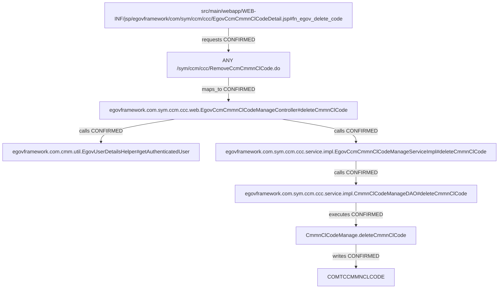

> AI의 PASS는 PL/PM 승인이나 고객 검수 완료가 아닙니다.

# si-trace 실행 결과

상태: PARTIAL. 연결은 정적 소스 근거(증거 2단계)이며 실제 앱/DB 실행을 뜻하지 않는다.

## 개요

공통분류코드 삭제 버튼은 확인 대화상자 후 선택한 코드를 서버에 제출한다.
실제 SQL은 행 삭제가 아니라 USE_AT를 N으로 바꾸는 논리 삭제다.

## 동작 흐름

fn_egov_delete_code → RemoveCcmCmmnClCode.do → deleteCmmnClCode Controller → 이름 주입 ServiceImpl → DAO 문자열 sqlId → mysql UPDATE COMTCCMMNCLCODE.
처리 후 목록 forward 도착까지만 확인했고 후속 목록 요청은 이번 범위에서 제외했다.

```text
src/main/webapp/WEB-INF/jsp/egovframework/com/sym/ccm/ccc/EgovCcmCmmnClCodeDetail.jsp#fn_egov_delete_code
└─ requests [CONFIRMED] → ANY /sym/ccm/ccc/RemoveCcmCmmnClCode.do
   └─ maps_to [CONFIRMED] → egovframework.com.sym.ccm.ccc.web.EgovCcmCmmnClCodeManageController#deleteCmmnClCode
      └─ calls [CONFIRMED] → egovframework.com.cmm.util.EgovUserDetailsHelper#getAuthenticatedUser
      └─ calls [CONFIRMED] → egovframework.com.sym.ccm.ccc.service.impl.EgovCcmCmmnClCodeManageServiceImpl#deleteCmmnClCode
         └─ calls [CONFIRMED] → egovframework.com.sym.ccm.ccc.service.impl.CmmnClCodeManageDAO#deleteCmmnClCode
            └─ executes [CONFIRMED] → CmmnClCodeManage.deleteCmmnClCode
               └─ writes [CONFIRMED] → COMTCCMMNCLCODE
```



## 파일 위치

| 계층 | 위치 | 이름 |
|---|---|---|
| table | `script/ddl/altibase/com_DDL_altibase.sql:791` | COMTCCMMNCLCODE |
| method | `src/main/java/egovframework/com/cmm/util/EgovUserDetailsHelper.java:41` | egovframework.com.cmm.util.EgovUserDetailsHelper#getAuthenticatedUser |
| method | `src/main/java/egovframework/com/sym/ccm/ccc/service/impl/CmmnClCodeManageDAO.java:78` | egovframework.com.sym.ccm.ccc.service.impl.CmmnClCodeManageDAO#deleteCmmnClCode |
| method | `src/main/java/egovframework/com/sym/ccm/ccc/service/impl/EgovCcmCmmnClCodeManageServiceImpl.java:81` | egovframework.com.sym.ccm.ccc.service.impl.EgovCcmCmmnClCodeManageServiceImpl#deleteCmmnClCode |
| method | `src/main/java/egovframework/com/sym/ccm/ccc/web/EgovCcmCmmnClCodeManageController.java:181` | egovframework.com.sym.ccm.ccc.web.EgovCcmCmmnClCodeManageController#deleteCmmnClCode |
| sql | `src/main/resources/egovframework/mapper/com/sym/ccm/ccc/EgovCmmnClCodeManage_SQL_mysql.xml:103` | CmmnClCodeManage.deleteCmmnClCode |
| js | `src/main/webapp/WEB-INF/jsp/egovframework/com/sym/ccm/ccc/EgovCcmCmmnClCodeDetail.jsp:35` | src/main/webapp/WEB-INF/jsp/egovframework/com/sym/ccm/ccc/EgovCcmCmmnClCodeDetail.jsp#fn_egov_delete_code |
| endpoint | `src/main/java/egovframework/com/sym/ccm/ccc/web/EgovCcmCmmnClCodeManageController.java:180` | ANY /sym/ccm/ccc/RemoveCcmCmmnClCode.do |

## 연결 근거

| 출발 → 도착 | 관계·상태 | 소스 근거 |
|---|---|---|
| src/main/webapp/WEB-INF/jsp/egovframework/com/sym/ccm/ccc/EgovCcmCmmnClCodeDetail.jsp#fn_egov_delete_code → ANY /sym/ccm/ccc/RemoveCcmCmmnClCode.do | requests / CONFIRMED | `src/main/webapp/WEB-INF/jsp/egovframework/com/sym/ccm/ccc/EgovCcmCmmnClCodeDetail.jsp:40`, `src/main/java/egovframework/com/sym/ccm/ccc/web/EgovCcmCmmnClCodeManageController.java:180` |
| ANY /sym/ccm/ccc/RemoveCcmCmmnClCode.do → egovframework.com.sym.ccm.ccc.web.EgovCcmCmmnClCodeManageController#deleteCmmnClCode | maps_to / CONFIRMED | `src/main/java/egovframework/com/sym/ccm/ccc/web/EgovCcmCmmnClCodeManageController.java:180`, `src/main/java/egovframework/com/sym/ccm/ccc/web/EgovCcmCmmnClCodeManageController.java:181`, `src/main/java/egovframework/com/sym/ccm/ccc/web/EgovCcmCmmnClCodeManageController.java:47` |
| egovframework.com.sym.ccm.ccc.web.EgovCcmCmmnClCodeManageController#deleteCmmnClCode → egovframework.com.cmm.util.EgovUserDetailsHelper#getAuthenticatedUser | calls / CONFIRMED | `src/main/java/egovframework/com/sym/ccm/ccc/web/EgovCcmCmmnClCodeManageController.java:184`, `src/main/java/egovframework/com/cmm/util/EgovUserDetailsHelper.java:41` |
| egovframework.com.sym.ccm.ccc.web.EgovCcmCmmnClCodeManageController#deleteCmmnClCode → egovframework.com.sym.ccm.ccc.service.impl.EgovCcmCmmnClCodeManageServiceImpl#deleteCmmnClCode | calls / CONFIRMED | `src/main/java/egovframework/com/sym/ccm/ccc/web/EgovCcmCmmnClCodeManageController.java:187`, `src/main/java/egovframework/com/sym/ccm/ccc/service/impl/EgovCcmCmmnClCodeManageServiceImpl.java:81`, `src/main/java/egovframework/com/sym/ccm/ccc/web/EgovCcmCmmnClCodeManageController.java:49` |
| egovframework.com.sym.ccm.ccc.service.impl.EgovCcmCmmnClCodeManageServiceImpl#deleteCmmnClCode → egovframework.com.sym.ccm.ccc.service.impl.CmmnClCodeManageDAO#deleteCmmnClCode | calls / CONFIRMED | `src/main/java/egovframework/com/sym/ccm/ccc/service/impl/EgovCcmCmmnClCodeManageServiceImpl.java:82`, `src/main/java/egovframework/com/sym/ccm/ccc/service/impl/CmmnClCodeManageDAO.java:78`, `src/main/java/egovframework/com/sym/ccm/ccc/service/impl/EgovCcmCmmnClCodeManageServiceImpl.java:39` |
| egovframework.com.sym.ccm.ccc.service.impl.CmmnClCodeManageDAO#deleteCmmnClCode → CmmnClCodeManage.deleteCmmnClCode | executes / CONFIRMED | `src/main/java/egovframework/com/sym/ccm/ccc/service/impl/CmmnClCodeManageDAO.java:79`, `src/main/resources/egovframework/mapper/com/sym/ccm/ccc/EgovCmmnClCodeManage_SQL_mysql.xml:103`, `src/main/resources/egovframework/spring/com/context-mapper.xml:15`, `src/main/resources/egovframework/spring/com/context-datasource.xml:12`, `src/main/resources/egovframework/egovProps/globals.properties:20` |
| CmmnClCodeManage.deleteCmmnClCode → COMTCCMMNCLCODE | writes / CONFIRMED | `src/main/resources/egovframework/mapper/com/sym/ccm/ccc/EgovCmmnClCodeManage_SQL_mysql.xml:106` |

## 관련 테이블

- 쓰기: COMTCCMMNCLCODE — CONFIRMED, `src/main/resources/egovframework/mapper/com/sym/ccm/ccc/EgovCmmnClCodeManage_SQL_mysql.xml:106`

## 함정

- 기본 DB 선택: mapperLocations의 *_{Globals.DbType}.xml과 Globals.DbType=mysql로 mysql 문장을 선택한다. 다른 DB XML은 활성 실행 근거가 아닌 후보다. 외부 override는 미검증. (`src/main/resources/egovframework/spring/com/context-mapper.xml:15`, `src/main/resources/egovframework/spring/com/context-datasource.xml:12`, `src/main/resources/egovframework/egovProps/globals.properties:20`)
- profile-boundary / UNRESOLVED: AuthenticInterceptor는 dummy 프로필 전용이다. 활성 프로필은 Java Listener의 런타임 계산이라 자동 확정하지 못했다. 후보 연결은 LIKELY, profile=dummy; active=미확정으로 유지한다. Globals.Auth=security는 기본값 근거이며 실제 기동·override·실행 순서는 미확인이다. (`src/main/webapp/WEB-INF/config/egovframework/springmvc/egov-com-interceptor.xml:19`, `src/main/java/egovframework/com/cmm/context/EgovWebServletContextListener.java:58`, `src/main/resources/egovframework/egovProps/globals.properties:26`)
- delete라는 메서드명과 달리 UPDATE USE_AT=N이다. 사용자 확인을 취소하면 요청하지 않는다. (`src/main/resources/egovframework/mapper/com/sym/ccm/ccc/EgovCmmnClCodeManage_SQL_mysql.xml:106`, `src/main/webapp/WEB-INF/jsp/egovframework/com/sym/ccm/ccc/EgovCcmCmmnClCodeDetail.jsp:36`)
- 표의 altibase DDL 위치는 이름 병합 대표 선언이다. 실행 선택은 mysql XML 근거로 판단했다. (`script/ddl/altibase/com_DDL_altibase.sql:791`, `src/main/resources/egovframework/mapper/com/sym/ccm/ccc/EgovCmmnClCodeManage_SQL_mysql.xml:106`)

## 숨은 경로 확인

- interceptor: UNRESOLVED — 기본 locale/web-log 선언은 확인했다. dummy 전용 AuthenticInterceptor의 활성 프로필·실행 순서는 미확정이다. 조건부 후보는 LIKELY와 이유를 유지하며 무조건 활성/제외로 확정하지 않는다. (`src/main/webapp/WEB-INF/config/egovframework/springmvc/egov-com-servlet.xml:44`, `src/main/webapp/WEB-INF/config/egovframework/springmvc/egov-com-servlet.xml:51`, `src/main/webapp/WEB-INF/config/egovframework/springmvc/egov-com-interceptor.xml:19`, `src/main/java/egovframework/com/cmm/context/EgovWebServletContextListener.java:58`)
- filter: CONFIRMED — Java initializer에서 encoding *.do, security /*, multipart, HTMLTag 필터를 등록한다. Security 내부 필터 체인 동작은 실행하지 않았다. (`src/main/java/egovframework/com/cmm/config/EgovWebApplicationInitializer.java:66`, `src/main/java/egovframework/com/cmm/config/EgovWebApplicationInitializer.java:98`, `src/main/java/egovframework/com/cmm/config/EgovWebApplicationInitializer.java:149`, `src/main/java/egovframework/com/cmm/config/EgovWebApplicationInitializer.java:159`)
- aop: UNRESOLVED — syslog·privacy AOP의 pointcut 선언은 확인했으나 각 advice 내부와 실제 적용 여부는 미검증이다. (`src/main/resources/egovframework/spring/com/context-syslogaop.xml:13`, `src/main/resources/egovframework/spring/com/context-privacylogaop.xml:24`)
- paging: NOT_FOUND — 이번 단일 삭제/컬럼 조회 범위에는 공통 목록 페이징 호출이 없다. 프로젝트 전체 부재를 뜻하지 않는다.
- common-code: NOT_FOUND — 이번 단일 삭제/컬럼 조회 메서드에서 별도 공통코드 조회는 발견하지 못했다.
- exception: CONFIRMED — MVC SimpleMappingExceptionResolver의 예외→뷰 선언을 확인했다. 실제 발생·응답은 미검증이다. (`src/main/webapp/WEB-INF/config/egovframework/springmvc/egov-com-servlet.xml:63`, `src/main/webapp/WEB-INF/config/egovframework/springmvc/egov-com-servlet.xml:72`)

## 확정 못 한 경로

- 실제 앱·HTTP·DB 실행은 하지 않았다. 정적 소스 증거 2단계이며 외부 라이브러리·조건 참/거짓·서버 override는 미확정이다.
- v2는 승인된 사례를 본 뒤 일반 결함을 고친 확인 결과다. 일반화 성능으로 해석하지 않는다.
- 동적 Java profile 계산·복잡한 overload/가변인자·동적 URL/테이블은 자동 확정하지 않는다.

## 실행 방식

simple / direct. 주 에이전트 직접 원문 확인과 기존 불변 소스 근거 재대조. 다른 계층의 실제 탐색자 검토도 참고했다.

## 다음 확인

- 자동 활성화 미실행 두 질문은 docs/manual-checks.md 절차로 확인한다.
- 학습 정답과 새 인증 Helper 호출의 차이는 source 근거와 함께 별도로 검토한다.
