> AI의 PASS는 PL/PM 승인이나 고객 검수 완료가 아닙니다.

# si-trace 실행 결과

상태: PARTIAL. 연결은 정적 소스 근거(증거 2단계)이며 실제 앱/DB 실행을 뜻하지 않는다.

## 개요

공통상세코드 목록은 검색 조건과 페이지를 받아 상세코드·코드명 및 전체 건수를 조회한다.
이 화면의 상세 링크와 등록 화면 진입은 별도 Controller 분기로 이어진다.

## 동작 흐름

목록 폼/페이징 → SelectCcmCmmnDetailCodeList.do → ServiceImpl 목록/count → DAO sqlId → mysql 두 조회 → COMTCCMMNDETAILCODE와 COMTCCMMNCODE.
등록뷰 진입은 분류코드를 읽고 선택된 분류가 있을 때 공통코드도 읽는다. 상세 링크는 별도 상세 조회로 이어진다.

```text
src/main/webapp/WEB-INF/jsp/egovframework/com/sym/ccm/cde/EgovCcmCmmnDetailCodeList.jsp
└─ includes [CONFIRMED] → src/main/webapp/WEB-INF/jsp/egovframework/com/sym/ccm/cde/EgovCcmCmmnDetailCodeList.jsp#inline:30
   └─ includes [CONFIRMED] → src/main/webapp/WEB-INF/jsp/egovframework/com/sym/ccm/cde/EgovCcmCmmnDetailCodeList.jsp#fn_egov_init
   └─ includes [CONFIRMED] → src/main/webapp/WEB-INF/jsp/egovframework/com/sym/ccm/cde/EgovCcmCmmnDetailCodeList.jsp#fn_egov_select_linkPage
      └─ requests [CONFIRMED] → ANY /sym/ccm/cde/SelectCcmCmmnDetailCodeList.do
         └─ maps_to [CONFIRMED] → egovframework.com.sym.ccm.cde.web.EgovCcmCmmnDetailCodeManageController#selectCmmnDetailCodeList
            └─ calls [UNRESOLVED] → external-injection:src/main/java/egovframework/com/sym/ccm/cde/web/EgovCcmCmmnDetailCodeManageController.java:87
            └─ calls [UNRESOLVED] → external-injection:src/main/java/egovframework/com/sym/ccm/cde/web/EgovCcmCmmnDetailCodeManageController.java:88
            └─ calls [CONFIRMED] → egovframework.com.sym.ccm.cde.service.impl.EgovCcmCmmnDetailCodeManageServiceImpl#selectCmmnDetailCodeList
               └─ calls [CONFIRMED] → egovframework.com.sym.ccm.cde.service.impl.CmmnDetailCodeManageDAO#selectCmmnDetailCodeList
                  └─ executes [CONFIRMED] → CmmnDetailCodeManage.selectCmmnDetailCodeList
                     └─ reads [CONFIRMED] → COMTCCMMNDETAILCODE
                     └─ reads [CONFIRMED] → COMTCCMMNCODE
            └─ calls [CONFIRMED] → egovframework.com.sym.ccm.cde.service.impl.EgovCcmCmmnDetailCodeManageServiceImpl#selectCmmnDetailCodeListTotCnt
               └─ calls [CONFIRMED] → egovframework.com.sym.ccm.cde.service.impl.CmmnDetailCodeManageDAO#selectCmmnDetailCodeListTotCnt
                  └─ executes [CONFIRMED] → CmmnDetailCodeManage.selectCmmnDetailCodeListTotCnt
                     └─ reads [CONFIRMED] → COMTCCMMNDETAILCODE
                     └─ reads [CONFIRMED] → COMTCCMMNCODE
         └─ intercepted_by [LIKELY] → egovframework.com.cmm.interceptor.AuthenticInterceptor#preHandle
            └─ calls [CONFIRMED] → egovframework.com.cmm.util.EgovUserDetailsHelper#isAuthenticated
            └─ calls [CONFIRMED] → egovframework.com.cmm.util.EgovUserDetailsHelper#getAuthorities
               └─ calls [LIKELY] → egovframework.com.cmm.service.impl.EgoDummyUserDetailsServiceImpl#getAuthorities
               └─ calls [LIKELY] → egovframework.com.cmm.service.impl.EgovUserDetailsSessionServiceImpl#getAuthorities
                  └─ calls [UNRESOLVED] → external-static:src/main/java/egovframework/com/cmm/service/impl/EgovUserDetailsSessionServiceImpl.java:42
               └─ calls [LIKELY] → egovframework.com.sec.ram.service.impl.EgovUserDetailsSecurityServiceImpl#getAuthorities
                  └─ calls [UNRESOLVED] → external-static:src/main/java/egovframework/com/sec/ram/service/impl/EgovUserDetailsSecurityServiceImpl.java:53
   └─ includes [CONFIRMED] → src/main/webapp/WEB-INF/jsp/egovframework/com/sym/ccm/cde/EgovCcmCmmnDetailCodeList.jsp#fn_egov_search_code
      └─ requests [CONFIRMED] → ANY /sym/ccm/cde/SelectCcmCmmnDetailCodeList.do
   └─ includes [CONFIRMED] → src/main/webapp/WEB-INF/jsp/egovframework/com/sym/ccm/cde/EgovCcmCmmnDetailCodeList.jsp#fn_egov_inquire_codedetail
      └─ requests [CONFIRMED] → ANY /sym/ccm/cde/SelectCcmCmmnDetailCodeDetail.do
         └─ maps_to [CONFIRMED] → egovframework.com.sym.ccm.cde.web.EgovCcmCmmnDetailCodeManageController#selectCmmnDetailCodeDetail
            └─ calls [CONFIRMED] → egovframework.com.sym.ccm.cde.service.impl.EgovCcmCmmnDetailCodeManageServiceImpl#selectCmmnDetailCodeDetail
               └─ calls [CONFIRMED] → egovframework.com.sym.ccm.cde.service.impl.CmmnDetailCodeManageDAO#selectCmmnDetailCodeDetail
                  └─ executes [CONFIRMED] → CmmnDetailCodeManage.selectCmmnDetailCodeDetail
                     └─ reads [CONFIRMED] → COMTCCMMNDETAILCODE
                     └─ reads [CONFIRMED] → COMTCCMMNCODE
         └─ intercepted_by [LIKELY] → egovframework.com.cmm.interceptor.AuthenticInterceptor#preHandle
└─ requests [CONFIRMED] → ANY /sym/ccm/cde/SelectCcmCmmnDetailCodeList.do
└─ requests [CONFIRMED] → ANY /sym/ccm/cde/RegistCcmCmmnDetailCodeView.do
   └─ maps_to [CONFIRMED] → egovframework.com.sym.ccm.cde.web.EgovCcmCmmnDetailCodeManageController#insertCmmnDetailCodeView
      └─ calls [CONFIRMED] → egovframework.com.sym.ccm.ccc.service.impl.EgovCcmCmmnClCodeManageServiceImpl#selectCmmnClCodeList
         └─ calls [CONFIRMED] → egovframework.com.sym.ccm.ccc.service.impl.CmmnClCodeManageDAO#selectCmmnClCodeList
            └─ executes [CONFIRMED] → CmmnClCodeManage.selectCmmnClCodeList
               └─ reads [CONFIRMED] → COMTCCMMNCLCODE
      └─ calls [CONFIRMED] → egovframework.com.sym.ccm.cca.service.impl.EgovCcmCmmnCodeManageServiceImpl#selectCmmnCodeList
         └─ calls [CONFIRMED] → egovframework.com.sym.ccm.cca.service.impl.CmmnCodeManageDAO#selectCmmnCodeList
            └─ executes [CONFIRMED] → CmmnCodeManage.selectCmmnCodeList
               └─ reads [CONFIRMED] → COMTCCMMNCODE
               └─ reads [CONFIRMED] → COMTCCMMNCLCODE
   └─ intercepted_by [LIKELY] → egovframework.com.cmm.interceptor.AuthenticInterceptor#preHandle
└─ requests [CONFIRMED] → ANY /sym/ccm/cde/SelectCcmCmmnDetailCodeDetail.do
```

```mermaid
flowchart TD
  n0["COMTCCMMNCLCODE"]
  n1["COMTCCMMNCODE"]
  n2["COMTCCMMNDETAILCODE"]
  n3["egovframework.com.cmm.interceptor.AuthenticInterceptor#preHandle"]
  n4["egovframework.com.cmm.service.impl.EgoDummyUserDetailsServiceImpl#getAuthorities"]
  n5["egovframework.com.cmm.service.impl.EgovUserDetailsSessionServiceImpl#getAuthorities"]
  n6["egovframework.com.cmm.util.EgovUserDetailsHelper#getAuthorities"]
  n7["egovframework.com.cmm.util.EgovUserDetailsHelper#isAuthenticated"]
  n8["egovframework.com.sec.ram.service.impl.EgovUserDetailsSecurityServiceImpl#getAuthorities"]
  n9["egovframework.com.sym.ccm.cca.service.impl.CmmnCodeManageDAO#selectCmmnCodeList"]
  n10["egovframework.com.sym.ccm.cca.service.impl.EgovCcmCmmnCodeManageServiceImpl#selectCmmnCodeList"]
  n11["egovframework.com.sym.ccm.ccc.service.impl.CmmnClCodeManageDAO#selectCmmnClCodeList"]
  n12["egovframework.com.sym.ccm.ccc.service.impl.EgovCcmCmmnClCodeManageServiceImpl#selectCmmnClCodeList"]
  n13["egovframework.com.sym.ccm.cde.service.impl.CmmnDetailCodeManageDAO#selectCmmnDetailCodeListTotCnt"]
  n14["egovframework.com.sym.ccm.cde.service.impl.CmmnDetailCodeManageDAO#selectCmmnDetailCodeList"]
  n15["egovframework.com.sym.ccm.cde.service.impl.CmmnDetailCodeManageDAO#selectCmmnDetailCodeDetail"]
  n16["egovframework.com.sym.ccm.cde.service.impl.EgovCcmCmmnDetailCodeManageServiceImpl#selectCmmnDetailCodeListTotCnt"]
  n17["egovframework.com.sym.ccm.cde.service.impl.EgovCcmCmmnDetailCodeManageServiceImpl#selectCmmnDetailCodeList"]
  n18["egovframework.com.sym.ccm.cde.service.impl.EgovCcmCmmnDetailCodeManageServiceImpl#selectCmmnDetailCodeDetail"]
  n19["egovframework.com.sym.ccm.cde.web.EgovCcmCmmnDetailCodeManageController#selectCmmnDetailCodeList"]
  n20["egovframework.com.sym.ccm.cde.web.EgovCcmCmmnDetailCodeManageController#selectCmmnDetailCodeDetail"]
  n21["egovframework.com.sym.ccm.cde.web.EgovCcmCmmnDetailCodeManageController#insertCmmnDetailCodeView"]
  n22["CmmnCodeManage.selectCmmnCodeList"]
  n23["CmmnClCodeManage.selectCmmnClCodeList"]
  n24["CmmnDetailCodeManage.selectCmmnDetailCodeList"]
  n25["CmmnDetailCodeManage.selectCmmnDetailCodeListTotCnt"]
  n26["CmmnDetailCodeManage.selectCmmnDetailCodeDetail"]
  n27["src/main/webapp/WEB-INF/jsp/egovframework/com/sym/ccm/cde/EgovCcmCmmnDetailCodeList.jsp"]
  n28["src/main/webapp/WEB-INF/jsp/egovframework/com/sym/ccm/cde/EgovCcmCmmnDetailCodeList.jsp#inline:30"]
  n29["src/main/webapp/WEB-INF/jsp/egovframework/com/sym/ccm/cde/EgovCcmCmmnDetailCodeList.jsp#fn_egov_init"]
  n30["src/main/webapp/WEB-INF/jsp/egovframework/com/sym/ccm/cde/EgovCcmCmmnDetailCodeList.jsp#fn_egov_select_linkPage"]
  n31["src/main/webapp/WEB-INF/jsp/egovframework/com/sym/ccm/cde/EgovCcmCmmnDetailCodeList.jsp#fn_egov_search_code"]
  n32["src/main/webapp/WEB-INF/jsp/egovframework/com/sym/ccm/cde/EgovCcmCmmnDetailCodeList.jsp#fn_egov_inquire_codedetail"]
  n33["ANY /sym/ccm/cde/SelectCcmCmmnDetailCodeList.do"]
  n34["ANY /sym/ccm/cde/SelectCcmCmmnDetailCodeDetail.do"]
  n35["ANY /sym/ccm/cde/RegistCcmCmmnDetailCodeView.do"]
  n36["external-static:src/main/java/egovframework/com/cmm/service/impl/EgovUserDetailsSessionServiceImpl.java:42"]
  n37["external-static:src/main/java/egovframework/com/sec/ram/service/impl/EgovUserDetailsSecurityServiceImpl.java:53"]
  n38["external-injection:src/main/java/egovframework/com/sym/ccm/cde/web/EgovCcmCmmnDetailCodeManageController.java:87"]
  n39["external-injection:src/main/java/egovframework/com/sym/ccm/cde/web/EgovCcmCmmnDetailCodeManageController.java:88"]
  n27 -->|"includes CONFIRMED"| n28
  n27 -->|"requests CONFIRMED"| n33
  n27 -->|"requests CONFIRMED"| n35
  n27 -->|"requests CONFIRMED"| n34
  n28 -->|"includes CONFIRMED"| n29
  n28 -->|"includes CONFIRMED"| n30
  n28 -->|"includes CONFIRMED"| n31
  n28 -->|"includes CONFIRMED"| n32
  n33 -->|"maps_to CONFIRMED"| n19
  n33 -->|"intercepted_by LIKELY"| n3
  n35 -->|"maps_to CONFIRMED"| n21
  n35 -->|"intercepted_by LIKELY"| n3
  n30 -->|"requests CONFIRMED"| n33
  n31 -->|"requests CONFIRMED"| n33
  n32 -->|"requests CONFIRMED"| n34
  n19 -->|"calls UNRESOLVED"| n38
  n19 -->|"calls UNRESOLVED"| n39
  n19 -->|"calls CONFIRMED"| n17
  n19 -->|"calls CONFIRMED"| n16
  n3 -->|"calls CONFIRMED"| n7
  n3 -->|"calls CONFIRMED"| n6
  n21 -->|"calls CONFIRMED"| n12
  n21 -->|"calls CONFIRMED"| n10
  n34 -->|"maps_to CONFIRMED"| n20
  n34 -->|"intercepted_by LIKELY"| n3
  n17 -->|"calls CONFIRMED"| n14
  n16 -->|"calls CONFIRMED"| n13
  n6 -->|"calls LIKELY"| n4
  n6 -->|"calls LIKELY"| n5
  n6 -->|"calls LIKELY"| n8
  n12 -->|"calls CONFIRMED"| n11
  n10 -->|"calls CONFIRMED"| n9
  n20 -->|"calls CONFIRMED"| n18
  n14 -->|"executes CONFIRMED"| n24
  n13 -->|"executes CONFIRMED"| n25
  n5 -->|"calls UNRESOLVED"| n36
  n8 -->|"calls UNRESOLVED"| n37
  n11 -->|"executes CONFIRMED"| n23
  n9 -->|"executes CONFIRMED"| n22
  n18 -->|"calls CONFIRMED"| n15
  n24 -->|"reads CONFIRMED"| n2
  n24 -->|"reads CONFIRMED"| n1
  n25 -->|"reads CONFIRMED"| n2
  n25 -->|"reads CONFIRMED"| n1
  n23 -->|"reads CONFIRMED"| n0
  n22 -->|"reads CONFIRMED"| n1
  n22 -->|"reads CONFIRMED"| n0
  n15 -->|"executes CONFIRMED"| n26
  n26 -->|"reads CONFIRMED"| n2
  n26 -->|"reads CONFIRMED"| n1
```



## 파일 위치

| 계층 | 위치 | 이름 |
|---|---|---|
| table | `script/ddl/altibase/com_DDL_altibase.sql:791` | COMTCCMMNCLCODE |
| table | `script/ddl/altibase/com_DDL_altibase.sql:806` | COMTCCMMNCODE |
| table | `script/ddl/altibase/com_DDL_altibase.sql:828` | COMTCCMMNDETAILCODE |
| method | `src/main/java/egovframework/com/cmm/interceptor/AuthenticInterceptor.java:60` | egovframework.com.cmm.interceptor.AuthenticInterceptor#preHandle |
| method | `src/main/java/egovframework/com/cmm/service/impl/EgoDummyUserDetailsServiceImpl.java:52` | egovframework.com.cmm.service.impl.EgoDummyUserDetailsServiceImpl#getAuthorities |
| method | `src/main/java/egovframework/com/cmm/service/impl/EgovUserDetailsSessionServiceImpl.java:40` | egovframework.com.cmm.service.impl.EgovUserDetailsSessionServiceImpl#getAuthorities |
| method | `src/main/java/egovframework/com/cmm/util/EgovUserDetailsHelper.java:50` | egovframework.com.cmm.util.EgovUserDetailsHelper#getAuthorities |
| method | `src/main/java/egovframework/com/cmm/util/EgovUserDetailsHelper.java:58` | egovframework.com.cmm.util.EgovUserDetailsHelper#isAuthenticated |
| method | `src/main/java/egovframework/com/sec/ram/service/impl/EgovUserDetailsSecurityServiceImpl.java:52` | egovframework.com.sec.ram.service.impl.EgovUserDetailsSecurityServiceImpl#getAuthorities |
| method | `src/main/java/egovframework/com/sym/ccm/cca/service/impl/CmmnCodeManageDAO.java:47` | egovframework.com.sym.ccm.cca.service.impl.CmmnCodeManageDAO#selectCmmnCodeList |
| method | `src/main/java/egovframework/com/sym/ccm/cca/service/impl/EgovCcmCmmnCodeManageServiceImpl.java:50` | egovframework.com.sym.ccm.cca.service.impl.EgovCcmCmmnCodeManageServiceImpl#selectCmmnCodeList |
| method | `src/main/java/egovframework/com/sym/ccm/ccc/service/impl/CmmnClCodeManageDAO.java:50` | egovframework.com.sym.ccm.ccc.service.impl.CmmnClCodeManageDAO#selectCmmnClCodeList |
| method | `src/main/java/egovframework/com/sym/ccm/ccc/service/impl/EgovCcmCmmnClCodeManageServiceImpl.java:55` | egovframework.com.sym.ccm.ccc.service.impl.EgovCcmCmmnClCodeManageServiceImpl#selectCmmnClCodeList |
| method | `src/main/java/egovframework/com/sym/ccm/cde/service/impl/CmmnDetailCodeManageDAO.java:37` | egovframework.com.sym.ccm.cde.service.impl.CmmnDetailCodeManageDAO#selectCmmnDetailCodeListTotCnt |
| method | `src/main/java/egovframework/com/sym/ccm/cde/service/impl/CmmnDetailCodeManageDAO.java:47` | egovframework.com.sym.ccm.cde.service.impl.CmmnDetailCodeManageDAO#selectCmmnDetailCodeList |
| method | `src/main/java/egovframework/com/sym/ccm/cde/service/impl/CmmnDetailCodeManageDAO.java:56` | egovframework.com.sym.ccm.cde.service.impl.CmmnDetailCodeManageDAO#selectCmmnDetailCodeDetail |
| method | `src/main/java/egovframework/com/sym/ccm/cde/service/impl/EgovCcmCmmnDetailCodeManageServiceImpl.java:41` | egovframework.com.sym.ccm.cde.service.impl.EgovCcmCmmnDetailCodeManageServiceImpl#selectCmmnDetailCodeListTotCnt |
| method | `src/main/java/egovframework/com/sym/ccm/cde/service/impl/EgovCcmCmmnDetailCodeManageServiceImpl.java:49` | egovframework.com.sym.ccm.cde.service.impl.EgovCcmCmmnDetailCodeManageServiceImpl#selectCmmnDetailCodeList |
| method | `src/main/java/egovframework/com/sym/ccm/cde/service/impl/EgovCcmCmmnDetailCodeManageServiceImpl.java:58` | egovframework.com.sym.ccm.cde.service.impl.EgovCcmCmmnDetailCodeManageServiceImpl#selectCmmnDetailCodeDetail |
| method | `src/main/java/egovframework/com/sym/ccm/cde/web/EgovCcmCmmnDetailCodeManageController.java:83` | egovframework.com.sym.ccm.cde.web.EgovCcmCmmnDetailCodeManageController#selectCmmnDetailCodeList |
| method | `src/main/java/egovframework/com/sym/ccm/cde/web/EgovCcmCmmnDetailCodeManageController.java:119` | egovframework.com.sym.ccm.cde.web.EgovCcmCmmnDetailCodeManageController#selectCmmnDetailCodeDetail |
| method | `src/main/java/egovframework/com/sym/ccm/cde/web/EgovCcmCmmnDetailCodeManageController.java:152` | egovframework.com.sym.ccm.cde.web.EgovCcmCmmnDetailCodeManageController#insertCmmnDetailCodeView |
| sql | `src/main/resources/egovframework/mapper/com/sym/ccm/cca/EgovCmmnCodeManage_SQL_mysql.xml:10` | CmmnCodeManage.selectCmmnCodeList |
| sql | `src/main/resources/egovframework/mapper/com/sym/ccm/ccc/EgovCmmnClCodeManage_SQL_mysql.xml:10` | CmmnClCodeManage.selectCmmnClCodeList |
| sql | `src/main/resources/egovframework/mapper/com/sym/ccm/cde/EgovCmmnDetailCodeManage_SQL_mysql.xml:10` | CmmnDetailCodeManage.selectCmmnDetailCodeList |
| sql | `src/main/resources/egovframework/mapper/com/sym/ccm/cde/EgovCmmnDetailCodeManage_SQL_mysql.xml:35` | CmmnDetailCodeManage.selectCmmnDetailCodeListTotCnt |
| sql | `src/main/resources/egovframework/mapper/com/sym/ccm/cde/EgovCmmnDetailCodeManage_SQL_mysql.xml:57` | CmmnDetailCodeManage.selectCmmnDetailCodeDetail |
| jsp | `src/main/webapp/WEB-INF/jsp/egovframework/com/sym/ccm/cde/EgovCcmCmmnDetailCodeList.jsp:1` | src/main/webapp/WEB-INF/jsp/egovframework/com/sym/ccm/cde/EgovCcmCmmnDetailCodeList.jsp |
| js | `src/main/webapp/WEB-INF/jsp/egovframework/com/sym/ccm/cde/EgovCcmCmmnDetailCodeList.jsp:30` | src/main/webapp/WEB-INF/jsp/egovframework/com/sym/ccm/cde/EgovCcmCmmnDetailCodeList.jsp#inline:30 |
| js | `src/main/webapp/WEB-INF/jsp/egovframework/com/sym/ccm/cde/EgovCcmCmmnDetailCodeList.jsp:34` | src/main/webapp/WEB-INF/jsp/egovframework/com/sym/ccm/cde/EgovCcmCmmnDetailCodeList.jsp#fn_egov_init |
| js | `src/main/webapp/WEB-INF/jsp/egovframework/com/sym/ccm/cde/EgovCcmCmmnDetailCodeList.jsp:42` | src/main/webapp/WEB-INF/jsp/egovframework/com/sym/ccm/cde/EgovCcmCmmnDetailCodeList.jsp#fn_egov_select_linkPage |
| js | `src/main/webapp/WEB-INF/jsp/egovframework/com/sym/ccm/cde/EgovCcmCmmnDetailCodeList.jsp:50` | src/main/webapp/WEB-INF/jsp/egovframework/com/sym/ccm/cde/EgovCcmCmmnDetailCodeList.jsp#fn_egov_search_code |
| js | `src/main/webapp/WEB-INF/jsp/egovframework/com/sym/ccm/cde/EgovCcmCmmnDetailCodeList.jsp:57` | src/main/webapp/WEB-INF/jsp/egovframework/com/sym/ccm/cde/EgovCcmCmmnDetailCodeList.jsp#fn_egov_inquire_codedetail |
| endpoint | `src/main/java/egovframework/com/sym/ccm/cde/web/EgovCcmCmmnDetailCodeManageController.java:82` | ANY /sym/ccm/cde/SelectCcmCmmnDetailCodeList.do |
| endpoint | `src/main/java/egovframework/com/sym/ccm/cde/web/EgovCcmCmmnDetailCodeManageController.java:118` | ANY /sym/ccm/cde/SelectCcmCmmnDetailCodeDetail.do |
| endpoint | `src/main/java/egovframework/com/sym/ccm/cde/web/EgovCcmCmmnDetailCodeManageController.java:151` | ANY /sym/ccm/cde/RegistCcmCmmnDetailCodeView.do |
| unknown | `src/main/java/egovframework/com/cmm/service/impl/EgovUserDetailsSessionServiceImpl.java:42` | external-static:src/main/java/egovframework/com/cmm/service/impl/EgovUserDetailsSessionServiceImpl.java:42 |
| unknown | `src/main/java/egovframework/com/sec/ram/service/impl/EgovUserDetailsSecurityServiceImpl.java:53` | external-static:src/main/java/egovframework/com/sec/ram/service/impl/EgovUserDetailsSecurityServiceImpl.java:53 |
| unknown | `src/main/java/egovframework/com/sym/ccm/cde/web/EgovCcmCmmnDetailCodeManageController.java:87` | external-injection:src/main/java/egovframework/com/sym/ccm/cde/web/EgovCcmCmmnDetailCodeManageController.java:87 |
| unknown | `src/main/java/egovframework/com/sym/ccm/cde/web/EgovCcmCmmnDetailCodeManageController.java:88` | external-injection:src/main/java/egovframework/com/sym/ccm/cde/web/EgovCcmCmmnDetailCodeManageController.java:88 |

## 연결 근거

| 출발 → 도착 | 관계·상태 | 소스 근거 |
|---|---|---|
| src/main/webapp/WEB-INF/jsp/egovframework/com/sym/ccm/cde/EgovCcmCmmnDetailCodeList.jsp → src/main/webapp/WEB-INF/jsp/egovframework/com/sym/ccm/cde/EgovCcmCmmnDetailCodeList.jsp#inline:30 | includes / CONFIRMED | `src/main/webapp/WEB-INF/jsp/egovframework/com/sym/ccm/cde/EgovCcmCmmnDetailCodeList.jsp:1`, `src/main/webapp/WEB-INF/jsp/egovframework/com/sym/ccm/cde/EgovCcmCmmnDetailCodeList.jsp:30` |
| src/main/webapp/WEB-INF/jsp/egovframework/com/sym/ccm/cde/EgovCcmCmmnDetailCodeList.jsp → ANY /sym/ccm/cde/SelectCcmCmmnDetailCodeList.do | requests / CONFIRMED | `src/main/webapp/WEB-INF/jsp/egovframework/com/sym/ccm/cde/EgovCcmCmmnDetailCodeList.jsp:68`, `src/main/java/egovframework/com/sym/ccm/cde/web/EgovCcmCmmnDetailCodeManageController.java:82` |
| src/main/webapp/WEB-INF/jsp/egovframework/com/sym/ccm/cde/EgovCcmCmmnDetailCodeList.jsp → ANY /sym/ccm/cde/RegistCcmCmmnDetailCodeView.do | requests / CONFIRMED | `src/main/webapp/WEB-INF/jsp/egovframework/com/sym/ccm/cde/EgovCcmCmmnDetailCodeList.jsp:88`, `src/main/java/egovframework/com/sym/ccm/cde/web/EgovCcmCmmnDetailCodeManageController.java:151` |
| src/main/webapp/WEB-INF/jsp/egovframework/com/sym/ccm/cde/EgovCcmCmmnDetailCodeList.jsp → ANY /sym/ccm/cde/SelectCcmCmmnDetailCodeDetail.do | requests / CONFIRMED | `src/main/webapp/WEB-INF/jsp/egovframework/com/sym/ccm/cde/EgovCcmCmmnDetailCodeList.jsp:123`, `src/main/java/egovframework/com/sym/ccm/cde/web/EgovCcmCmmnDetailCodeManageController.java:118` |
| src/main/webapp/WEB-INF/jsp/egovframework/com/sym/ccm/cde/EgovCcmCmmnDetailCodeList.jsp#inline:30 → src/main/webapp/WEB-INF/jsp/egovframework/com/sym/ccm/cde/EgovCcmCmmnDetailCodeList.jsp#fn_egov_init | includes / CONFIRMED | `src/main/webapp/WEB-INF/jsp/egovframework/com/sym/ccm/cde/EgovCcmCmmnDetailCodeList.jsp:30`, `src/main/webapp/WEB-INF/jsp/egovframework/com/sym/ccm/cde/EgovCcmCmmnDetailCodeList.jsp:34` |
| src/main/webapp/WEB-INF/jsp/egovframework/com/sym/ccm/cde/EgovCcmCmmnDetailCodeList.jsp#inline:30 → src/main/webapp/WEB-INF/jsp/egovframework/com/sym/ccm/cde/EgovCcmCmmnDetailCodeList.jsp#fn_egov_select_linkPage | includes / CONFIRMED | `src/main/webapp/WEB-INF/jsp/egovframework/com/sym/ccm/cde/EgovCcmCmmnDetailCodeList.jsp:30`, `src/main/webapp/WEB-INF/jsp/egovframework/com/sym/ccm/cde/EgovCcmCmmnDetailCodeList.jsp:42` |
| src/main/webapp/WEB-INF/jsp/egovframework/com/sym/ccm/cde/EgovCcmCmmnDetailCodeList.jsp#inline:30 → src/main/webapp/WEB-INF/jsp/egovframework/com/sym/ccm/cde/EgovCcmCmmnDetailCodeList.jsp#fn_egov_search_code | includes / CONFIRMED | `src/main/webapp/WEB-INF/jsp/egovframework/com/sym/ccm/cde/EgovCcmCmmnDetailCodeList.jsp:30`, `src/main/webapp/WEB-INF/jsp/egovframework/com/sym/ccm/cde/EgovCcmCmmnDetailCodeList.jsp:50` |
| src/main/webapp/WEB-INF/jsp/egovframework/com/sym/ccm/cde/EgovCcmCmmnDetailCodeList.jsp#inline:30 → src/main/webapp/WEB-INF/jsp/egovframework/com/sym/ccm/cde/EgovCcmCmmnDetailCodeList.jsp#fn_egov_inquire_codedetail | includes / CONFIRMED | `src/main/webapp/WEB-INF/jsp/egovframework/com/sym/ccm/cde/EgovCcmCmmnDetailCodeList.jsp:30`, `src/main/webapp/WEB-INF/jsp/egovframework/com/sym/ccm/cde/EgovCcmCmmnDetailCodeList.jsp:57` |
| ANY /sym/ccm/cde/SelectCcmCmmnDetailCodeList.do → egovframework.com.sym.ccm.cde.web.EgovCcmCmmnDetailCodeManageController#selectCmmnDetailCodeList | maps_to / CONFIRMED | `src/main/java/egovframework/com/sym/ccm/cde/web/EgovCcmCmmnDetailCodeManageController.java:82`, `src/main/java/egovframework/com/sym/ccm/cde/web/EgovCcmCmmnDetailCodeManageController.java:83`, `src/main/java/egovframework/com/sym/ccm/cde/web/EgovCcmCmmnDetailCodeManageController.java:51` |
| ANY /sym/ccm/cde/SelectCcmCmmnDetailCodeList.do → egovframework.com.cmm.interceptor.AuthenticInterceptor#preHandle | intercepted_by / LIKELY | `src/main/webapp/WEB-INF/config/egovframework/springmvc/egov-com-interceptor.xml:26`, `src/main/java/egovframework/com/cmm/interceptor/AuthenticInterceptor.java:60`, `src/main/java/egovframework/com/sym/ccm/cde/web/EgovCcmCmmnDetailCodeManageController.java:82`, `src/main/webapp/WEB-INF/config/egovframework/springmvc/egov-com-interceptor.xml:25`, `src/main/webapp/WEB-INF/config/egovframework/springmvc/egov-com-interceptor.xml:36`, `src/main/java/egovframework/com/cmm/context/EgovWebServletContextListener.java:58`, `src/main/webapp/WEB-INF/config/egovframework/springmvc/egov-com-interceptor.xml:19` |
| ANY /sym/ccm/cde/RegistCcmCmmnDetailCodeView.do → egovframework.com.sym.ccm.cde.web.EgovCcmCmmnDetailCodeManageController#insertCmmnDetailCodeView | maps_to / CONFIRMED | `src/main/java/egovframework/com/sym/ccm/cde/web/EgovCcmCmmnDetailCodeManageController.java:151`, `src/main/java/egovframework/com/sym/ccm/cde/web/EgovCcmCmmnDetailCodeManageController.java:152`, `src/main/java/egovframework/com/sym/ccm/cde/web/EgovCcmCmmnDetailCodeManageController.java:51` |
| ANY /sym/ccm/cde/RegistCcmCmmnDetailCodeView.do → egovframework.com.cmm.interceptor.AuthenticInterceptor#preHandle | intercepted_by / LIKELY | `src/main/webapp/WEB-INF/config/egovframework/springmvc/egov-com-interceptor.xml:26`, `src/main/java/egovframework/com/cmm/interceptor/AuthenticInterceptor.java:60`, `src/main/java/egovframework/com/sym/ccm/cde/web/EgovCcmCmmnDetailCodeManageController.java:151`, `src/main/webapp/WEB-INF/config/egovframework/springmvc/egov-com-interceptor.xml:25`, `src/main/webapp/WEB-INF/config/egovframework/springmvc/egov-com-interceptor.xml:36`, `src/main/java/egovframework/com/cmm/context/EgovWebServletContextListener.java:58`, `src/main/webapp/WEB-INF/config/egovframework/springmvc/egov-com-interceptor.xml:19` |
| src/main/webapp/WEB-INF/jsp/egovframework/com/sym/ccm/cde/EgovCcmCmmnDetailCodeList.jsp#fn_egov_select_linkPage → ANY /sym/ccm/cde/SelectCcmCmmnDetailCodeList.do | requests / CONFIRMED | `src/main/webapp/WEB-INF/jsp/egovframework/com/sym/ccm/cde/EgovCcmCmmnDetailCodeList.jsp:45`, `src/main/java/egovframework/com/sym/ccm/cde/web/EgovCcmCmmnDetailCodeManageController.java:82` |
| src/main/webapp/WEB-INF/jsp/egovframework/com/sym/ccm/cde/EgovCcmCmmnDetailCodeList.jsp#fn_egov_search_code → ANY /sym/ccm/cde/SelectCcmCmmnDetailCodeList.do | requests / CONFIRMED | `src/main/webapp/WEB-INF/jsp/egovframework/com/sym/ccm/cde/EgovCcmCmmnDetailCodeList.jsp:52`, `src/main/java/egovframework/com/sym/ccm/cde/web/EgovCcmCmmnDetailCodeManageController.java:82`, `src/main/webapp/WEB-INF/jsp/egovframework/com/sym/ccm/cde/EgovCcmCmmnDetailCodeList.jsp:68` |
| src/main/webapp/WEB-INF/jsp/egovframework/com/sym/ccm/cde/EgovCcmCmmnDetailCodeList.jsp#fn_egov_inquire_codedetail → ANY /sym/ccm/cde/SelectCcmCmmnDetailCodeDetail.do | requests / CONFIRMED | `src/main/webapp/WEB-INF/jsp/egovframework/com/sym/ccm/cde/EgovCcmCmmnDetailCodeList.jsp:62`, `src/main/java/egovframework/com/sym/ccm/cde/web/EgovCcmCmmnDetailCodeManageController.java:118` |
| egovframework.com.sym.ccm.cde.web.EgovCcmCmmnDetailCodeManageController#selectCmmnDetailCodeList → external-injection:src/main/java/egovframework/com/sym/ccm/cde/web/EgovCcmCmmnDetailCodeManageController.java:87 | calls / UNRESOLVED | `src/main/java/egovframework/com/sym/ccm/cde/web/EgovCcmCmmnDetailCodeManageController.java:87` |
| egovframework.com.sym.ccm.cde.web.EgovCcmCmmnDetailCodeManageController#selectCmmnDetailCodeList → external-injection:src/main/java/egovframework/com/sym/ccm/cde/web/EgovCcmCmmnDetailCodeManageController.java:88 | calls / UNRESOLVED | `src/main/java/egovframework/com/sym/ccm/cde/web/EgovCcmCmmnDetailCodeManageController.java:88` |
| egovframework.com.sym.ccm.cde.web.EgovCcmCmmnDetailCodeManageController#selectCmmnDetailCodeList → egovframework.com.sym.ccm.cde.service.impl.EgovCcmCmmnDetailCodeManageServiceImpl#selectCmmnDetailCodeList | calls / CONFIRMED | `src/main/java/egovframework/com/sym/ccm/cde/web/EgovCcmCmmnDetailCodeManageController.java:100`, `src/main/java/egovframework/com/sym/ccm/cde/service/impl/EgovCcmCmmnDetailCodeManageServiceImpl.java:49`, `src/main/java/egovframework/com/sym/ccm/cde/web/EgovCcmCmmnDetailCodeManageController.java:54` |
| egovframework.com.sym.ccm.cde.web.EgovCcmCmmnDetailCodeManageController#selectCmmnDetailCodeList → egovframework.com.sym.ccm.cde.service.impl.EgovCcmCmmnDetailCodeManageServiceImpl#selectCmmnDetailCodeListTotCnt | calls / CONFIRMED | `src/main/java/egovframework/com/sym/ccm/cde/web/EgovCcmCmmnDetailCodeManageController.java:103`, `src/main/java/egovframework/com/sym/ccm/cde/service/impl/EgovCcmCmmnDetailCodeManageServiceImpl.java:41`, `src/main/java/egovframework/com/sym/ccm/cde/web/EgovCcmCmmnDetailCodeManageController.java:54` |
| egovframework.com.cmm.interceptor.AuthenticInterceptor#preHandle → egovframework.com.cmm.util.EgovUserDetailsHelper#isAuthenticated | calls / CONFIRMED | `src/main/java/egovframework/com/cmm/interceptor/AuthenticInterceptor.java:62`, `src/main/java/egovframework/com/cmm/util/EgovUserDetailsHelper.java:58` |
| egovframework.com.cmm.interceptor.AuthenticInterceptor#preHandle → egovframework.com.cmm.util.EgovUserDetailsHelper#getAuthorities | calls / CONFIRMED | `src/main/java/egovframework/com/cmm/interceptor/AuthenticInterceptor.java:69`, `src/main/java/egovframework/com/cmm/util/EgovUserDetailsHelper.java:50` |
| egovframework.com.sym.ccm.cde.web.EgovCcmCmmnDetailCodeManageController#insertCmmnDetailCodeView → egovframework.com.sym.ccm.ccc.service.impl.EgovCcmCmmnClCodeManageServiceImpl#selectCmmnClCodeList | calls / CONFIRMED | `src/main/java/egovframework/com/sym/ccm/cde/web/EgovCcmCmmnDetailCodeManageController.java:158`, `src/main/java/egovframework/com/sym/ccm/ccc/service/impl/EgovCcmCmmnClCodeManageServiceImpl.java:55`, `src/main/java/egovframework/com/sym/ccm/cde/web/EgovCcmCmmnDetailCodeManageController.java:57` |
| egovframework.com.sym.ccm.cde.web.EgovCcmCmmnDetailCodeManageController#insertCmmnDetailCodeView → egovframework.com.sym.ccm.cca.service.impl.EgovCcmCmmnCodeManageServiceImpl#selectCmmnCodeList | calls / CONFIRMED | `src/main/java/egovframework/com/sym/ccm/cde/web/EgovCcmCmmnDetailCodeManageController.java:172`, `src/main/java/egovframework/com/sym/ccm/cca/service/impl/EgovCcmCmmnCodeManageServiceImpl.java:50`, `src/main/java/egovframework/com/sym/ccm/cde/web/EgovCcmCmmnDetailCodeManageController.java:60` |
| ANY /sym/ccm/cde/SelectCcmCmmnDetailCodeDetail.do → egovframework.com.sym.ccm.cde.web.EgovCcmCmmnDetailCodeManageController#selectCmmnDetailCodeDetail | maps_to / CONFIRMED | `src/main/java/egovframework/com/sym/ccm/cde/web/EgovCcmCmmnDetailCodeManageController.java:118`, `src/main/java/egovframework/com/sym/ccm/cde/web/EgovCcmCmmnDetailCodeManageController.java:119`, `src/main/java/egovframework/com/sym/ccm/cde/web/EgovCcmCmmnDetailCodeManageController.java:51` |
| ANY /sym/ccm/cde/SelectCcmCmmnDetailCodeDetail.do → egovframework.com.cmm.interceptor.AuthenticInterceptor#preHandle | intercepted_by / LIKELY | `src/main/webapp/WEB-INF/config/egovframework/springmvc/egov-com-interceptor.xml:26`, `src/main/java/egovframework/com/cmm/interceptor/AuthenticInterceptor.java:60`, `src/main/java/egovframework/com/sym/ccm/cde/web/EgovCcmCmmnDetailCodeManageController.java:118`, `src/main/webapp/WEB-INF/config/egovframework/springmvc/egov-com-interceptor.xml:25`, `src/main/webapp/WEB-INF/config/egovframework/springmvc/egov-com-interceptor.xml:36`, `src/main/java/egovframework/com/cmm/context/EgovWebServletContextListener.java:58`, `src/main/webapp/WEB-INF/config/egovframework/springmvc/egov-com-interceptor.xml:19` |
| egovframework.com.sym.ccm.cde.service.impl.EgovCcmCmmnDetailCodeManageServiceImpl#selectCmmnDetailCodeList → egovframework.com.sym.ccm.cde.service.impl.CmmnDetailCodeManageDAO#selectCmmnDetailCodeList | calls / CONFIRMED | `src/main/java/egovframework/com/sym/ccm/cde/service/impl/EgovCcmCmmnDetailCodeManageServiceImpl.java:50`, `src/main/java/egovframework/com/sym/ccm/cde/service/impl/CmmnDetailCodeManageDAO.java:47`, `src/main/java/egovframework/com/sym/ccm/cde/service/impl/EgovCcmCmmnDetailCodeManageServiceImpl.java:35` |
| egovframework.com.sym.ccm.cde.service.impl.EgovCcmCmmnDetailCodeManageServiceImpl#selectCmmnDetailCodeListTotCnt → egovframework.com.sym.ccm.cde.service.impl.CmmnDetailCodeManageDAO#selectCmmnDetailCodeListTotCnt | calls / CONFIRMED | `src/main/java/egovframework/com/sym/ccm/cde/service/impl/EgovCcmCmmnDetailCodeManageServiceImpl.java:42`, `src/main/java/egovframework/com/sym/ccm/cde/service/impl/CmmnDetailCodeManageDAO.java:37`, `src/main/java/egovframework/com/sym/ccm/cde/service/impl/EgovCcmCmmnDetailCodeManageServiceImpl.java:35` |
| egovframework.com.cmm.util.EgovUserDetailsHelper#getAuthorities → egovframework.com.cmm.service.impl.EgoDummyUserDetailsServiceImpl#getAuthorities | calls / LIKELY | `src/main/java/egovframework/com/cmm/util/EgovUserDetailsHelper.java:51`, `src/main/java/egovframework/com/cmm/util/EgovUserDetailsHelper.java:27`, `src/main/java/egovframework/com/cmm/service/impl/EgoDummyUserDetailsServiceImpl.java:52` |
| egovframework.com.cmm.util.EgovUserDetailsHelper#getAuthorities → egovframework.com.cmm.service.impl.EgovUserDetailsSessionServiceImpl#getAuthorities | calls / LIKELY | `src/main/java/egovframework/com/cmm/util/EgovUserDetailsHelper.java:51`, `src/main/java/egovframework/com/cmm/util/EgovUserDetailsHelper.java:27`, `src/main/java/egovframework/com/cmm/service/impl/EgovUserDetailsSessionServiceImpl.java:40` |
| egovframework.com.cmm.util.EgovUserDetailsHelper#getAuthorities → egovframework.com.sec.ram.service.impl.EgovUserDetailsSecurityServiceImpl#getAuthorities | calls / LIKELY | `src/main/java/egovframework/com/cmm/util/EgovUserDetailsHelper.java:51`, `src/main/java/egovframework/com/cmm/util/EgovUserDetailsHelper.java:27`, `src/main/java/egovframework/com/sec/ram/service/impl/EgovUserDetailsSecurityServiceImpl.java:52` |
| egovframework.com.sym.ccm.ccc.service.impl.EgovCcmCmmnClCodeManageServiceImpl#selectCmmnClCodeList → egovframework.com.sym.ccm.ccc.service.impl.CmmnClCodeManageDAO#selectCmmnClCodeList | calls / CONFIRMED | `src/main/java/egovframework/com/sym/ccm/ccc/service/impl/EgovCcmCmmnClCodeManageServiceImpl.java:56`, `src/main/java/egovframework/com/sym/ccm/ccc/service/impl/CmmnClCodeManageDAO.java:50`, `src/main/java/egovframework/com/sym/ccm/ccc/service/impl/EgovCcmCmmnClCodeManageServiceImpl.java:39` |
| egovframework.com.sym.ccm.cca.service.impl.EgovCcmCmmnCodeManageServiceImpl#selectCmmnCodeList → egovframework.com.sym.ccm.cca.service.impl.CmmnCodeManageDAO#selectCmmnCodeList | calls / CONFIRMED | `src/main/java/egovframework/com/sym/ccm/cca/service/impl/EgovCcmCmmnCodeManageServiceImpl.java:51`, `src/main/java/egovframework/com/sym/ccm/cca/service/impl/CmmnCodeManageDAO.java:47`, `src/main/java/egovframework/com/sym/ccm/cca/service/impl/EgovCcmCmmnCodeManageServiceImpl.java:36` |
| egovframework.com.sym.ccm.cde.web.EgovCcmCmmnDetailCodeManageController#selectCmmnDetailCodeDetail → egovframework.com.sym.ccm.cde.service.impl.EgovCcmCmmnDetailCodeManageServiceImpl#selectCmmnDetailCodeDetail | calls / CONFIRMED | `src/main/java/egovframework/com/sym/ccm/cde/web/EgovCcmCmmnDetailCodeManageController.java:121`, `src/main/java/egovframework/com/sym/ccm/cde/service/impl/EgovCcmCmmnDetailCodeManageServiceImpl.java:58`, `src/main/java/egovframework/com/sym/ccm/cde/web/EgovCcmCmmnDetailCodeManageController.java:54` |
| egovframework.com.sym.ccm.cde.service.impl.CmmnDetailCodeManageDAO#selectCmmnDetailCodeList → CmmnDetailCodeManage.selectCmmnDetailCodeList | executes / CONFIRMED | `src/main/java/egovframework/com/sym/ccm/cde/service/impl/CmmnDetailCodeManageDAO.java:48`, `src/main/resources/egovframework/mapper/com/sym/ccm/cde/EgovCmmnDetailCodeManage_SQL_mysql.xml:10`, `src/main/resources/egovframework/spring/com/context-mapper.xml:15`, `src/main/resources/egovframework/spring/com/context-datasource.xml:12`, `src/main/resources/egovframework/egovProps/globals.properties:20` |
| egovframework.com.sym.ccm.cde.service.impl.CmmnDetailCodeManageDAO#selectCmmnDetailCodeListTotCnt → CmmnDetailCodeManage.selectCmmnDetailCodeListTotCnt | executes / CONFIRMED | `src/main/java/egovframework/com/sym/ccm/cde/service/impl/CmmnDetailCodeManageDAO.java:38`, `src/main/resources/egovframework/mapper/com/sym/ccm/cde/EgovCmmnDetailCodeManage_SQL_mysql.xml:35`, `src/main/resources/egovframework/spring/com/context-mapper.xml:15`, `src/main/resources/egovframework/spring/com/context-datasource.xml:12`, `src/main/resources/egovframework/egovProps/globals.properties:20` |
| egovframework.com.cmm.service.impl.EgovUserDetailsSessionServiceImpl#getAuthorities → external-static:src/main/java/egovframework/com/cmm/service/impl/EgovUserDetailsSessionServiceImpl.java:42 | calls / UNRESOLVED | `src/main/java/egovframework/com/cmm/service/impl/EgovUserDetailsSessionServiceImpl.java:42` |
| egovframework.com.sec.ram.service.impl.EgovUserDetailsSecurityServiceImpl#getAuthorities → external-static:src/main/java/egovframework/com/sec/ram/service/impl/EgovUserDetailsSecurityServiceImpl.java:53 | calls / UNRESOLVED | `src/main/java/egovframework/com/sec/ram/service/impl/EgovUserDetailsSecurityServiceImpl.java:53` |
| egovframework.com.sym.ccm.ccc.service.impl.CmmnClCodeManageDAO#selectCmmnClCodeList → CmmnClCodeManage.selectCmmnClCodeList | executes / CONFIRMED | `src/main/java/egovframework/com/sym/ccm/ccc/service/impl/CmmnClCodeManageDAO.java:51`, `src/main/resources/egovframework/mapper/com/sym/ccm/ccc/EgovCmmnClCodeManage_SQL_mysql.xml:10`, `src/main/resources/egovframework/spring/com/context-mapper.xml:15`, `src/main/resources/egovframework/spring/com/context-datasource.xml:12`, `src/main/resources/egovframework/egovProps/globals.properties:20` |
| egovframework.com.sym.ccm.cca.service.impl.CmmnCodeManageDAO#selectCmmnCodeList → CmmnCodeManage.selectCmmnCodeList | executes / CONFIRMED | `src/main/java/egovframework/com/sym/ccm/cca/service/impl/CmmnCodeManageDAO.java:48`, `src/main/resources/egovframework/mapper/com/sym/ccm/cca/EgovCmmnCodeManage_SQL_mysql.xml:10`, `src/main/resources/egovframework/spring/com/context-mapper.xml:15`, `src/main/resources/egovframework/spring/com/context-datasource.xml:12`, `src/main/resources/egovframework/egovProps/globals.properties:20` |
| egovframework.com.sym.ccm.cde.service.impl.EgovCcmCmmnDetailCodeManageServiceImpl#selectCmmnDetailCodeDetail → egovframework.com.sym.ccm.cde.service.impl.CmmnDetailCodeManageDAO#selectCmmnDetailCodeDetail | calls / CONFIRMED | `src/main/java/egovframework/com/sym/ccm/cde/service/impl/EgovCcmCmmnDetailCodeManageServiceImpl.java:59`, `src/main/java/egovframework/com/sym/ccm/cde/service/impl/CmmnDetailCodeManageDAO.java:56`, `src/main/java/egovframework/com/sym/ccm/cde/service/impl/EgovCcmCmmnDetailCodeManageServiceImpl.java:35` |
| CmmnDetailCodeManage.selectCmmnDetailCodeList → COMTCCMMNDETAILCODE | reads / CONFIRMED | `src/main/resources/egovframework/mapper/com/sym/ccm/cde/EgovCmmnDetailCodeManage_SQL_mysql.xml:17` |
| CmmnDetailCodeManage.selectCmmnDetailCodeList → COMTCCMMNCODE | reads / CONFIRMED | `src/main/resources/egovframework/mapper/com/sym/ccm/cde/EgovCmmnDetailCodeManage_SQL_mysql.xml:18` |
| CmmnDetailCodeManage.selectCmmnDetailCodeListTotCnt → COMTCCMMNDETAILCODE | reads / CONFIRMED | `src/main/resources/egovframework/mapper/com/sym/ccm/cde/EgovCmmnDetailCodeManage_SQL_mysql.xml:39` |
| CmmnDetailCodeManage.selectCmmnDetailCodeListTotCnt → COMTCCMMNCODE | reads / CONFIRMED | `src/main/resources/egovframework/mapper/com/sym/ccm/cde/EgovCmmnDetailCodeManage_SQL_mysql.xml:40` |
| CmmnClCodeManage.selectCmmnClCodeList → COMTCCMMNCLCODE | reads / CONFIRMED | `src/main/resources/egovframework/mapper/com/sym/ccm/ccc/EgovCmmnClCodeManage_SQL_mysql.xml:16` |
| CmmnCodeManage.selectCmmnCodeList → COMTCCMMNCODE | reads / CONFIRMED | `src/main/resources/egovframework/mapper/com/sym/ccm/cca/EgovCmmnCodeManage_SQL_mysql.xml:16` |
| CmmnCodeManage.selectCmmnCodeList → COMTCCMMNCLCODE | reads / CONFIRMED | `src/main/resources/egovframework/mapper/com/sym/ccm/cca/EgovCmmnCodeManage_SQL_mysql.xml:17` |
| egovframework.com.sym.ccm.cde.service.impl.CmmnDetailCodeManageDAO#selectCmmnDetailCodeDetail → CmmnDetailCodeManage.selectCmmnDetailCodeDetail | executes / CONFIRMED | `src/main/java/egovframework/com/sym/ccm/cde/service/impl/CmmnDetailCodeManageDAO.java:57`, `src/main/resources/egovframework/mapper/com/sym/ccm/cde/EgovCmmnDetailCodeManage_SQL_mysql.xml:57`, `src/main/resources/egovframework/spring/com/context-mapper.xml:15`, `src/main/resources/egovframework/spring/com/context-datasource.xml:12`, `src/main/resources/egovframework/egovProps/globals.properties:20` |
| CmmnDetailCodeManage.selectCmmnDetailCodeDetail → COMTCCMMNDETAILCODE | reads / CONFIRMED | `src/main/resources/egovframework/mapper/com/sym/ccm/cde/EgovCmmnDetailCodeManage_SQL_mysql.xml:66` |
| CmmnDetailCodeManage.selectCmmnDetailCodeDetail → COMTCCMMNCODE | reads / CONFIRMED | `src/main/resources/egovframework/mapper/com/sym/ccm/cde/EgovCmmnDetailCodeManage_SQL_mysql.xml:67` |

## 관련 테이블

- 읽기: COMTCCMMNDETAILCODE — CONFIRMED, `src/main/resources/egovframework/mapper/com/sym/ccm/cde/EgovCmmnDetailCodeManage_SQL_mysql.xml:17`
- 읽기: COMTCCMMNCODE — CONFIRMED, `src/main/resources/egovframework/mapper/com/sym/ccm/cde/EgovCmmnDetailCodeManage_SQL_mysql.xml:18`
- 읽기: COMTCCMMNDETAILCODE — CONFIRMED, `src/main/resources/egovframework/mapper/com/sym/ccm/cde/EgovCmmnDetailCodeManage_SQL_mysql.xml:39`
- 읽기: COMTCCMMNCODE — CONFIRMED, `src/main/resources/egovframework/mapper/com/sym/ccm/cde/EgovCmmnDetailCodeManage_SQL_mysql.xml:40`
- 읽기: COMTCCMMNCLCODE — CONFIRMED, `src/main/resources/egovframework/mapper/com/sym/ccm/ccc/EgovCmmnClCodeManage_SQL_mysql.xml:16`
- 읽기: COMTCCMMNCODE — CONFIRMED, `src/main/resources/egovframework/mapper/com/sym/ccm/cca/EgovCmmnCodeManage_SQL_mysql.xml:16`
- 읽기: COMTCCMMNCLCODE — CONFIRMED, `src/main/resources/egovframework/mapper/com/sym/ccm/cca/EgovCmmnCodeManage_SQL_mysql.xml:17`
- 읽기: COMTCCMMNDETAILCODE — CONFIRMED, `src/main/resources/egovframework/mapper/com/sym/ccm/cde/EgovCmmnDetailCodeManage_SQL_mysql.xml:66`
- 읽기: COMTCCMMNCODE — CONFIRMED, `src/main/resources/egovframework/mapper/com/sym/ccm/cde/EgovCmmnDetailCodeManage_SQL_mysql.xml:67`

## 함정

- 기본 DB 선택: mapperLocations의 *_{Globals.DbType}.xml과 Globals.DbType=mysql로 mysql 문장을 선택한다. 다른 DB XML은 활성 실행 근거가 아닌 후보다. 외부 override는 미검증. (`src/main/resources/egovframework/spring/com/context-mapper.xml:15`, `src/main/resources/egovframework/spring/com/context-datasource.xml:12`, `src/main/resources/egovframework/egovProps/globals.properties:20`)
- profile-boundary / UNRESOLVED: AuthenticInterceptor는 dummy 프로필 전용이다. 활성 프로필은 Java Listener의 런타임 계산이라 자동 확정하지 못했다. 후보 연결은 LIKELY, profile=dummy; active=미확정으로 유지한다. Globals.Auth=security는 기본값 근거이며 실제 기동·override·실행 순서는 미확인이다. (`src/main/webapp/WEB-INF/config/egovframework/springmvc/egov-com-interceptor.xml:19`, `src/main/java/egovframework/com/cmm/context/EgovWebServletContextListener.java:58`, `src/main/resources/egovframework/egovProps/globals.properties:26`)
- 검색은 pageIndex=1로 초기화하고 페이징은 지정한 번호를 사용한다. (`src/main/webapp/WEB-INF/jsp/egovframework/com/sym/ccm/cde/EgovCcmCmmnDetailCodeList.jsp:50`, `src/main/webapp/WEB-INF/jsp/egovframework/com/sym/ccm/cde/EgovCcmCmmnDetailCodeList.jsp:42`)
- 상세 href의 GET fallback과 onclick의 POST는 두 도달 가능 경로다. 중첩 태그 때문에 골격이 놓친 href를 소스로 보완했다. (`src/main/webapp/WEB-INF/jsp/egovframework/com/sym/ccm/cde/EgovCcmCmmnDetailCodeList.jsp:123`, `src/main/webapp/WEB-INF/jsp/egovframework/com/sym/ccm/cde/EgovCcmCmmnDetailCodeList.jsp:57`)
- 테이블 노드의 altibase 대표 선언은 DB 선택을 뜻하지 않는다. mysql DDL에도 세 테이블 선언이 있으며 mysql mapper를 실행 대상으로 선택했다. (`script/ddl/mysql/com_DDL_mysql.sql:1205`, `script/ddl/mysql/com_DDL_mysql.sql:1229`, `script/ddl/mysql/com_DDL_mysql.sql:1263`)

## 숨은 경로 확인

- interceptor: UNRESOLVED — 기본 locale/web-log 선언은 확인했다. dummy 전용 AuthenticInterceptor의 활성 프로필·실행 순서는 미확정이다. 조건부 후보는 LIKELY와 이유를 유지하며 무조건 활성/제외로 확정하지 않는다. (`src/main/webapp/WEB-INF/config/egovframework/springmvc/egov-com-servlet.xml:44`, `src/main/webapp/WEB-INF/config/egovframework/springmvc/egov-com-servlet.xml:51`, `src/main/webapp/WEB-INF/config/egovframework/springmvc/egov-com-interceptor.xml:19`, `src/main/java/egovframework/com/cmm/context/EgovWebServletContextListener.java:58`)
- filter: CONFIRMED — Java initializer에서 encoding *.do, security /*, multipart, HTMLTag 필터를 등록한다. Security 내부 필터 체인 동작은 실행하지 않았다. (`src/main/java/egovframework/com/cmm/config/EgovWebApplicationInitializer.java:66`, `src/main/java/egovframework/com/cmm/config/EgovWebApplicationInitializer.java:98`, `src/main/java/egovframework/com/cmm/config/EgovWebApplicationInitializer.java:149`, `src/main/java/egovframework/com/cmm/config/EgovWebApplicationInitializer.java:159`)
- aop: UNRESOLVED — syslog·privacy AOP의 pointcut 선언은 확인했으나 각 advice 내부와 실제 적용 여부는 미검증이다. (`src/main/resources/egovframework/spring/com/context-syslogaop.xml:13`, `src/main/resources/egovframework/spring/com/context-privacylogaop.xml:24`)
- paging: CONFIRMED — Controller가 pageUnit/pageSize를 읽고 PaginationInfo의 인덱스를 VO에 넣는다. SQL은 LIMIT/OFFSET을 사용한다. properties 라이브러리 내부는 소스에 없다. (`src/main/java/egovframework/com/sym/ccm/cde/web/EgovCcmCmmnDetailCodeManageController.java:87`, `src/main/java/egovframework/com/sym/ccm/cde/web/EgovCcmCmmnDetailCodeManageController.java:91`, `src/main/java/egovframework/com/sym/ccm/cde/web/EgovCcmCmmnDetailCodeManageController.java:98`, `src/main/resources/egovframework/mapper/com/sym/ccm/cde/EgovCmmnDetailCodeManage_SQL_mysql.xml:32`, `src/main/resources/egovframework/spring/com/context-properties.xml:8`)
- common-code: CONFIRMED — 등록뷰가 분류코드를 조회하고 선택된 분류가 있을 때 공통코드를 조회한다. (`src/main/java/egovframework/com/sym/ccm/cde/web/EgovCcmCmmnDetailCodeManageController.java:156`, `src/main/java/egovframework/com/sym/ccm/cde/web/EgovCcmCmmnDetailCodeManageController.java:164`, `src/main/java/egovframework/com/sym/ccm/cde/web/EgovCcmCmmnDetailCodeManageController.java:172`)
- exception: CONFIRMED — MVC SimpleMappingExceptionResolver의 예외→뷰 선언을 확인했다. 실제 발생·응답은 미검증이다. (`src/main/webapp/WEB-INF/config/egovframework/springmvc/egov-com-servlet.xml:63`, `src/main/webapp/WEB-INF/config/egovframework/springmvc/egov-com-servlet.xml:72`)

## 확정 못 한 경로

- ANY /sym/ccm/cde/SelectCcmCmmnDetailCodeList.do → egovframework.com.cmm.interceptor.AuthenticInterceptor#preHandle: LIKELY — profile=dummy; active=미확정; profile=dummy; active=미확정
- ANY /sym/ccm/cde/RegistCcmCmmnDetailCodeView.do → egovframework.com.cmm.interceptor.AuthenticInterceptor#preHandle: LIKELY — profile=dummy; active=미확정; profile=dummy; active=미확정
- egovframework.com.sym.ccm.cde.web.EgovCcmCmmnDetailCodeManageController#selectCmmnDetailCodeList → external-injection:src/main/java/egovframework/com/sym/ccm/cde/web/EgovCcmCmmnDetailCodeManageController.java:87: UNRESOLVED — 주입 필드의 호출 대상 구현이 소스 범위에 없음
- egovframework.com.sym.ccm.cde.web.EgovCcmCmmnDetailCodeManageController#selectCmmnDetailCodeList → external-injection:src/main/java/egovframework/com/sym/ccm/cde/web/EgovCcmCmmnDetailCodeManageController.java:88: UNRESOLVED — 주입 필드의 호출 대상 구현이 소스 범위에 없음
- ANY /sym/ccm/cde/SelectCcmCmmnDetailCodeDetail.do → egovframework.com.cmm.interceptor.AuthenticInterceptor#preHandle: LIKELY — profile=dummy; active=미확정; profile=dummy; active=미확정
- egovframework.com.cmm.util.EgovUserDetailsHelper#getAuthorities → egovframework.com.cmm.service.impl.EgoDummyUserDetailsServiceImpl#getAuthorities: LIKELY — 필드 타입은 확인했으나 주입/할당 근거가 없음
- egovframework.com.cmm.util.EgovUserDetailsHelper#getAuthorities → egovframework.com.cmm.service.impl.EgovUserDetailsSessionServiceImpl#getAuthorities: LIKELY — 필드 타입은 확인했으나 주입/할당 근거가 없음
- egovframework.com.cmm.util.EgovUserDetailsHelper#getAuthorities → egovframework.com.sec.ram.service.impl.EgovUserDetailsSecurityServiceImpl#getAuthorities: LIKELY — 필드 타입은 확인했으나 주입/할당 근거가 없음
- egovframework.com.cmm.service.impl.EgovUserDetailsSessionServiceImpl#getAuthorities → external-static:src/main/java/egovframework/com/cmm/service/impl/EgovUserDetailsSessionServiceImpl.java:42: UNRESOLVED — static 호출 org.egovframe.rte.fdl.access.service.EgovUserDetailsHelper.getAuthorities의 구현이 외부 라이브러리 또는 미수집 소스에 있음
- egovframework.com.sec.ram.service.impl.EgovUserDetailsSecurityServiceImpl#getAuthorities → external-static:src/main/java/egovframework/com/sec/ram/service/impl/EgovUserDetailsSecurityServiceImpl.java:53: UNRESOLVED — static 호출 org.egovframe.rte.fdl.security.userdetails.util.EgovUserDetailsHelper.getAuthorities의 구현이 외부 라이브러리 또는 미수집 소스에 있음
- 실제 앱·HTTP·DB 실행은 하지 않았다. 정적 소스 증거 2단계이며 외부 라이브러리·조건 참/거짓·서버 override는 미확정이다.
- v2는 승인된 사례를 본 뒤 일반 결함을 고친 확인 결과다. 일반화 성능으로 해석하지 않는다.
- 동적 Java profile 계산·복잡한 overload/가변인자·동적 URL/테이블은 자동 확정하지 않는다.

## 실행 방식

complex / parallel. 동일 모델의 화면/서버/SQL 탐색자가 초기 v2와 최종 v2-final 골격·원문을 실제 병렬 재확인했다.

## 다음 확인

- 자동 활성화 미실행 두 질문은 docs/manual-checks.md 절차로 확인한다.
- 학습 정답과 새 인증 Helper 호출의 차이는 source 근거와 함께 별도로 검토한다.
