> AI의 PASS는 PL/PM 승인이나 고객 검수 완료가 아닙니다.

# si-trace 실행 결과

상태: PARTIAL. 연결은 정적 소스 근거(증거 2단계)이며 실제 앱/DB 실행을 뜻하지 않는다.

## 개요

RSS 등록 화면은 선택한 테이블의 컬럼 목록을 AJAX로 가져온다.
이 기능은 MyBatis XML 대신 직접 JDBC와 ResultSet 메타데이터를 사용한다.

## 동작 흐름

화면 handler의 문자열 조합 URL은 UNRESOLVED로 유지했다. 알려진 서버 URL을 별도 시작점으로 추적했으며 끊긴 구간을 임의로 연결하지 않았다.
URL → Controller → egovRssManageService 구현 → RssTagManageDao → whitelist 검사 → 동적 SQL/JDBC → 컬럼 메타데이터. 실제 선택 테이블과 DB 실행은 미확정이다.

```text
src/main/webapp/WEB-INF/jsp/egovframework/com/uss/ion/rss/EgovRssTagManageRegist.jsp#fn_egov_tableColumn_RssTagManage
└─ requests [UNRESOLVED] → string-url:src/main/webapp/WEB-INF/jsp/egovframework/com/uss/ion/rss/EgovRssTagManageRegist.jsp:81
ANY /uss/ion/rss/listRssTagManageTableColumnList.do
└─ maps_to [CONFIRMED] → egovframework.com.uss.ion.rss.web.EgovRssTagManageController#EgovRssTagManageTableColumnList
   └─ calls [CONFIRMED] → egovframework.com.uss.ion.rss.service.impl.EgovRssTagManageServiceImpl#selectRssTagManageTableColumnList
      └─ calls [CONFIRMED] → egovframework.com.uss.ion.rss.service.impl.RssTagManageDao#selectRssTagManageTableColumnList
         └─ calls [CONFIRMED] → egovframework.com.utl.fcc.service.EgovStringUtil#isNullToString
         └─ calls [UNRESOLVED] → static-method:src/main/java/egovframework/com/uss/ion/rss/service/impl/RssTagManageDao.java:146
         └─ calls [UNRESOLVED] → external-injection:src/main/java/egovframework/com/uss/ion/rss/service/impl/RssTagManageDao.java:114
         └─ executes [UNRESOLVED] → jdbc-runtime-sql:src/main/java/egovframework/com/uss/ion/rss/service/impl/RssTagManageDao.java:126
         └─ executes [UNRESOLVED] → jdbc-runtime-sql:src/main/java/egovframework/com/uss/ion/rss/service/impl/RssTagManageDao.java:128
└─ intercepted_by [LIKELY] → egovframework.com.cmm.interceptor.AuthenticInterceptor#preHandle
   └─ calls [CONFIRMED] → egovframework.com.cmm.util.EgovUserDetailsHelper#isAuthenticated
   └─ calls [CONFIRMED] → egovframework.com.cmm.util.EgovUserDetailsHelper#getAuthorities
      └─ calls [LIKELY] → egovframework.com.cmm.service.impl.EgoDummyUserDetailsServiceImpl#getAuthorities
      └─ calls [LIKELY] → egovframework.com.cmm.service.impl.EgovUserDetailsSessionServiceImpl#getAuthorities
         └─ calls [UNRESOLVED] → external-static:src/main/java/egovframework/com/cmm/service/impl/EgovUserDetailsSessionServiceImpl.java:42
      └─ calls [LIKELY] → egovframework.com.sec.ram.service.impl.EgovUserDetailsSecurityServiceImpl#getAuthorities
         └─ calls [UNRESOLVED] → external-static:src/main/java/egovframework/com/sec/ram/service/impl/EgovUserDetailsSecurityServiceImpl.java:53
```

```mermaid
flowchart TD
  n0["src/main/webapp/WEB-INF/jsp/egovframework/com/uss/ion/rss/EgovRssTagManageRegist.jsp#fn_egov_tableColumn_RssTagManage"]
  n1["string-url:src/main/webapp/WEB-INF/jsp/egovframework/com/uss/ion/rss/EgovRssTagManageRegist.jsp:81"]
  n2["egovframework.com.cmm.interceptor.AuthenticInterceptor#preHandle"]
  n3["egovframework.com.cmm.service.impl.EgoDummyUserDetailsServiceImpl#getAuthorities"]
  n4["egovframework.com.cmm.service.impl.EgovUserDetailsSessionServiceImpl#getAuthorities"]
  n5["egovframework.com.cmm.util.EgovUserDetailsHelper#getAuthorities"]
  n6["egovframework.com.cmm.util.EgovUserDetailsHelper#isAuthenticated"]
  n7["egovframework.com.sec.ram.service.impl.EgovUserDetailsSecurityServiceImpl#getAuthorities"]
  n8["egovframework.com.uss.ion.rss.service.impl.EgovRssTagManageServiceImpl#selectRssTagManageTableColumnList"]
  n9["egovframework.com.uss.ion.rss.service.impl.RssTagManageDao#selectRssTagManageTableColumnList"]
  n10["egovframework.com.uss.ion.rss.web.EgovRssTagManageController#EgovRssTagManageTableColumnList"]
  n11["egovframework.com.utl.fcc.service.EgovStringUtil#isNullToString"]
  n12["ANY /uss/ion/rss/listRssTagManageTableColumnList.do"]
  n13["external-static:src/main/java/egovframework/com/cmm/service/impl/EgovUserDetailsSessionServiceImpl.java:42"]
  n14["external-static:src/main/java/egovframework/com/sec/ram/service/impl/EgovUserDetailsSecurityServiceImpl.java:53"]
  n15["static-method:src/main/java/egovframework/com/uss/ion/rss/service/impl/RssTagManageDao.java:146"]
  n16["external-injection:src/main/java/egovframework/com/uss/ion/rss/service/impl/RssTagManageDao.java:114"]
  n17["jdbc-runtime-sql:src/main/java/egovframework/com/uss/ion/rss/service/impl/RssTagManageDao.java:126"]
  n18["jdbc-runtime-sql:src/main/java/egovframework/com/uss/ion/rss/service/impl/RssTagManageDao.java:128"]
  n0 -->|"requests UNRESOLVED"| n1
  n12 -->|"maps_to CONFIRMED"| n10
  n12 -->|"intercepted_by LIKELY"| n2
  n10 -->|"calls CONFIRMED"| n8
  n2 -->|"calls CONFIRMED"| n6
  n2 -->|"calls CONFIRMED"| n5
  n8 -->|"calls CONFIRMED"| n9
  n5 -->|"calls LIKELY"| n3
  n5 -->|"calls LIKELY"| n4
  n5 -->|"calls LIKELY"| n7
  n9 -->|"calls CONFIRMED"| n11
  n9 -->|"calls UNRESOLVED"| n15
  n9 -->|"calls UNRESOLVED"| n16
  n9 -->|"executes UNRESOLVED"| n17
  n9 -->|"executes UNRESOLVED"| n18
  n4 -->|"calls UNRESOLVED"| n13
  n7 -->|"calls UNRESOLVED"| n14
```



## 파일 위치

| 계층 | 위치 | 이름 |
|---|---|---|
| js | `src/main/webapp/WEB-INF/jsp/egovframework/com/uss/ion/rss/EgovRssTagManageRegist.jsp:69` | src/main/webapp/WEB-INF/jsp/egovframework/com/uss/ion/rss/EgovRssTagManageRegist.jsp#fn_egov_tableColumn_RssTagManage |
| unknown | `src/main/webapp/WEB-INF/jsp/egovframework/com/uss/ion/rss/EgovRssTagManageRegist.jsp:81` | string-url:src/main/webapp/WEB-INF/jsp/egovframework/com/uss/ion/rss/EgovRssTagManageRegist.jsp:81 |
| method | `src/main/java/egovframework/com/cmm/interceptor/AuthenticInterceptor.java:60` | egovframework.com.cmm.interceptor.AuthenticInterceptor#preHandle |
| method | `src/main/java/egovframework/com/cmm/service/impl/EgoDummyUserDetailsServiceImpl.java:52` | egovframework.com.cmm.service.impl.EgoDummyUserDetailsServiceImpl#getAuthorities |
| method | `src/main/java/egovframework/com/cmm/service/impl/EgovUserDetailsSessionServiceImpl.java:40` | egovframework.com.cmm.service.impl.EgovUserDetailsSessionServiceImpl#getAuthorities |
| method | `src/main/java/egovframework/com/cmm/util/EgovUserDetailsHelper.java:50` | egovframework.com.cmm.util.EgovUserDetailsHelper#getAuthorities |
| method | `src/main/java/egovframework/com/cmm/util/EgovUserDetailsHelper.java:58` | egovframework.com.cmm.util.EgovUserDetailsHelper#isAuthenticated |
| method | `src/main/java/egovframework/com/sec/ram/service/impl/EgovUserDetailsSecurityServiceImpl.java:52` | egovframework.com.sec.ram.service.impl.EgovUserDetailsSecurityServiceImpl#getAuthorities |
| method | `src/main/java/egovframework/com/uss/ion/rss/service/impl/EgovRssTagManageServiceImpl.java:58` | egovframework.com.uss.ion.rss.service.impl.EgovRssTagManageServiceImpl#selectRssTagManageTableColumnList |
| method | `src/main/java/egovframework/com/uss/ion/rss/service/impl/RssTagManageDao.java:98` | egovframework.com.uss.ion.rss.service.impl.RssTagManageDao#selectRssTagManageTableColumnList |
| method | `src/main/java/egovframework/com/uss/ion/rss/web/EgovRssTagManageController.java:72` | egovframework.com.uss.ion.rss.web.EgovRssTagManageController#EgovRssTagManageTableColumnList |
| method | `src/main/java/egovframework/com/utl/fcc/service/EgovStringUtil.java:371` | egovframework.com.utl.fcc.service.EgovStringUtil#isNullToString |
| endpoint | `src/main/java/egovframework/com/uss/ion/rss/web/EgovRssTagManageController.java:71` | ANY /uss/ion/rss/listRssTagManageTableColumnList.do |
| unknown | `src/main/java/egovframework/com/cmm/service/impl/EgovUserDetailsSessionServiceImpl.java:42` | external-static:src/main/java/egovframework/com/cmm/service/impl/EgovUserDetailsSessionServiceImpl.java:42 |
| unknown | `src/main/java/egovframework/com/sec/ram/service/impl/EgovUserDetailsSecurityServiceImpl.java:53` | external-static:src/main/java/egovframework/com/sec/ram/service/impl/EgovUserDetailsSecurityServiceImpl.java:53 |
| unknown | `src/main/java/egovframework/com/uss/ion/rss/service/impl/RssTagManageDao.java:146` | static-method:src/main/java/egovframework/com/uss/ion/rss/service/impl/RssTagManageDao.java:146 |
| unknown | `src/main/java/egovframework/com/uss/ion/rss/service/impl/RssTagManageDao.java:114` | external-injection:src/main/java/egovframework/com/uss/ion/rss/service/impl/RssTagManageDao.java:114 |
| unknown | `src/main/java/egovframework/com/uss/ion/rss/service/impl/RssTagManageDao.java:126` | jdbc-runtime-sql:src/main/java/egovframework/com/uss/ion/rss/service/impl/RssTagManageDao.java:126 |
| unknown | `src/main/java/egovframework/com/uss/ion/rss/service/impl/RssTagManageDao.java:128` | jdbc-runtime-sql:src/main/java/egovframework/com/uss/ion/rss/service/impl/RssTagManageDao.java:128 |

## 연결 근거

| 출발 → 도착 | 관계·상태 | 소스 근거 |
|---|---|---|
| src/main/webapp/WEB-INF/jsp/egovframework/com/uss/ion/rss/EgovRssTagManageRegist.jsp#fn_egov_tableColumn_RssTagManage → string-url:src/main/webapp/WEB-INF/jsp/egovframework/com/uss/ion/rss/EgovRssTagManageRegist.jsp:81 | requests / UNRESOLVED | `src/main/webapp/WEB-INF/jsp/egovframework/com/uss/ion/rss/EgovRssTagManageRegist.jsp:81` |
| ANY /uss/ion/rss/listRssTagManageTableColumnList.do → egovframework.com.uss.ion.rss.web.EgovRssTagManageController#EgovRssTagManageTableColumnList | maps_to / CONFIRMED | `src/main/java/egovframework/com/uss/ion/rss/web/EgovRssTagManageController.java:71`, `src/main/java/egovframework/com/uss/ion/rss/web/EgovRssTagManageController.java:72`, `src/main/java/egovframework/com/uss/ion/rss/web/EgovRssTagManageController.java:46` |
| ANY /uss/ion/rss/listRssTagManageTableColumnList.do → egovframework.com.cmm.interceptor.AuthenticInterceptor#preHandle | intercepted_by / LIKELY | `src/main/webapp/WEB-INF/config/egovframework/springmvc/egov-com-interceptor.xml:26`, `src/main/java/egovframework/com/cmm/interceptor/AuthenticInterceptor.java:60`, `src/main/java/egovframework/com/uss/ion/rss/web/EgovRssTagManageController.java:71`, `src/main/webapp/WEB-INF/config/egovframework/springmvc/egov-com-interceptor.xml:25`, `src/main/webapp/WEB-INF/config/egovframework/springmvc/egov-com-interceptor.xml:36`, `src/main/java/egovframework/com/cmm/context/EgovWebServletContextListener.java:58`, `src/main/webapp/WEB-INF/config/egovframework/springmvc/egov-com-interceptor.xml:19` |
| egovframework.com.uss.ion.rss.web.EgovRssTagManageController#EgovRssTagManageTableColumnList → egovframework.com.uss.ion.rss.service.impl.EgovRssTagManageServiceImpl#selectRssTagManageTableColumnList | calls / CONFIRMED | `src/main/java/egovframework/com/uss/ion/rss/web/EgovRssTagManageController.java:83`, `src/main/java/egovframework/com/uss/ion/rss/service/impl/EgovRssTagManageServiceImpl.java:58`, `src/main/java/egovframework/com/uss/ion/rss/web/EgovRssTagManageController.java:57` |
| egovframework.com.cmm.interceptor.AuthenticInterceptor#preHandle → egovframework.com.cmm.util.EgovUserDetailsHelper#isAuthenticated | calls / CONFIRMED | `src/main/java/egovframework/com/cmm/interceptor/AuthenticInterceptor.java:62`, `src/main/java/egovframework/com/cmm/util/EgovUserDetailsHelper.java:58` |
| egovframework.com.cmm.interceptor.AuthenticInterceptor#preHandle → egovframework.com.cmm.util.EgovUserDetailsHelper#getAuthorities | calls / CONFIRMED | `src/main/java/egovframework/com/cmm/interceptor/AuthenticInterceptor.java:69`, `src/main/java/egovframework/com/cmm/util/EgovUserDetailsHelper.java:50` |
| egovframework.com.uss.ion.rss.service.impl.EgovRssTagManageServiceImpl#selectRssTagManageTableColumnList → egovframework.com.uss.ion.rss.service.impl.RssTagManageDao#selectRssTagManageTableColumnList | calls / CONFIRMED | `src/main/java/egovframework/com/uss/ion/rss/service/impl/EgovRssTagManageServiceImpl.java:59`, `src/main/java/egovframework/com/uss/ion/rss/service/impl/RssTagManageDao.java:98`, `src/main/java/egovframework/com/uss/ion/rss/service/impl/EgovRssTagManageServiceImpl.java:35` |
| egovframework.com.cmm.util.EgovUserDetailsHelper#getAuthorities → egovframework.com.cmm.service.impl.EgoDummyUserDetailsServiceImpl#getAuthorities | calls / LIKELY | `src/main/java/egovframework/com/cmm/util/EgovUserDetailsHelper.java:51`, `src/main/java/egovframework/com/cmm/util/EgovUserDetailsHelper.java:27`, `src/main/java/egovframework/com/cmm/service/impl/EgoDummyUserDetailsServiceImpl.java:52` |
| egovframework.com.cmm.util.EgovUserDetailsHelper#getAuthorities → egovframework.com.cmm.service.impl.EgovUserDetailsSessionServiceImpl#getAuthorities | calls / LIKELY | `src/main/java/egovframework/com/cmm/util/EgovUserDetailsHelper.java:51`, `src/main/java/egovframework/com/cmm/util/EgovUserDetailsHelper.java:27`, `src/main/java/egovframework/com/cmm/service/impl/EgovUserDetailsSessionServiceImpl.java:40` |
| egovframework.com.cmm.util.EgovUserDetailsHelper#getAuthorities → egovframework.com.sec.ram.service.impl.EgovUserDetailsSecurityServiceImpl#getAuthorities | calls / LIKELY | `src/main/java/egovframework/com/cmm/util/EgovUserDetailsHelper.java:51`, `src/main/java/egovframework/com/cmm/util/EgovUserDetailsHelper.java:27`, `src/main/java/egovframework/com/sec/ram/service/impl/EgovUserDetailsSecurityServiceImpl.java:52` |
| egovframework.com.uss.ion.rss.service.impl.RssTagManageDao#selectRssTagManageTableColumnList → egovframework.com.utl.fcc.service.EgovStringUtil#isNullToString | calls / CONFIRMED | `src/main/java/egovframework/com/uss/ion/rss/service/impl/RssTagManageDao.java:138`, `src/main/java/egovframework/com/utl/fcc/service/EgovStringUtil.java:371`, `src/main/java/egovframework/com/uss/ion/rss/service/impl/RssTagManageDao.java:139` |
| egovframework.com.uss.ion.rss.service.impl.RssTagManageDao#selectRssTagManageTableColumnList → static-method:src/main/java/egovframework/com/uss/ion/rss/service/impl/RssTagManageDao.java:146 | calls / UNRESOLVED | `src/main/java/egovframework/com/uss/ion/rss/service/impl/RssTagManageDao.java:146` |
| egovframework.com.uss.ion.rss.service.impl.RssTagManageDao#selectRssTagManageTableColumnList → external-injection:src/main/java/egovframework/com/uss/ion/rss/service/impl/RssTagManageDao.java:114 | calls / UNRESOLVED | `src/main/java/egovframework/com/uss/ion/rss/service/impl/RssTagManageDao.java:114` |
| egovframework.com.uss.ion.rss.service.impl.RssTagManageDao#selectRssTagManageTableColumnList → jdbc-runtime-sql:src/main/java/egovframework/com/uss/ion/rss/service/impl/RssTagManageDao.java:126 | executes / UNRESOLVED | `src/main/java/egovframework/com/uss/ion/rss/service/impl/RssTagManageDao.java:126` |
| egovframework.com.uss.ion.rss.service.impl.RssTagManageDao#selectRssTagManageTableColumnList → jdbc-runtime-sql:src/main/java/egovframework/com/uss/ion/rss/service/impl/RssTagManageDao.java:128 | executes / UNRESOLVED | `src/main/java/egovframework/com/uss/ion/rss/service/impl/RssTagManageDao.java:128` |
| egovframework.com.cmm.service.impl.EgovUserDetailsSessionServiceImpl#getAuthorities → external-static:src/main/java/egovframework/com/cmm/service/impl/EgovUserDetailsSessionServiceImpl.java:42 | calls / UNRESOLVED | `src/main/java/egovframework/com/cmm/service/impl/EgovUserDetailsSessionServiceImpl.java:42` |
| egovframework.com.sec.ram.service.impl.EgovUserDetailsSecurityServiceImpl#getAuthorities → external-static:src/main/java/egovframework/com/sec/ram/service/impl/EgovUserDetailsSecurityServiceImpl.java:53 | calls / UNRESOLVED | `src/main/java/egovframework/com/sec/ram/service/impl/EgovUserDetailsSecurityServiceImpl.java:53` |

## 관련 테이블

확인된 읽기/쓰기 대상 0건. 동적 대상은 확정 못 한 경로를 확인한다.

## 함정

- 기본 DB 선택: mapperLocations의 *_{Globals.DbType}.xml과 Globals.DbType=mysql로 mysql 문장을 선택한다. 다른 DB XML은 활성 실행 근거가 아닌 후보다. 외부 override는 미검증. (`src/main/resources/egovframework/spring/com/context-mapper.xml:15`, `src/main/resources/egovframework/spring/com/context-datasource.xml:12`, `src/main/resources/egovframework/egovProps/globals.properties:20`)
- profile-boundary / UNRESOLVED: AuthenticInterceptor는 dummy 프로필 전용이다. 활성 프로필은 Java Listener의 런타임 계산이라 자동 확정하지 못했다. 후보 연결은 LIKELY, profile=dummy; active=미확정으로 유지한다. Globals.Auth=security는 기본값 근거이며 실제 기동·override·실행 순서는 미확인이다. (`src/main/webapp/WEB-INF/config/egovframework/springmvc/egov-com-interceptor.xml:19`, `src/main/java/egovframework/com/cmm/context/EgovWebServletContextListener.java:58`, `src/main/resources/egovframework/egovProps/globals.properties:26`)
- URL에 tableName 값을 붙이는 표현식은 contextPath+단일 경로 예외와 다르다. 요청 구간은 미확정으로 남겼다. (`src/main/webapp/WEB-INF/jsp/egovframework/com/uss/ion/rss/EgovRssTagManageRegist.jsp:81`)
- DAO는 table whitelist를 검사한 뒤 DB 종류별 LIMIT/ROWNUM SQL을 만든다. 설정의 후보 두 테이블과 런타임에 선택된 실제 테이블을 혼동하지 않는다. (`src/main/java/egovframework/com/uss/ion/rss/service/impl/RssTagManageDao.java:114`, `src/main/java/egovframework/com/uss/ion/rss/service/impl/RssTagManageDao.java:116`, `src/main/java/egovframework/com/uss/ion/rss/service/impl/RssTagManageDao.java:126`, `src/main/resources/egovframework/spring/com/context-whitelist.xml:22`)
- prepareStatement와 executeQuery가 두 위치로 기록되어도 승인 정답의 동적 JDBC 논리 연결 하나로 비교한다. (`src/main/java/egovframework/com/uss/ion/rss/service/impl/RssTagManageDao.java:126`, `src/main/java/egovframework/com/uss/ion/rss/service/impl/RssTagManageDao.java:128`)

## 숨은 경로 확인

- interceptor: UNRESOLVED — 기본 locale/web-log 선언은 확인했다. dummy 전용 AuthenticInterceptor의 활성 프로필·실행 순서는 미확정이다. 조건부 후보는 LIKELY와 이유를 유지하며 무조건 활성/제외로 확정하지 않는다. (`src/main/webapp/WEB-INF/config/egovframework/springmvc/egov-com-servlet.xml:44`, `src/main/webapp/WEB-INF/config/egovframework/springmvc/egov-com-servlet.xml:51`, `src/main/webapp/WEB-INF/config/egovframework/springmvc/egov-com-interceptor.xml:19`, `src/main/java/egovframework/com/cmm/context/EgovWebServletContextListener.java:58`)
- filter: CONFIRMED — Java initializer에서 encoding *.do, security /*, multipart, HTMLTag 필터를 등록한다. Security 내부 필터 체인 동작은 실행하지 않았다. (`src/main/java/egovframework/com/cmm/config/EgovWebApplicationInitializer.java:66`, `src/main/java/egovframework/com/cmm/config/EgovWebApplicationInitializer.java:98`, `src/main/java/egovframework/com/cmm/config/EgovWebApplicationInitializer.java:149`, `src/main/java/egovframework/com/cmm/config/EgovWebApplicationInitializer.java:159`)
- aop: UNRESOLVED — syslog·privacy AOP의 pointcut 선언은 확인했으나 각 advice 내부와 실제 적용 여부는 미검증이다. (`src/main/resources/egovframework/spring/com/context-syslogaop.xml:13`, `src/main/resources/egovframework/spring/com/context-privacylogaop.xml:24`)
- paging: NOT_FOUND — 이번 단일 삭제/컬럼 조회 범위에는 공통 목록 페이징 호출이 없다. 프로젝트 전체 부재를 뜻하지 않는다.
- common-code: NOT_FOUND — 이번 단일 삭제/컬럼 조회 메서드에서 별도 공통코드 조회는 발견하지 못했다.
- exception: CONFIRMED — MVC SimpleMappingExceptionResolver의 예외→뷰 선언을 확인했다. 실제 발생·응답은 미검증이다. (`src/main/webapp/WEB-INF/config/egovframework/springmvc/egov-com-servlet.xml:63`, `src/main/webapp/WEB-INF/config/egovframework/springmvc/egov-com-servlet.xml:72`)

## 확정 못 한 경로

- src/main/webapp/WEB-INF/jsp/egovframework/com/uss/ion/rss/EgovRssTagManageRegist.jsp#fn_egov_tableColumn_RssTagManage → string-url:src/main/webapp/WEB-INF/jsp/egovframework/com/uss/ion/rss/EgovRssTagManageRegist.jsp:81: UNRESOLVED — URL 문자열 조합/변수/폼 action은 확정하지 않음; contextPath 선언과 단일 리터럴 조합만 예외
- ANY /uss/ion/rss/listRssTagManageTableColumnList.do → egovframework.com.cmm.interceptor.AuthenticInterceptor#preHandle: LIKELY — profile=dummy; active=미확정; profile=dummy; active=미확정
- egovframework.com.cmm.util.EgovUserDetailsHelper#getAuthorities → egovframework.com.cmm.service.impl.EgoDummyUserDetailsServiceImpl#getAuthorities: LIKELY — 필드 타입은 확인했으나 주입/할당 근거가 없음
- egovframework.com.cmm.util.EgovUserDetailsHelper#getAuthorities → egovframework.com.cmm.service.impl.EgovUserDetailsSessionServiceImpl#getAuthorities: LIKELY — 필드 타입은 확인했으나 주입/할당 근거가 없음
- egovframework.com.cmm.util.EgovUserDetailsHelper#getAuthorities → egovframework.com.sec.ram.service.impl.EgovUserDetailsSecurityServiceImpl#getAuthorities: LIKELY — 필드 타입은 확인했으나 주입/할당 근거가 없음
- egovframework.com.uss.ion.rss.service.impl.RssTagManageDao#selectRssTagManageTableColumnList → static-method:src/main/java/egovframework/com/uss/ion/rss/service/impl/RssTagManageDao.java:146: UNRESOLVED — egovframework.com.cmm.util.EgovResourceCloseHelper.closeDBObjects의 static 선언/인자 타입을 확인하지 못함
- egovframework.com.uss.ion.rss.service.impl.RssTagManageDao#selectRssTagManageTableColumnList → external-injection:src/main/java/egovframework/com/uss/ion/rss/service/impl/RssTagManageDao.java:114: UNRESOLVED — 주입 필드의 호출 대상 구현이 소스 범위에 없음
- egovframework.com.uss.ion.rss.service.impl.RssTagManageDao#selectRssTagManageTableColumnList → jdbc-runtime-sql:src/main/java/egovframework/com/uss/ion/rss/service/impl/RssTagManageDao.java:126: UNRESOLVED — JDBC SQL/메타데이터 대상은 런타임 값이며 정적 테이블 확정 불가
- egovframework.com.uss.ion.rss.service.impl.RssTagManageDao#selectRssTagManageTableColumnList → jdbc-runtime-sql:src/main/java/egovframework/com/uss/ion/rss/service/impl/RssTagManageDao.java:128: UNRESOLVED — JDBC SQL/메타데이터 대상은 런타임 값이며 정적 테이블 확정 불가
- egovframework.com.cmm.service.impl.EgovUserDetailsSessionServiceImpl#getAuthorities → external-static:src/main/java/egovframework/com/cmm/service/impl/EgovUserDetailsSessionServiceImpl.java:42: UNRESOLVED — static 호출 org.egovframe.rte.fdl.access.service.EgovUserDetailsHelper.getAuthorities의 구현이 외부 라이브러리 또는 미수집 소스에 있음
- egovframework.com.sec.ram.service.impl.EgovUserDetailsSecurityServiceImpl#getAuthorities → external-static:src/main/java/egovframework/com/sec/ram/service/impl/EgovUserDetailsSecurityServiceImpl.java:53: UNRESOLVED — static 호출 org.egovframe.rte.fdl.security.userdetails.util.EgovUserDetailsHelper.getAuthorities의 구현이 외부 라이브러리 또는 미수집 소스에 있음
- 실제 앱·HTTP·DB 실행은 하지 않았다. 정적 소스 증거 2단계이며 외부 라이브러리·조건 참/거짓·서버 override는 미확정이다.
- v2는 승인된 사례를 본 뒤 일반 결함을 고친 확인 결과다. 일반화 성능으로 해석하지 않는다.
- 동적 Java profile 계산·복잡한 overload/가변인자·동적 URL/테이블은 자동 확정하지 않는다.

## 실행 방식

simple / direct. 주 에이전트 직접 원문 확인과 기존 불변 소스 근거 재대조. 다른 계층의 실제 탐색자 검토도 참고했다.

## 다음 확인

- 자동 활성화 미실행 두 질문은 docs/manual-checks.md 절차로 확인한다.
- 학습 정답과 새 인증 Helper 호출의 차이는 source 근거와 함께 별도로 검토한다.
