> AI의 PASS는 PL/PM 승인이나 고객 검수 완료가 아닙니다.

# si-trace 실행 결과

상태: PARTIAL. 연결은 정적 소스 근거(증거 2단계)이며 실제 앱/DB 실행을 뜻하지 않는다.

## 개요

등록 폼은 신규 등록과 수정에 같은 JSP를 사용하고 저장 URL을 리터럴 분기로 고른다.
로그인 인터셉터가 사용자와 메뉴를 먼저 준비한다. 공유 JSP/JS를 통해 보이는 다른 화면의 handler는 실제 실행과 구별한다.

## 동작 흐름

form의 POST create/update → BoardController → BoardServiceImpl → BoardMapper XML의 INSERT/UPDATE. 등록의 selectKey는 BOARD_SEQ를 사용한다. 등록 전 prepareForm은 COMMON_CODE 선택지를 채운다.
각 /board 요청 → LoginInterceptor.preHandle → MenuMapper.selectList → APP_MENU. 인증·권한·CSRF 검사에서 중단될 수 있다.

```text
src/main/webapp/WEB-INF/views/board/form.jsp
└─ includes [CONFIRMED] → src/main/webapp/WEB-INF/views/common/header.jspf
   └─ includes [CONFIRMED] → src/main/webapp/WEB-INF/views/common/header.jspf#inline:7
   └─ includes [CONFIRMED] → src/main/webapp/WEB-INF/views/common/header.jspf#inline:9
   └─ includes [CONFIRMED] → src/main/webapp/resources/board.js
      └─ includes [CONFIRMED] → src/main/webapp/resources/board.js#listUrl
      └─ includes [CONFIRMED] → src/main/webapp/resources/board.js#handler:18
         └─ requests [UNRESOLVED] → string-url:src/main/webapp/resources/board.js:21
      └─ includes [CONFIRMED] → src/main/webapp/resources/board.js#handler:44
         └─ requests [CONFIRMED] → POST /board/delete.do
            └─ maps_to [CONFIRMED] → kr.sistack.board.web.BoardController#delete
               └─ calls [CONFIRMED] → kr.sistack.board.service.impl.BoardServiceImpl#delete
                  └─ calls [CONFIRMED] → kr.sistack.board.mapper.BoardMapper#delete
                     └─ executes [CONFIRMED] → kr.sistack.board.mapper.BoardMapper.delete
                        └─ writes [CONFIRMED] → BOARD
            └─ intercepted_by [CONFIRMED] → kr.sistack.board.web.LoginInterceptor#preHandle
               └─ calls [CONFIRMED] → kr.sistack.board.mapper.MenuMapper#selectList
                  └─ executes [CONFIRMED] → kr.sistack.board.mapper.MenuMapper.selectList
                     └─ reads [CONFIRMED] → APP_MENU
         └─ requests [UNRESOLVED] → string-url:src/main/webapp/resources/board.js:59
      └─ requests [UNRESOLVED] → string-url:src/main/webapp/resources/board.js:15
└─ includes [CONFIRMED] → src/main/webapp/WEB-INF/views/common/menu.jspf
   └─ requests [UNRESOLVED] → dynamic-url:src/main/webapp/WEB-INF/views/common/menu.jspf:5
   └─ requests [CONFIRMED] → POST /auth/logout.do
      └─ maps_to [CONFIRMED] → kr.sistack.board.web.AuthController#logout
      └─ intercepted_by [CONFIRMED] → kr.sistack.board.web.LoginInterceptor#preHandle
└─ includes [CONFIRMED] → src/main/webapp/resources/board.js
└─ requests [CONFIRMED] → POST /board/create.do
   └─ maps_to [CONFIRMED] → kr.sistack.board.web.BoardController#create
      └─ calls [CONFIRMED] → kr.sistack.board.service.impl.BoardServiceImpl#create
         └─ calls [CONFIRMED] → kr.sistack.board.mapper.BoardMapper#insert
            └─ executes [CONFIRMED] → kr.sistack.board.mapper.BoardMapper.insert
               └─ reads [CONFIRMED] → DUAL
               └─ writes [CONFIRMED] → BOARD
         └─ calls [CONFIRMED] → kr.sistack.board.service.impl.BoardServiceImpl#validate
   └─ intercepted_by [CONFIRMED] → kr.sistack.board.web.LoginInterceptor#preHandle
└─ requests [CONFIRMED] → POST /board/update.do
   └─ maps_to [CONFIRMED] → kr.sistack.board.web.BoardController#update
      └─ calls [CONFIRMED] → kr.sistack.board.service.impl.BoardServiceImpl#update
         └─ calls [CONFIRMED] → kr.sistack.board.mapper.BoardMapper#update
            └─ executes [CONFIRMED] → kr.sistack.board.mapper.BoardMapper.update
               └─ writes [CONFIRMED] → BOARD
         └─ calls [CONFIRMED] → kr.sistack.board.service.impl.BoardServiceImpl#validate
   └─ intercepted_by [CONFIRMED] → kr.sistack.board.web.LoginInterceptor#preHandle
└─ requests [CONFIRMED] → GET /board/list.do
   └─ maps_to [CONFIRMED] → kr.sistack.board.web.BoardController#list
      └─ calls [CONFIRMED] → kr.sistack.board.service.impl.BoardServiceImpl#list
         └─ calls [CONFIRMED] → kr.sistack.board.mapper.BoardMapper#count
            └─ executes [CONFIRMED] → kr.sistack.board.mapper.BoardMapper.count
               └─ reads [CONFIRMED] → BOARD
               └─ includes [CONFIRMED] → kr.sistack.board.mapper.BoardMapper.filters
         └─ calls [CONFIRMED] → kr.sistack.board.mapper.BoardMapper#selectList
            └─ executes [CONFIRMED] → kr.sistack.board.mapper.BoardMapper.selectList
               └─ reads [CONFIRMED] → BOARD
               └─ includes [CONFIRMED] → commonSql.pageStart
               └─ includes [CONFIRMED] → kr.sistack.board.mapper.BoardMapper.filters
               └─ includes [CONFIRMED] → commonSql.pageEnd
               └─ maps_to [CONFIRMED] → kr.sistack.board.mapper.BoardMapper.board
   └─ intercepted_by [CONFIRMED] → kr.sistack.board.web.LoginInterceptor#preHandle
```

```mermaid
flowchart TD
  n0["kr.sistack.board.mapper.BoardMapper#selectList"]
  n1["kr.sistack.board.mapper.BoardMapper#count"]
  n2["kr.sistack.board.mapper.BoardMapper#insert"]
  n3["kr.sistack.board.mapper.BoardMapper#update"]
  n4["kr.sistack.board.mapper.BoardMapper#delete"]
  n5["kr.sistack.board.mapper.MenuMapper#selectList"]
  n6["kr.sistack.board.service.impl.BoardServiceImpl#list"]
  n7["kr.sistack.board.service.impl.BoardServiceImpl#create"]
  n8["kr.sistack.board.service.impl.BoardServiceImpl#update"]
  n9["kr.sistack.board.service.impl.BoardServiceImpl#delete"]
  n10["kr.sistack.board.service.impl.BoardServiceImpl#validate"]
  n11["kr.sistack.board.web.AuthController#logout"]
  n12["kr.sistack.board.web.BoardController#list"]
  n13["kr.sistack.board.web.BoardController#create"]
  n14["kr.sistack.board.web.BoardController#update"]
  n15["kr.sistack.board.web.BoardController#delete"]
  n16["kr.sistack.board.web.LoginInterceptor#preHandle"]
  n17["APP_MENU"]
  n18["BOARD"]
  n19["kr.sistack.board.mapper.BoardMapper.board"]
  n20["kr.sistack.board.mapper.BoardMapper.filters"]
  n21["kr.sistack.board.mapper.BoardMapper.selectList"]
  n22["kr.sistack.board.mapper.BoardMapper.count"]
  n23["kr.sistack.board.mapper.BoardMapper.insert"]
  n24["DUAL"]
  n25["kr.sistack.board.mapper.BoardMapper.update"]
  n26["kr.sistack.board.mapper.BoardMapper.delete"]
  n27["commonSql.pageStart"]
  n28["commonSql.pageEnd"]
  n29["src/main/webapp/resources/board.js"]
  n30["src/main/webapp/resources/board.js#listUrl"]
  n31["src/main/webapp/resources/board.js#handler:18"]
  n32["src/main/webapp/resources/board.js#handler:44"]
  n33["src/main/webapp/WEB-INF/views/board/form.jsp"]
  n34["src/main/webapp/WEB-INF/views/common/header.jspf"]
  n35["src/main/webapp/WEB-INF/views/common/header.jspf#inline:7"]
  n36["src/main/webapp/WEB-INF/views/common/header.jspf#inline:9"]
  n37["src/main/webapp/WEB-INF/views/common/menu.jspf"]
  n38["POST /auth/logout.do"]
  n39["GET /board/list.do"]
  n40["POST /board/create.do"]
  n41["POST /board/update.do"]
  n42["POST /board/delete.do"]
  n43["kr.sistack.board.mapper.MenuMapper.selectList"]
  n44["dynamic-url:src/main/webapp/WEB-INF/views/common/menu.jspf:5"]
  n45["string-url:src/main/webapp/resources/board.js:21"]
  n46["string-url:src/main/webapp/resources/board.js:59"]
  n47["string-url:src/main/webapp/resources/board.js:15"]
  n33 -->|"includes CONFIRMED"| n34
  n33 -->|"includes CONFIRMED"| n37
  n33 -->|"includes CONFIRMED"| n29
  n33 -->|"requests CONFIRMED"| n40
  n33 -->|"requests CONFIRMED"| n41
  n33 -->|"requests CONFIRMED"| n39
  n34 -->|"includes CONFIRMED"| n35
  n34 -->|"includes CONFIRMED"| n36
  n34 -->|"includes CONFIRMED"| n29
  n37 -->|"requests UNRESOLVED"| n44
  n37 -->|"requests CONFIRMED"| n38
  n29 -->|"includes CONFIRMED"| n30
  n29 -->|"includes CONFIRMED"| n31
  n29 -->|"includes CONFIRMED"| n32
  n29 -->|"requests UNRESOLVED"| n47
  n40 -->|"maps_to CONFIRMED"| n13
  n40 -->|"intercepted_by CONFIRMED"| n16
  n41 -->|"maps_to CONFIRMED"| n14
  n41 -->|"intercepted_by CONFIRMED"| n16
  n39 -->|"maps_to CONFIRMED"| n12
  n39 -->|"intercepted_by CONFIRMED"| n16
  n38 -->|"maps_to CONFIRMED"| n11
  n38 -->|"intercepted_by CONFIRMED"| n16
  n31 -->|"requests UNRESOLVED"| n45
  n32 -->|"requests CONFIRMED"| n42
  n32 -->|"requests UNRESOLVED"| n46
  n13 -->|"calls CONFIRMED"| n7
  n16 -->|"calls CONFIRMED"| n5
  n14 -->|"calls CONFIRMED"| n8
  n12 -->|"calls CONFIRMED"| n6
  n42 -->|"maps_to CONFIRMED"| n15
  n42 -->|"intercepted_by CONFIRMED"| n16
  n7 -->|"calls CONFIRMED"| n2
  n7 -->|"calls CONFIRMED"| n10
  n5 -->|"executes CONFIRMED"| n43
  n8 -->|"calls CONFIRMED"| n3
  n8 -->|"calls CONFIRMED"| n10
  n6 -->|"calls CONFIRMED"| n1
  n6 -->|"calls CONFIRMED"| n0
  n15 -->|"calls CONFIRMED"| n9
  n2 -->|"executes CONFIRMED"| n23
  n43 -->|"reads CONFIRMED"| n17
  n3 -->|"executes CONFIRMED"| n25
  n1 -->|"executes CONFIRMED"| n22
  n0 -->|"executes CONFIRMED"| n21
  n9 -->|"calls CONFIRMED"| n4
  n23 -->|"reads CONFIRMED"| n24
  n23 -->|"writes CONFIRMED"| n18
  n25 -->|"writes CONFIRMED"| n18
  n22 -->|"reads CONFIRMED"| n18
  n22 -->|"includes CONFIRMED"| n20
  n21 -->|"reads CONFIRMED"| n18
  n21 -->|"includes CONFIRMED"| n27
  n21 -->|"includes CONFIRMED"| n20
  n21 -->|"includes CONFIRMED"| n28
  n21 -->|"maps_to CONFIRMED"| n19
  n4 -->|"executes CONFIRMED"| n26
  n26 -->|"writes CONFIRMED"| n18
```



## 파일 위치

| 계층 | 위치 | 이름 |
|---|---|---|
| method | `src/main/java/kr/sistack/board/mapper/BoardMapper.java:8` | kr.sistack.board.mapper.BoardMapper#selectList |
| method | `src/main/java/kr/sistack/board/mapper/BoardMapper.java:10` | kr.sistack.board.mapper.BoardMapper#count |
| method | `src/main/java/kr/sistack/board/mapper/BoardMapper.java:14` | kr.sistack.board.mapper.BoardMapper#insert |
| method | `src/main/java/kr/sistack/board/mapper/BoardMapper.java:16` | kr.sistack.board.mapper.BoardMapper#update |
| method | `src/main/java/kr/sistack/board/mapper/BoardMapper.java:18` | kr.sistack.board.mapper.BoardMapper#delete |
| method | `src/main/java/kr/sistack/board/mapper/MenuMapper.java:10` | kr.sistack.board.mapper.MenuMapper#selectList |
| method | `src/main/java/kr/sistack/board/service/impl/BoardServiceImpl.java:19` | kr.sistack.board.service.impl.BoardServiceImpl#list |
| method | `src/main/java/kr/sistack/board/service/impl/BoardServiceImpl.java:39` | kr.sistack.board.service.impl.BoardServiceImpl#create |
| method | `src/main/java/kr/sistack/board/service/impl/BoardServiceImpl.java:48` | kr.sistack.board.service.impl.BoardServiceImpl#update |
| method | `src/main/java/kr/sistack/board/service/impl/BoardServiceImpl.java:58` | kr.sistack.board.service.impl.BoardServiceImpl#delete |
| method | `src/main/java/kr/sistack/board/service/impl/BoardServiceImpl.java:64` | kr.sistack.board.service.impl.BoardServiceImpl#validate |
| method | `src/main/java/kr/sistack/board/web/AuthController.java:41` | kr.sistack.board.web.AuthController#logout |
| method | `src/main/java/kr/sistack/board/web/BoardController.java:37` | kr.sistack.board.web.BoardController#list |
| method | `src/main/java/kr/sistack/board/web/BoardController.java:58` | kr.sistack.board.web.BoardController#create |
| method | `src/main/java/kr/sistack/board/web/BoardController.java:63` | kr.sistack.board.web.BoardController#update |
| method | `src/main/java/kr/sistack/board/web/BoardController.java:70` | kr.sistack.board.web.BoardController#delete |
| method | `src/main/java/kr/sistack/board/web/LoginInterceptor.java:18` | kr.sistack.board.web.LoginInterceptor#preHandle |
| table | `src/main/resources/db/oracle/ddl.sql:6` | APP_MENU |
| table | `src/main/resources/db/oracle/ddl.sql:15` | BOARD |
| resultMap | `src/main/resources/mapper/BoardMapper.xml:4` | kr.sistack.board.mapper.BoardMapper.board |
| fragment | `src/main/resources/mapper/BoardMapper.xml:12` | kr.sistack.board.mapper.BoardMapper.filters |
| sql | `src/main/resources/mapper/BoardMapper.xml:30` | kr.sistack.board.mapper.BoardMapper.selectList |
| sql | `src/main/resources/mapper/BoardMapper.xml:37` | kr.sistack.board.mapper.BoardMapper.count |
| sql | `src/main/resources/mapper/BoardMapper.xml:44` | kr.sistack.board.mapper.BoardMapper.insert |
| table | `src/main/resources/mapper/BoardMapper.xml:46` | DUAL |
| sql | `src/main/resources/mapper/BoardMapper.xml:50` | kr.sistack.board.mapper.BoardMapper.update |
| sql | `src/main/resources/mapper/BoardMapper.xml:53` | kr.sistack.board.mapper.BoardMapper.delete |
| fragment | `src/main/resources/mapper/CommonSql.xml:4` | commonSql.pageStart |
| fragment | `src/main/resources/mapper/CommonSql.xml:7` | commonSql.pageEnd |
| js | `src/main/webapp/resources/board.js:1` | src/main/webapp/resources/board.js |
| js | `src/main/webapp/resources/board.js:3` | src/main/webapp/resources/board.js#listUrl |
| js | `src/main/webapp/resources/board.js:18` | src/main/webapp/resources/board.js#handler:18 |
| js | `src/main/webapp/resources/board.js:44` | src/main/webapp/resources/board.js#handler:44 |
| jsp | `src/main/webapp/WEB-INF/views/board/form.jsp:1` | src/main/webapp/WEB-INF/views/board/form.jsp |
| jsp | `src/main/webapp/WEB-INF/views/common/header.jspf:1` | src/main/webapp/WEB-INF/views/common/header.jspf |
| js | `src/main/webapp/WEB-INF/views/common/header.jspf:7` | src/main/webapp/WEB-INF/views/common/header.jspf#inline:7 |
| js | `src/main/webapp/WEB-INF/views/common/header.jspf:9` | src/main/webapp/WEB-INF/views/common/header.jspf#inline:9 |
| jsp | `src/main/webapp/WEB-INF/views/common/menu.jspf:1` | src/main/webapp/WEB-INF/views/common/menu.jspf |
| endpoint | `src/main/java/kr/sistack/board/web/AuthController.java:40` | POST /auth/logout.do |
| endpoint | `src/main/java/kr/sistack/board/web/BoardController.java:36` | GET /board/list.do |
| endpoint | `src/main/java/kr/sistack/board/web/BoardController.java:57` | POST /board/create.do |
| endpoint | `src/main/java/kr/sistack/board/web/BoardController.java:62` | POST /board/update.do |
| endpoint | `src/main/java/kr/sistack/board/web/BoardController.java:68` | POST /board/delete.do |
| sql | `src/main/java/kr/sistack/board/mapper/MenuMapper.java:9` | kr.sistack.board.mapper.MenuMapper.selectList |
| unknown | `src/main/webapp/WEB-INF/views/common/menu.jspf:5` | dynamic-url:src/main/webapp/WEB-INF/views/common/menu.jspf:5 |
| unknown | `src/main/webapp/resources/board.js:21` | string-url:src/main/webapp/resources/board.js:21 |
| unknown | `src/main/webapp/resources/board.js:59` | string-url:src/main/webapp/resources/board.js:59 |
| unknown | `src/main/webapp/resources/board.js:15` | string-url:src/main/webapp/resources/board.js:15 |

## 연결 근거

| 출발 → 도착 | 관계·상태 | 소스 근거 |
|---|---|---|
| src/main/webapp/WEB-INF/views/board/form.jsp → src/main/webapp/WEB-INF/views/common/header.jspf | includes / CONFIRMED | `src/main/webapp/WEB-INF/views/board/form.jsp:6`, `src/main/webapp/WEB-INF/views/common/header.jspf:1` |
| src/main/webapp/WEB-INF/views/board/form.jsp → src/main/webapp/WEB-INF/views/common/menu.jspf | includes / CONFIRMED | `src/main/webapp/WEB-INF/views/board/form.jsp:10`, `src/main/webapp/WEB-INF/views/common/menu.jspf:1` |
| src/main/webapp/WEB-INF/views/board/form.jsp → src/main/webapp/resources/board.js | includes / CONFIRMED | `src/main/webapp/WEB-INF/views/common/header.jspf:9`, `src/main/webapp/resources/board.js:1` |
| src/main/webapp/WEB-INF/views/board/form.jsp → POST /board/create.do | requests / CONFIRMED | `src/main/webapp/WEB-INF/views/board/form.jsp:13`, `src/main/java/kr/sistack/board/web/BoardController.java:57`, `src/main/webapp/WEB-INF/views/board/form.jsp:12` |
| src/main/webapp/WEB-INF/views/board/form.jsp → POST /board/update.do | requests / CONFIRMED | `src/main/webapp/WEB-INF/views/board/form.jsp:13`, `src/main/java/kr/sistack/board/web/BoardController.java:62`, `src/main/webapp/WEB-INF/views/board/form.jsp:12` |
| src/main/webapp/WEB-INF/views/board/form.jsp → GET /board/list.do | requests / CONFIRMED | `src/main/webapp/WEB-INF/views/board/form.jsp:30`, `src/main/java/kr/sistack/board/web/BoardController.java:36` |
| src/main/webapp/WEB-INF/views/common/header.jspf → src/main/webapp/WEB-INF/views/common/header.jspf#inline:7 | includes / CONFIRMED | `src/main/webapp/WEB-INF/views/common/header.jspf:1`, `src/main/webapp/WEB-INF/views/common/header.jspf:7` |
| src/main/webapp/WEB-INF/views/common/header.jspf → src/main/webapp/WEB-INF/views/common/header.jspf#inline:9 | includes / CONFIRMED | `src/main/webapp/WEB-INF/views/common/header.jspf:1`, `src/main/webapp/WEB-INF/views/common/header.jspf:9` |
| src/main/webapp/WEB-INF/views/common/header.jspf → src/main/webapp/resources/board.js | includes / CONFIRMED | `src/main/webapp/WEB-INF/views/common/header.jspf:9`, `src/main/webapp/resources/board.js:1` |
| src/main/webapp/WEB-INF/views/common/menu.jspf → dynamic-url:src/main/webapp/WEB-INF/views/common/menu.jspf:5 | requests / UNRESOLVED | `src/main/webapp/WEB-INF/views/common/menu.jspf:5` |
| src/main/webapp/WEB-INF/views/common/menu.jspf → POST /auth/logout.do | requests / CONFIRMED | `src/main/webapp/WEB-INF/views/common/menu.jspf:9`, `src/main/java/kr/sistack/board/web/AuthController.java:40` |
| src/main/webapp/resources/board.js → src/main/webapp/resources/board.js#listUrl | includes / CONFIRMED | `src/main/webapp/resources/board.js:1`, `src/main/webapp/resources/board.js:3` |
| src/main/webapp/resources/board.js → src/main/webapp/resources/board.js#handler:18 | includes / CONFIRMED | `src/main/webapp/resources/board.js:1`, `src/main/webapp/resources/board.js:18` |
| src/main/webapp/resources/board.js → src/main/webapp/resources/board.js#handler:44 | includes / CONFIRMED | `src/main/webapp/resources/board.js:1`, `src/main/webapp/resources/board.js:44` |
| src/main/webapp/resources/board.js → string-url:src/main/webapp/resources/board.js:15 | requests / UNRESOLVED | `src/main/webapp/resources/board.js:15` |
| POST /board/create.do → kr.sistack.board.web.BoardController#create | maps_to / CONFIRMED | `src/main/java/kr/sistack/board/web/BoardController.java:57`, `src/main/java/kr/sistack/board/web/BoardController.java:58`, `src/main/java/kr/sistack/board/web/BoardController.java:19` |
| POST /board/create.do → kr.sistack.board.web.LoginInterceptor#preHandle | intercepted_by / CONFIRMED | `src/main/webapp/WEB-INF/spring/dispatcher-servlet.xml:10`, `src/main/java/kr/sistack/board/web/LoginInterceptor.java:18`, `src/main/java/kr/sistack/board/web/BoardController.java:57`, `src/main/webapp/WEB-INF/spring/dispatcher-servlet.xml:9`, `src/main/webapp/WEB-INF/spring/dispatcher-servlet.xml:13` |
| POST /board/update.do → kr.sistack.board.web.BoardController#update | maps_to / CONFIRMED | `src/main/java/kr/sistack/board/web/BoardController.java:62`, `src/main/java/kr/sistack/board/web/BoardController.java:63`, `src/main/java/kr/sistack/board/web/BoardController.java:19` |
| POST /board/update.do → kr.sistack.board.web.LoginInterceptor#preHandle | intercepted_by / CONFIRMED | `src/main/webapp/WEB-INF/spring/dispatcher-servlet.xml:10`, `src/main/java/kr/sistack/board/web/LoginInterceptor.java:18`, `src/main/java/kr/sistack/board/web/BoardController.java:62`, `src/main/webapp/WEB-INF/spring/dispatcher-servlet.xml:9`, `src/main/webapp/WEB-INF/spring/dispatcher-servlet.xml:13` |
| GET /board/list.do → kr.sistack.board.web.BoardController#list | maps_to / CONFIRMED | `src/main/java/kr/sistack/board/web/BoardController.java:36`, `src/main/java/kr/sistack/board/web/BoardController.java:37`, `src/main/java/kr/sistack/board/web/BoardController.java:19` |
| GET /board/list.do → kr.sistack.board.web.LoginInterceptor#preHandle | intercepted_by / CONFIRMED | `src/main/webapp/WEB-INF/spring/dispatcher-servlet.xml:10`, `src/main/java/kr/sistack/board/web/LoginInterceptor.java:18`, `src/main/java/kr/sistack/board/web/BoardController.java:36`, `src/main/webapp/WEB-INF/spring/dispatcher-servlet.xml:9`, `src/main/webapp/WEB-INF/spring/dispatcher-servlet.xml:13` |
| POST /auth/logout.do → kr.sistack.board.web.AuthController#logout | maps_to / CONFIRMED | `src/main/java/kr/sistack/board/web/AuthController.java:40`, `src/main/java/kr/sistack/board/web/AuthController.java:41`, `src/main/java/kr/sistack/board/web/AuthController.java:13` |
| POST /auth/logout.do → kr.sistack.board.web.LoginInterceptor#preHandle | intercepted_by / CONFIRMED | `src/main/webapp/WEB-INF/spring/dispatcher-servlet.xml:12`, `src/main/java/kr/sistack/board/web/LoginInterceptor.java:18`, `src/main/java/kr/sistack/board/web/AuthController.java:40`, `src/main/webapp/WEB-INF/spring/dispatcher-servlet.xml:9`, `src/main/webapp/WEB-INF/spring/dispatcher-servlet.xml:13` |
| src/main/webapp/resources/board.js#handler:18 → string-url:src/main/webapp/resources/board.js:21 | requests / UNRESOLVED | `src/main/webapp/resources/board.js:21` |
| src/main/webapp/resources/board.js#handler:44 → POST /board/delete.do | requests / CONFIRMED | `src/main/webapp/resources/board.js:50`, `src/main/java/kr/sistack/board/web/BoardController.java:68`, `src/main/webapp/WEB-INF/views/board/detail.jsp:7` |
| src/main/webapp/resources/board.js#handler:44 → string-url:src/main/webapp/resources/board.js:59 | requests / UNRESOLVED | `src/main/webapp/resources/board.js:59` |
| kr.sistack.board.web.BoardController#create → kr.sistack.board.service.impl.BoardServiceImpl#create | calls / CONFIRMED | `src/main/java/kr/sistack/board/web/BoardController.java:59`, `src/main/java/kr/sistack/board/service/impl/BoardServiceImpl.java:39`, `src/main/java/kr/sistack/board/web/BoardController.java:21` |
| kr.sistack.board.web.LoginInterceptor#preHandle → kr.sistack.board.mapper.MenuMapper#selectList | calls / CONFIRMED | `src/main/java/kr/sistack/board/web/LoginInterceptor.java:38`, `src/main/java/kr/sistack/board/mapper/MenuMapper.java:10`, `src/main/java/kr/sistack/board/web/LoginInterceptor.java:11` |
| kr.sistack.board.web.BoardController#update → kr.sistack.board.service.impl.BoardServiceImpl#update | calls / CONFIRMED | `src/main/java/kr/sistack/board/web/BoardController.java:64`, `src/main/java/kr/sistack/board/service/impl/BoardServiceImpl.java:48`, `src/main/java/kr/sistack/board/web/BoardController.java:21` |
| kr.sistack.board.web.BoardController#list → kr.sistack.board.service.impl.BoardServiceImpl#list | calls / CONFIRMED | `src/main/java/kr/sistack/board/web/BoardController.java:38`, `src/main/java/kr/sistack/board/service/impl/BoardServiceImpl.java:19`, `src/main/java/kr/sistack/board/web/BoardController.java:21` |
| POST /board/delete.do → kr.sistack.board.web.BoardController#delete | maps_to / CONFIRMED | `src/main/java/kr/sistack/board/web/BoardController.java:68`, `src/main/java/kr/sistack/board/web/BoardController.java:70`, `src/main/java/kr/sistack/board/web/BoardController.java:19` |
| POST /board/delete.do → kr.sistack.board.web.LoginInterceptor#preHandle | intercepted_by / CONFIRMED | `src/main/webapp/WEB-INF/spring/dispatcher-servlet.xml:10`, `src/main/java/kr/sistack/board/web/LoginInterceptor.java:18`, `src/main/java/kr/sistack/board/web/BoardController.java:68`, `src/main/webapp/WEB-INF/spring/dispatcher-servlet.xml:9`, `src/main/webapp/WEB-INF/spring/dispatcher-servlet.xml:13` |
| kr.sistack.board.service.impl.BoardServiceImpl#create → kr.sistack.board.mapper.BoardMapper#insert | calls / CONFIRMED | `src/main/java/kr/sistack/board/service/impl/BoardServiceImpl.java:42`, `src/main/java/kr/sistack/board/mapper/BoardMapper.java:14`, `src/main/java/kr/sistack/board/service/impl/BoardServiceImpl.java:16` |
| kr.sistack.board.service.impl.BoardServiceImpl#create → kr.sistack.board.service.impl.BoardServiceImpl#validate | calls / CONFIRMED | `src/main/java/kr/sistack/board/service/impl/BoardServiceImpl.java:40`, `src/main/java/kr/sistack/board/service/impl/BoardServiceImpl.java:64` |
| kr.sistack.board.mapper.MenuMapper#selectList → kr.sistack.board.mapper.MenuMapper.selectList | executes / CONFIRMED | `src/main/java/kr/sistack/board/mapper/MenuMapper.java:10`, `src/main/java/kr/sistack/board/mapper/MenuMapper.java:9` |
| kr.sistack.board.service.impl.BoardServiceImpl#update → kr.sistack.board.mapper.BoardMapper#update | calls / CONFIRMED | `src/main/java/kr/sistack/board/service/impl/BoardServiceImpl.java:51`, `src/main/java/kr/sistack/board/mapper/BoardMapper.java:16`, `src/main/java/kr/sistack/board/service/impl/BoardServiceImpl.java:16` |
| kr.sistack.board.service.impl.BoardServiceImpl#update → kr.sistack.board.service.impl.BoardServiceImpl#validate | calls / CONFIRMED | `src/main/java/kr/sistack/board/service/impl/BoardServiceImpl.java:49`, `src/main/java/kr/sistack/board/service/impl/BoardServiceImpl.java:64` |
| kr.sistack.board.service.impl.BoardServiceImpl#list → kr.sistack.board.mapper.BoardMapper#count | calls / CONFIRMED | `src/main/java/kr/sistack/board/service/impl/BoardServiceImpl.java:24`, `src/main/java/kr/sistack/board/mapper/BoardMapper.java:10`, `src/main/java/kr/sistack/board/service/impl/BoardServiceImpl.java:16` |
| kr.sistack.board.service.impl.BoardServiceImpl#list → kr.sistack.board.mapper.BoardMapper#selectList | calls / CONFIRMED | `src/main/java/kr/sistack/board/service/impl/BoardServiceImpl.java:25`, `src/main/java/kr/sistack/board/mapper/BoardMapper.java:8`, `src/main/java/kr/sistack/board/service/impl/BoardServiceImpl.java:16` |
| kr.sistack.board.web.BoardController#delete → kr.sistack.board.service.impl.BoardServiceImpl#delete | calls / CONFIRMED | `src/main/java/kr/sistack/board/web/BoardController.java:71`, `src/main/java/kr/sistack/board/service/impl/BoardServiceImpl.java:58`, `src/main/java/kr/sistack/board/web/BoardController.java:21` |
| kr.sistack.board.mapper.BoardMapper#insert → kr.sistack.board.mapper.BoardMapper.insert | executes / CONFIRMED | `src/main/java/kr/sistack/board/mapper/BoardMapper.java:14`, `src/main/resources/mapper/BoardMapper.xml:44`, `src/main/resources/spring/root-context.xml:8` |
| kr.sistack.board.mapper.MenuMapper.selectList → APP_MENU | reads / CONFIRMED | `src/main/java/kr/sistack/board/mapper/MenuMapper.java:9` |
| kr.sistack.board.mapper.BoardMapper#update → kr.sistack.board.mapper.BoardMapper.update | executes / CONFIRMED | `src/main/java/kr/sistack/board/mapper/BoardMapper.java:16`, `src/main/resources/mapper/BoardMapper.xml:50`, `src/main/resources/spring/root-context.xml:8` |
| kr.sistack.board.mapper.BoardMapper#count → kr.sistack.board.mapper.BoardMapper.count | executes / CONFIRMED | `src/main/java/kr/sistack/board/mapper/BoardMapper.java:10`, `src/main/resources/mapper/BoardMapper.xml:37`, `src/main/resources/spring/root-context.xml:8` |
| kr.sistack.board.mapper.BoardMapper#selectList → kr.sistack.board.mapper.BoardMapper.selectList | executes / CONFIRMED | `src/main/java/kr/sistack/board/mapper/BoardMapper.java:8`, `src/main/resources/mapper/BoardMapper.xml:30`, `src/main/resources/spring/root-context.xml:8` |
| kr.sistack.board.service.impl.BoardServiceImpl#delete → kr.sistack.board.mapper.BoardMapper#delete | calls / CONFIRMED | `src/main/java/kr/sistack/board/service/impl/BoardServiceImpl.java:59`, `src/main/java/kr/sistack/board/mapper/BoardMapper.java:18`, `src/main/java/kr/sistack/board/service/impl/BoardServiceImpl.java:16` |
| kr.sistack.board.mapper.BoardMapper.insert → DUAL | reads / CONFIRMED | `src/main/resources/mapper/BoardMapper.xml:46` |
| kr.sistack.board.mapper.BoardMapper.insert → BOARD | writes / CONFIRMED | `src/main/resources/mapper/BoardMapper.xml:48` |
| kr.sistack.board.mapper.BoardMapper.update → BOARD | writes / CONFIRMED | `src/main/resources/mapper/BoardMapper.xml:51` |
| kr.sistack.board.mapper.BoardMapper.count → BOARD | reads / CONFIRMED | `src/main/resources/mapper/BoardMapper.xml:38` |
| kr.sistack.board.mapper.BoardMapper.count → kr.sistack.board.mapper.BoardMapper.filters | includes / CONFIRMED | `src/main/resources/mapper/BoardMapper.xml:39`, `src/main/resources/mapper/BoardMapper.xml:12` |
| kr.sistack.board.mapper.BoardMapper.selectList → BOARD | reads / CONFIRMED | `src/main/resources/mapper/BoardMapper.xml:32` |
| kr.sistack.board.mapper.BoardMapper.selectList → commonSql.pageStart | includes / CONFIRMED | `src/main/resources/mapper/BoardMapper.xml:31`, `src/main/resources/mapper/CommonSql.xml:4` |
| kr.sistack.board.mapper.BoardMapper.selectList → kr.sistack.board.mapper.BoardMapper.filters | includes / CONFIRMED | `src/main/resources/mapper/BoardMapper.xml:33`, `src/main/resources/mapper/BoardMapper.xml:12` |
| kr.sistack.board.mapper.BoardMapper.selectList → commonSql.pageEnd | includes / CONFIRMED | `src/main/resources/mapper/BoardMapper.xml:35`, `src/main/resources/mapper/CommonSql.xml:7` |
| kr.sistack.board.mapper.BoardMapper.selectList → kr.sistack.board.mapper.BoardMapper.board | maps_to / CONFIRMED | `src/main/resources/mapper/BoardMapper.xml:30`, `src/main/resources/mapper/BoardMapper.xml:4` |
| kr.sistack.board.mapper.BoardMapper#delete → kr.sistack.board.mapper.BoardMapper.delete | executes / CONFIRMED | `src/main/java/kr/sistack/board/mapper/BoardMapper.java:18`, `src/main/resources/mapper/BoardMapper.xml:53`, `src/main/resources/spring/root-context.xml:8` |
| kr.sistack.board.mapper.BoardMapper.delete → BOARD | writes / CONFIRMED | `src/main/resources/mapper/BoardMapper.xml:54` |

## 관련 테이블

- 읽기: APP_MENU — CONFIRMED, `src/main/java/kr/sistack/board/mapper/MenuMapper.java:9`
- 읽기: DUAL — CONFIRMED, `src/main/resources/mapper/BoardMapper.xml:46`
- 쓰기: BOARD — CONFIRMED, `src/main/resources/mapper/BoardMapper.xml:48`
- 쓰기: BOARD — CONFIRMED, `src/main/resources/mapper/BoardMapper.xml:51`
- 읽기: BOARD — CONFIRMED, `src/main/resources/mapper/BoardMapper.xml:38`
- 읽기: BOARD — CONFIRMED, `src/main/resources/mapper/BoardMapper.xml:32`
- 쓰기: BOARD — CONFIRMED, `src/main/resources/mapper/BoardMapper.xml:54`

## 함정

- JS 문자열 조합 URL: listUrl은 data-base와 문자열로 action을 만들므로 미확정이다. form의 리터럴 기본 action과 구분한다. (`src/main/webapp/resources/board.js:3`, `src/main/webapp/resources/board.js:9`)
- contextPath 변수 + 리터럴 경로: 상세 JSP의 ctx 선언과 삭제 AJAX /board/delete.do는 확정 가능하다. 공유 JS 포함만으로 목록·등록에서 삭제가 실행된다고 보지 않는다. (`src/main/webapp/WEB-INF/views/board/detail.jsp:7`, `src/main/webapp/resources/board.js:50`)
- 다른 클래스의 동명 list: BoardController와 CommonCodeController의 매핑·주입 서비스가 다르다. (`src/main/java/kr/sistack/board/web/BoardController.java:36`, `src/main/java/kr/sistack/board/web/CommonCodeController.java:26`)
- 공통 페이징: BoardSearch가 Pagination을 상속하며 offset/endRow를 사용한다. 페이징 JS는 page를 유지하고 검색 submit은 1로 초기화한다. (`src/main/java/kr/sistack/board/domain/BoardSearch.java:7`, `src/main/java/kr/sistack/board/common/Pagination.java:18`, `src/main/webapp/resources/board.js:7`, `src/main/webapp/resources/board.js:12`, `src/main/webapp/WEB-INF/views/common/paging.jspf:2`)
- 공유 SQL include: BoardMapper와 CommonCode는 CommonSql 페이징을 함께 사용하며 BoardMapper.filters는 로컬 검색 조건이다. (`src/main/resources/mapper/BoardMapper.xml:31`, `src/main/resources/mapper/CommonCode.xml:5`, `src/main/resources/mapper/CommonSql.xml:4`)
- 정렬 컬럼 ${}: 이 조회의 BoardSearch getter는 b.TITLE/b.CREATED_AT 허용 목록을 반환한다. 일반적인 문자열 치환 노드를 안전하다고 일괄 확정하지 않는다. (`src/main/resources/mapper/BoardMapper.xml:34`, `src/main/java/kr/sistack/board/domain/BoardSearch.java:70`)
- 주석 처리된 옛 호출: oldList.do는 실행 연결에 포함하지 않는다. (`src/main/webapp/resources/board.js:70`)
- 세션→request→Controller: LoginInterceptor가 loginUser를 currentUser로 넣고 Controller가 @RequestAttribute로 받는다. 로그인·권한·CSRF에서 먼저 종료할 수 있다. (`src/main/java/kr/sistack/board/web/LoginInterceptor.java:20`, `src/main/java/kr/sistack/board/web/LoginInterceptor.java:37`, `src/main/java/kr/sistack/board/web/BoardController.java:37`)
- 문자열 sqlId DAO: CommonCodeDao의 commonCode.selectList 문자열은 CommonCode.xml namespace.statement로 연결된다. (`src/main/java/kr/sistack/board/dao/CommonCodeDao.java:16`, `src/main/resources/mapper/CommonCode.xml:3`)
- XML·어노테이션 Mapper 혼용: BoardMapper XML과 MenuMapper @Select(APP_MENU)가 공존한다. 메뉴 조회는 요청 인터셉터 경로다. (`src/main/java/kr/sistack/board/mapper/MenuMapper.java:9`, `src/main/java/kr/sistack/board/mapper/BoardMapper.java:7`, `src/main/webapp/WEB-INF/spring/dispatcher-servlet.xml:10`)
- 서비스 인터페이스→Impl·이름 주입: @Resource boardService가 @Service 이름과 implements 선언을 통해 BoardServiceImpl로 연결된다. 인터셉터의 MenuMapper는 생성자로 주입된다. (`src/main/java/kr/sistack/board/web/BoardController.java:20`, `src/main/java/kr/sistack/board/service/impl/BoardServiceImpl.java:13`, `src/main/java/kr/sistack/board/web/LoginInterceptor.java:13`)
- 공통코드 서비스 구현·map 파라미터: Pagination 값이 offset/endRow 키로 바뀌어 SQL에 전달된다. 등록 화면 옵션 목록은 prepareForm에서 별도 조회한다. (`src/main/java/kr/sistack/board/service/impl/CommonCodeServiceImpl.java:20`, `src/main/java/kr/sistack/board/dao/CommonCodeDao.java:15`, `src/main/resources/mapper/CommonCode.xml:4`, `src/main/java/kr/sistack/board/web/BoardController.java:53`)
- AJAX GET URL→JSON: 코드 화면의 loadCodes가 문자열 URL을 사용한다. JSON codes/page/total을 DOM에 반영하지만 목록·등록 화면에 이 버튼은 없다. (`src/main/webapp/resources/board.js:21`, `src/main/webapp/resources/board.js:27`, `src/main/java/kr/sistack/board/web/CommonCodeController.java:31`, `src/main/webapp/WEB-INF/views/code/list.jsp:15`)
- AJAX POST URL·요청 데이터: 상세의 id/csrf POST 삭제 후 JSON success에 따라 JS가 목록으로 이동한다. HTTP redirect 응답과 구별한다. (`src/main/webapp/resources/board.js:50`, `src/main/webapp/resources/board.js:55`, `src/main/java/kr/sistack/board/web/BoardController.java:68`)
- 등록 form 삼항식은 create/update 두 리터럴 POST 모두 도달 가능 경로다. 등록 시 BOARD_SEQ를 먼저 읽고 BOARD에 INSERT하며 수정은 UPDATE다. (`src/main/webapp/WEB-INF/views/board/form.jsp:12`, `src/main/resources/mapper/BoardMapper.xml:44`, `src/main/resources/mapper/BoardMapper.xml:50`)

## 숨은 경로 확인

- interceptor: CONFIRMED — /board/**에 LoginInterceptor 적용. 인증·ADMIN·POST CSRF 검사 후 currentUser와 menus를 넣는다. (`src/main/webapp/WEB-INF/spring/dispatcher-servlet.xml:10`, `src/main/java/kr/sistack/board/web/LoginInterceptor.java:18`, `src/main/java/kr/sistack/board/web/LoginInterceptor.java:38`)
- filter: CONFIRMED — web.xml의 CharacterEncodingFilter가 /*에 UTF-8을 강제한다. (`src/main/webapp/WEB-INF/web.xml:12`, `src/main/webapp/WEB-INF/web.xml:24`)
- aop: CONFIRMED — transactionManager와 tx:annotation-driven, 쓰기 Service의 @Transactional 선언을 확인했다. 실제 프록시 실행은 미검증. (`src/main/resources/spring/root-context.xml:16`, `src/main/resources/spring/root-context.xml:19`, `src/main/java/kr/sistack/board/service/impl/BoardServiceImpl.java:37`)
- paging: CONFIRMED — Pagination getter와 JSP 공통 include, SQL include를 따라 offset/endRow를 확인했다. (`src/main/java/kr/sistack/board/common/Pagination.java:18`, `src/main/webapp/WEB-INF/views/common/paging.jspf:2`, `src/main/resources/mapper/CommonSql.xml:4`)
- common-code: CONFIRMED — prepareForm→CommonCodeServiceImpl→문자열 sqlId→COMMON_CODE 목록 조회가 있다. (`src/main/java/kr/sistack/board/web/BoardController.java:53`, `src/main/java/kr/sistack/board/service/impl/CommonCodeServiceImpl.java:20`, `src/main/resources/mapper/CommonCode.xml:6`)
- exception: CONFIRMED — ControllerAdvice는 NotFound 404, 입력 오류 400, RuntimeException 500을 처리한다. web.xml 오류 페이지도 존재한다. (`src/main/java/kr/sistack/board/web/CommonExceptionHandler.java:12`, `src/main/java/kr/sistack/board/web/CommonExceptionHandler.java:26`, `src/main/webapp/WEB-INF/web.xml:49`)

## 확정 못 한 경로

- src/main/webapp/WEB-INF/views/common/menu.jspf → dynamic-url:src/main/webapp/WEB-INF/views/common/menu.jspf:5: UNRESOLVED — 상대/동적/외부 URL은 배포 기준 경로 확정 불가
- src/main/webapp/resources/board.js → string-url:src/main/webapp/resources/board.js:15: UNRESOLVED — URL 문자열 조합/변수/폼 action은 확정하지 않음; contextPath 선언과 단일 리터럴 조합만 예외
- src/main/webapp/resources/board.js#handler:18 → string-url:src/main/webapp/resources/board.js:21: UNRESOLVED — URL 문자열 조합/변수/폼 action은 확정하지 않음; contextPath 선언과 단일 리터럴 조합만 예외
- src/main/webapp/resources/board.js#handler:44 → string-url:src/main/webapp/resources/board.js:59: UNRESOLVED — URL 문자열 조합/변수/폼 action은 확정하지 않음; contextPath 선언과 단일 리터럴 조합만 예외
- 실제 앱·HTTP·DB 실행은 하지 않았다. 정적 소스 증거 2단계이며 외부 라이브러리·조건 참/거짓·서버 override는 미확정이다.
- v2는 승인된 사례를 본 뒤 일반 결함을 고친 확인 결과다. 일반화 성능으로 해석하지 않는다.
- 동적 Java profile 계산·복잡한 overload/가변인자·동적 URL/테이블은 자동 확정하지 않는다.

## 실행 방식

complex / parallel. 동일 모델의 화면/서버/SQL 탐색자가 초기 v2와 최종 v2-final 골격·원문을 실제 병렬 재확인했다.

## 다음 확인

- 자동 활성화 미실행 두 질문은 docs/manual-checks.md 절차로 확인한다.
- 학습 정답과 새 인증 Helper 호출의 차이는 source 근거와 함께 별도로 검토한다.
