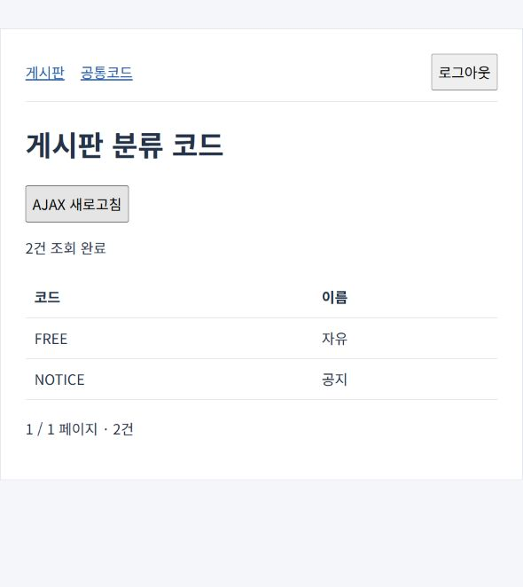

> AI의 PASS는 PL/PM 승인이나 고객 검수 완료가 아닙니다.

# M0 legacy-board 재검토 GATE — 2026-10-27

상태: **PARTIAL — 인프라·검증 도구는 사용자 승인 완료, legacy-board 수정·실행 검증 완료 후 구조 재승인 대기.** M1에는 착수하지 않았다.

### 한 일

| 요청 | 반영 결과 |
|---|---|
| Service 인터페이스·Impl | BoardService/BoardServiceImpl, CommonCodeService/CommonCodeServiceImpl 분리. Impl은 service/impl/에 위치 |
| 레거시 주입 방식 | @Service("boardService"), @Service("commonCodeService"); @Resource 이름 주입·@Autowired 필드 주입 혼용. 애플리케이션 DI 생성자는 LoginInterceptor 1곳 |
| AJAX GET | 공통코드 화면의 AJAX 새로고침 → $.ajax GET `/code/listJson.do` → @ResponseBody JSON codes/page/total → 화면 갱신 |
| AJAX POST | 상세 삭제 → $.ajax POST `/board/delete.do` (id, csrf) → @ResponseBody `{success:true}` → 목록 이동 |
| SI 소스 포맷 | 자체 Java·XML·JSP·JS/CSS를 문장/요소별 줄로 정리하고 메서드 사이 빈 줄 추가. jQuery 배포 파일은 보존 |
| Map Mapper | CommonCodeServiceImpl의 HashMap(offset, endRow) → CommonCodeDao 문자열 sqlId → CommonCode.xml의 parameterType="map" |
| Oracle 분석 자료 | `src/main/resources/db/oracle/ddl.sql`: 테이블 3개·시퀀스 1개, 테이블/컬럼 한글 COMMENT. H2 schema.sql은 변경하지 않음 |
| globals·prod | globals.properties에 DbType·Url·UserName·Password 자리표시자, prod datasource 빈 정의. Jetty 실행은 local 유지 |
| 백로그·함정 | MILESTONES.md의 v0.2에 modern-board 1줄 추가. 함정 목록 13항목의 라인 번호와 신규 경로 갱신 |

화면·URL·클래스·Mapper 전체 목록은 [examples/README.md](../examples/README.md), 소스 위치는 [함정 목록](../evals/legacy-board-traps.md)에 있다. UserSession의 값 생성자는 DI 생성자가 아니며 프레임워크 SqlSessionTemplate의 XML constructor-arg도 유지했다.

### 검증

Maven 3.9.10을 사용했다. 결과 수는 테스트 메서드 수이며 입력 조합 전체의 완전성을 의미하지 않는다.

| 환경·실행 | 결과 | 범위·증거 단계 |
|---|---|---|
| JDK 11.0.27: `mvn -q clean test` | PASS | JUnit 2개, 실패·오류·스킵 0. 서비스 단위 1개 + 실제 MVC/Mapper/H2 통합 1개; 4단계 |
| JDK 11.0.27: `mvn -q jetty:run` + `node smoke.mjs` | PASS | 실제 앱 1개, GET/POST JSON·한글·권한·CSRF·map 페이징·CRUD·검색·로그아웃; 5단계(HTTP) |
| JDK 17.0.14: `mvn -q clean test package` | PASS | 같은 JUnit 2개, 실패·오류·스킵 0 및 WAR 생성; 4단계 |
| JDK 17.0.14: `mvn -q jetty:run` + `node smoke.mjs` | PASS | 같은 실제 HTTP 시나리오; 5단계(HTTP) |
| `npm.cmd test` | PASS | Node 테스트 8개, 실패·스킵 0 + 스킬 1개 형식·공통 복사본 검사; 4단계 |
| 실제 브라우저, JDK 11 서버 | PASS | AJAX 새로고침 후 “2건 조회 완료” 및 코드 2행 확인. 합성 글 1건 등록→AJAX 삭제→목록에서 제거 확인; 5단계 |
| 클래스 헤더 | PASS | 본체 클래스파일 19개와 Jackson ObjectMapper·javax.annotation.Resource 모두 major 52(Java 8 형식); 4단계 |
| WAR 검사 | PASS | H2·JUnit·Mockito·spring-test·local datasource·H2 초기 SQL·jakarta.annotation-api 미포함; 4단계 |
| 소스·diff 검사 | PASS | 루트 package.json과 H2 schema.sql 변경 없음, `git diff --check` 통과 |

JSON 검사는 Content-Type과 실제 값을 확인한다. 공통코드 첫 페이지는 FREE/자유·NOTICE/공지, 두 번째 페이지는 빈 목록이며 0페이지는 400이다. 조회자의 JSON 접근·삭제와 CSRF 없는 삭제는 403이고 게시글이 남는다. 승인된 관리자 삭제 후에는 JSON success와 상세 404를 함께 확인했다.

브라우저 확인 중 기존 공통 JSP 조각의 한글 깨짐을 재현했다. 각 jspf의 pageEncoding=UTF-8로 원인을 수정하고 smoke에 로그아웃·페이징 문구 검사를 추가했다. 아래는 수정 후 실제 AJAX 조회 결과다.

검증에 사용한 두 서버는 종료했다. 재현 명령은 [examples/README.md](../examples/README.md)를 따른다. JAVA_HOME을 JDK 11 또는 17로 바꿔 각각 실행한다.

### 결정

- Jackson 2.20.2와 별도 승인된 javax.annotation-api 1.3.2를 테스트베드 pom에만 추가했다. javax.annotation-api는 compile 스코프이며 Jakarta API로 대체하지 않았다. 버전·이유·라이선스는 [의존성 표](decisions.md)에 기록했다.
- 기존 HTML 공통코드 목록은 유지하고 JSON 엔드포인트를 추가했다. 삭제의 HTTP 응답만 명시적으로 JSON 계약으로 바꾸고 UI 이동은 JS가 담당한다.
- Oracle 물리 컬럼명은 영문으로 유지하고 한글 논리명을 COMMENT로 제공한다. prod는 설정 분석용 정의이며 Oracle 드라이버·실제 접속 정보는 포함하지 않는다.
- 기존 보안 검사, local 프로필, test 스코프 H2, release 8, Spring/MyBatis/Mockito 버전은 유지했다.

### 남은 문제

- Oracle 실제 접속·DDL 실행 및 prod 프로필 실행은 미검증이다. 실행 요청이나 운영 접근 승인이 없으므로 수행하지 않았다.
- Java 8 JVM 자체 실행은 하지 않았다. Java 8 클래스 형식과 JDK 11·17 실행을 확인한 범위다.
- Spring 5.3 등 구버전의 EOL·CVE 한계는 그대로다. 운영 용도가 아니다. 전체 취약점 감사나 여러 브라우저의 호환성 검사는 하지 않았다.
- 인프라 승인과 별개로 legacy-board 구조의 사용자 재승인은 아직 없다. 새로운 eval 정답을 승인된 것으로 취급하지 않았다.

### 사용자 확인 필요

[기능·구조 목록](../examples/README.md)과 [갱신한 함정 목록](../evals/legacy-board-traps.md)을 재검토한다. `prompts/M0.md`의 `[GATE]`에 따라 여기서 멈추며, legacy-board 승인 또는 추가 수정 지시를 기다린다.
