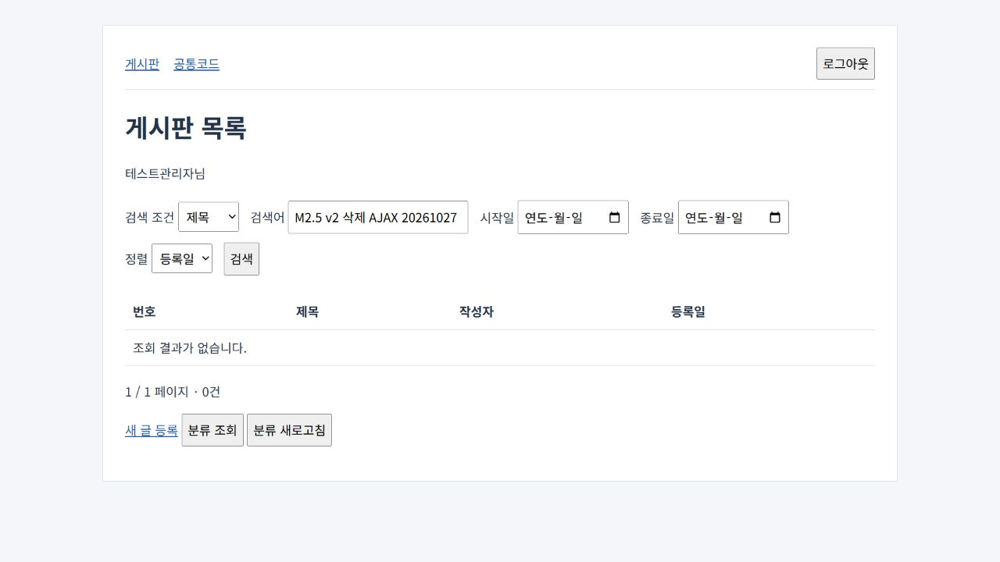

> AI의 PASS는 PL/PM 승인이나 고객 검수 완료가 아닙니다.

# M2.5 종료 보고 — Thymeleaf 수집기 v2

### 한 일

사용자가 승인한 네 일반 규칙을 실패 테스트부터 수정했다. 승인 정답·첫 FAIL 점수·원본은 변경하지 않았다. 프로젝트 이름/메서드 이름을 수집 규칙에 넣지 않았으며 외부 의존성 추가는 0개다.

| 규칙 | 변경·판정 |
|---|---|
| submit preventDefault | 같은 폼 ID의 선행 취소와 동일 URL/HTTP method AJAX는 handler requests 하나로 병합하고 폼·AJAX·취소 근거를 남긴다. 다른 endpoint/메서드·조건은 기본 action을 차단 이유의 LIKELY로 남긴다. |
| fragment 식 | 최상위 template/selector와 괄호 인자를 분리한다. root th:replace·중첩 인자·정적 따옴표 템플릿·자기 참조를 읽고 잘못된 식/동적 이름은 확정하지 않는다. |
| Boot 기본 뷰 | Maven/Gradle starter와 application*.properties/yml/yaml의 prefix/suffix를 확인한다. 기본 classpath:/templates/+.html, 파일 존재 시 CONFIRMED다. profile 상충/미지원 구문은 LIKELY다. 같은 루트 Maven·Gradle의 동일 starter는 한 구성으로 본다. |
| 반환 뷰 | 같은 클래스 static final String 상수·private String 메서드 반환을 호출 깊이 2까지 따라간다. 순환·동적/모호한 값·깊이 초과는 LIKELY, redirect/forward는 렌더링 파일이 아니다. |

구현은 `lib/indexer/{js,thymeleaf,thymeleaf-url,views,boot-views,index}.mjs`, 행동 테스트는 `test/thymeleaf-v2.test.mjs`다. 단독 설치 복사본·기술 안내도 동기화했다.

### 검증

**v2는 결함 수정 확인이며 일반화 성능이 아니다.** 첫 실행과 같은 승인 정답·scope를 사용했다. 그룹·사례·학습과 합산한 점수는 만들지 않았다. 아래의 숫자 순서는 누락/과탐/상태 불일치다.

| held-out | 그룹 | 첫 점수 | 첫 오류 | v2 | v2 오류 |
|---|---|---:|---|---:|---|
| 삭제 AJAX | screen | 4/4 FAIL | 0/1/0 | **4/4 PASS** | 0/0/0 |
| 삭제 AJAX | server | 9/9 PASS | 0/0/0 | **9/9 PASS** | 0/0/0 |
| PetClinic | screen | 2/6 FAIL | 4/1/0 | **6/6 PASS** | 0/0/0 |
| PetClinic | server | 3/3 PASS | 0/0/0 | **3/3 PASS** | 0/0/0 |

[나란히 비교한 원본](evidence/m2.5-v2/comparison.json), [v2 결과](evidence/m2.5-v2/results.json), [수정 전 첫 보고](m2.5-heldout-first-report.md). 삭제 screen 4개에는 AJAX POST·성공 GET 이동과 기존 목록/수정 링크가 포함된다. form/inline/fallback 중복 POST는 사라졌고 실제 POST 연결에 detail.html:12·39 양쪽 근거가 남는다. PetClinic은 Boot 뷰 3개·매개변수 layout을 모두 CONFIRMED로 연결했으며 private helper 경유 ownersList와 redirect 보충 항목도 구별했다. JPA는 계속 제외했다.

최종 설치본의 새 run-id는 `m25-v2-{delete,petclinic,search,create,coexist}-20261027-02`다. 학습 3건도 같은 구현으로 새로 실행했다.

| 학습 | parity 일치/정답 | screen 일치/정답 | 각 그룹 누락/과탐/상태 불일치 |
|---|---:|---:|---|
| search | 16/16 | 7/7 | 0/0/0 |
| create | 12/12 | 5/5 | 0/0/0 |
| coexist | 해당 없음 | 1/1 | 0/0/0 |

기존 JSP 8건은 최종 v2로 원문을 다시 인덱싱했다. 과거 held-out 3건을 새 일반화 평가로 표현하지 않는다. [회귀 원본](evidence/m2.5-v2/legacy-regression.json).

| 기존 구분 | 사례 | 일치/정답 | 누락/과탐/상태 불일치 |
|---|---|---:|---|
| 학습 | legacy-board-search | 17/17 | 0/0/0 |
| 학습 | legacy-board-create | 14/14 | 0/0/0 |
| 학습 | egov-clcode-delete | 7/7 | 0/0/0 |
| 학습 | egov-detailcode-list | 13/13 | 0/0/0 |
| 학습 | egov-rss-columns | 5/5 | 0/0/0 |
| 기존 held-out 회귀 | egov-article-list | 38/38 | 0/0/0 |
| 기존 held-out 회귀 | egov-user-insert | 11/11 | 0/0/0 |
| 기존 held-out 회귀 | egov-id-dplct-ajax | 17/17 | 0/0/0 |

실행한 검증:

- `node --test test/thymeleaf-v2.test.mjs`: 처음 일반 합성 10건 모두 FAIL → 수정 후 PASS. 실패를 `0add4e1`에 먼저 커밋했다. 동일 루트 Maven/Gradle 중복도 추가 테스트 1건을 먼저 실패시킨 뒤 고쳤다. [실패 기록](evidence/m2.5-v2/failing-before.txt), [추가 실패](evidence/m2.5-v2/dual-build-failing-before.txt).
- `npm.cmd test`: 최종 **108/108 PASS**, 승인 근거 13건·스킬 형식·복사본 검사 PASS. [최종 로그](evidence/m2.5-v2/npm-test-final.txt).
- `mvn -o -B -q -f examples/legacy-board-thymeleaf/pom.xml test`: Java 17/Maven JUnit **2/2 PASS**. 새 의존성을 설치하지 않고 승인된 캐시를 사용했다.
- 기존 `smoke.mjs`: HTTP 로그인·권한·레이아웃·data URL 2종·JSP 공존·등록·검색·CSRF·이스케이프 PASS.
- 실제 브라우저: 두 data AJAX 각각 자유/공지 2건, JSP 공존, 합성 글 등록·검색 1건, 삭제 버튼 AJAX 후 GET 목록 이동, 같은 제목 재검색 **0건**을 확인했다. [런타임 기록](evidence/m2.5-v2/runtime.json). localhost 검증 서버·임시 탭은 종료했다.
- `node docs/evidence/m2.5-v2/verify.mjs`: 첫 원본 49개·v2 원본 136개 해시, native eval 7개·회귀 8건·승인 정답/테스트베드 불변·raw index/trace 점수 일치 검사 PASS. 수집기를 재실행하지 않는 원본 검증이다.



### 결정

최종 구현 revision은 **`2ff7c2233fdb1ddb894cd77d4d4a296c49b6f8c7`**, 도구 지문은 **`37f82c6f7d6e535260f1582c2e8d441f48dd8c9adab32e5eafe3f2e2daa6c827`**다. 첫 구현 `fd1b93c`/지문 `8e5bdc83…`과 별도 기록했다. 첫 승인 정답·점수·49개 아카이브·학습 이전 원본·테스트베드 소스는 그대로다.

동일 starter를 pom/Gradle이 함께 선언한 경우를 처음 준비 단계에서 과도하게 LIKELY로 판정했다. 일반 합성 테스트로 재현해 같은 build 루트 기준으로 정규화했다. 미채점 `v2-01` 준비 자료도 보존하고 최종 `v2-02`를 새로 실행했다. -01을 첫 점수나 성공 실행으로 보고하지 않는다.

screen/server 보고는 동일 승인 scope/edges의 그룹별 투영과 기존 비교기를 재사용했다. 기대 도착 노드로 실제 출력을 여과하거나 누락 연결을 수동 추가하지 않았다. 학습 parity는 승인 JSP 서버 연결과 동일하다. 모든 복잡 실행은 단일 에이전트의 세 역할 순차 검토로 기록했다.

원본 전체 인덱스·query·trace·검토·manifest·보고서·native eval·승인본·도구/소스 해시·미채점 준비 자료를 [136개 파일 아카이브](evidence/m2.5-v2/README.md)에 보존했다. 외부 PetClinic은 고정 `500158f`를 유지하고 원문 소스·JPA 구간을 커밋/평가하지 않았다. v2를 첫 점수와 합산하거나 일반화 성능으로 보지 않는다.

### 남은 문제

**Java 8 런타임은 BLOCKED**다. 구성된 JDK는 11/17/21이며 Java 8이 없다. 이번 실제 실행은 Java 17 + Thymeleaf 3.1.5다. Java 8 메타데이터/컴파일 근거를 런타임 성공으로 대체하지 않는다. Java 8 환경이 준비되면 JAVA_HOME을 설정하고 아래를 재실행한다.

```powershell
mvn -B -q -f examples/legacy-board-thymeleaf/pom.xml test
mvn -B -f examples/legacy-board-thymeleaf/pom.xml jetty:run
node examples/legacy-board-thymeleaf/smoke.mjs
```

브라우저 삭제 AJAX도 Java 8 서버에서 별도로 확인해야 한다. YAML은 해당 두 키의 들여쓰기/점 키·한 줄 scalar만 읽으며 flow/anchor/alias/tag/block scalar·다중 문서·환경/설정 import/우선순위 전체를 해석하지 않는다. 복잡한 이벤트 위임·Java 값 연산/외부 상수·private 호출 깊이 초과도 제한된다. [limitations](limitations.md)에 명시했다.

정적 eval은 PASS지만 실행 manifest 5건은 외부 설정/AOP·scope 밖 경계 때문에 PARTIAL이다. 로컬 앱 검증과 외부 PetClinic/JPA 실행을 구별한다. 기존 SLF4J provider 부재 경고는 승인안대로 유지했다. 임시 Git 쓰기·localhost 샌드박스 제한은 코드 변경 없이 권한 있는 동일 명령에서 통과했고 실패 로그도 보존했다.

완료 기준 점검:

| 기준 | 상태·근거 |
|---|---|
| 의존성·학습 3건·held-out 2건 승인 | PASS, 기존 승인/확정 기록 유지 |
| 서버 parity·screen·공존·기존 8건 회귀 | PASS, 위 표와 새 run 원본 |
| 문법/경계 행동 테스트·전체 npm·단독 복사본 | PASS, 108/108·스킬/동기화 검사 |
| 테스트베드 빌드·렌더링·data AJAX·JSP·검색/등록/삭제 | PASS, Java 17 JUnit 2건·HTTP·실제 브라우저 |
| 단독 설치 si-trace 실행·manifest | PASS, 새 CLI run 5건·계약 검증. 분석 상태 PARTIAL은 유지 |
| 첫 점수/원본/해시·고정 외부 SHA·소스 미추적 | PASS, 첫 49개 보존·v2 136개 별도 |
| 결정·한계·마일스톤 문서 갱신 | PASS |
| 추가 Java 8 실제 실행 | BLOCKED, 위 환경·명령으로 이관 |

### 사용자 확인 필요

**M2.5 작업을 종료한다.** 구현·정적 평가·Java 17 앱 검증은 완료했고 Java 8 런타임 제약을 남긴다. 추가 승인 대기나 진행 중인 서버는 없다. M3는 시작하지 않았다.
