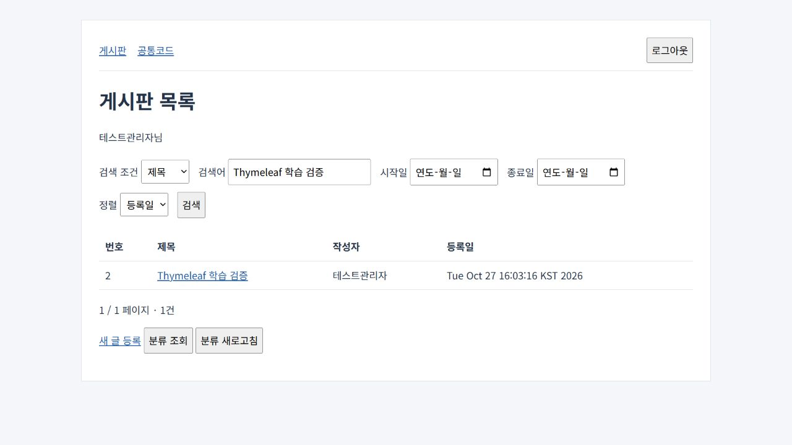

> AI의 PASS는 PL/PM 승인이나 고객 검수 완료가 아닙니다.

# M2.5 — 테스트베드 구축·학습 정답 GATE

> 후속 구조 변경: 기존 주 연결은 사용자 승인을 받았고, 화면 보충 항목을 screen 채점으로 승격했다. JSP 공존은 독립 사례로 분리했다. 현재 검토 대상은 [그룹별 GATE 보고](m2.5-grouped-gate-report.md)이며 아래는 변경 전 기록으로 보존한다.

**학습 정답 2건의 승인 대기다. 수집기 구현·새 eval·held-out 평가는 진행하지 않았다.**

### 한 일

- 승인한 spring5 3.1.5.RELEASE, Layout Dialect 3.4.0(thymeleaf exclusion), SLF4J API 2.0.17 고정을 적용했다.
- `examples/legacy-board-thymeleaf/`에 Layout Dialect 공통 레이아웃, 검색·등록·상세·로그인·오류 템플릿, data URL 2종과 외부 JS를 만들었다. 공통코드 목록은 JSP로 유지한다.
- Thymeleaf resolver는 order 1·viewNames `board/*,login,error`, JSP resolver는 order 2·`code/*`다. 컨테이너가 직접 보여주는 오류 JSP는 기존 설정을 보존했고 MVC `error` 뷰는 Thymeleaf다.
- checkExistence fallback과 Thymeleaf 3.0의 제거된 유틸 객체 읽기를 프롬프트에 추가했다. 수집기 단계에서 합성 테스트하며 렌더링 검증 기준 3.1.5는 limitations에 명시했다.
- 테스트베드 소스 `bfa5098`을 기준으로 아래 초안 2건을 작성했다. 기존 서버 연결과 새 화면 검토 범위를 나누었다.

| 초안 | 기존 승인본과 대응하는 주 연결 | 별도 보충 검토 | 상태 |
|---|---|---|---|
| [검색 MD](../evals/trace/legacy-board-thymeleaf-search/expected.draft.md) · [JSON](../evals/trace/legacy-board-thymeleaf-search/expected.draft.json) | 17개: 화면 1 + 동일 서버 16 | 7건: Thymeleaf/JSP 뷰 선택, 레이아웃, 메뉴, 페이징, data AJAX 2종 | DRAFT_SOURCES_VALID |
| [등록 MD](../evals/trace/legacy-board-thymeleaf-create/expected.draft.md) · [JSON](../evals/trace/legacy-board-thymeleaf-create/expected.draft.json) | 14개: 화면 2(create/update 분기) + 동일 서버 12 | 3건: form 뷰 선택, 레이아웃, 메뉴 | DRAFT_SOURCES_VALID |

### 검증

| 실행·확인 | 결과·범위 |
|---|---|
| 기존/새 pom의 `mvn -B dependency:tree -Dverbose` | PASS. 선택 jar 26 → 35개. 추가 9개 모두 예상 일치, 기존 제거·변경·예상 밖 추가·누락 0개 |
| Groovy 버전 선택 | 4.0.25 선택. 4.0.21·4.0.14는 conflict 제외. SLF4J는 2.0.17, Thymeleaf는 3.1.5만 선택 |
| `mvn -B -q test` (Maven 3.9.10, Corretto 17.0.14) | 기존 JUnit **2/2 PASS**, 실패·오류·스킵 0. 실제 Mapper·H2 및 렌더링 포함 |
| `mvn -q jetty:run` → `node smoke.mjs` | 로컬 앱 **1개 PASS**. 로그인·권한·레이아웃·JSP·등록·검색·data URL 응답·CSRF·이스케이프 확인 |
| 브라우저 UI | 두 data URL 버튼을 각각 새 화면에서 클릭해 자유/공지 2건 확인. JSP 기존 AJAX, 글 등록·검색 결과 확인 |
| 서버 파일 바이트 대조 | Java·main resources·기존 test **30/30 동일** |
| `npm.cmd test` | **74/74 PASS**, 승인 정답 8건 PASS·새 초안 2건 DRAFT_SOURCES_VALID, 스킬 2개·공통 복사본 검사 통과 |
| 기존 승인본 대비 JSON 대조 | 서버 연결 **16+12개 동일**. 평가 실행 결과나 전체 정확도가 아님 |

근거: [의존성 비교](evidence/m2.5-dependencies/comparison.json), [서버 파일 대조](evidence/m2.5-testbed/server-parity.json), [실행 기록](evidence/m2.5-testbed/verification.json), [초안 비교](evidence/m2.5-testbed/draft-comparison.json), [npm 로그](evidence/m2.5-testbed/npm-test.txt).

### 결정

실제 dependency tree가 승인안과 같아 구축을 계속했다. 선택·제외된 Groovy 버전과 예상 밖 의존성 0건은 [decisions.md](decisions.md)에 기록했다. 테스트베드는 viewNames 방식을 유지하고, checkExistence·3.0 구문은 이후 합성 검증으로 분리한다.

초안의 CONFIRMED는 소스 근거가 있는 연결 후보라는 뜻이며 사용자 승인을 대신하지 않는다. 기존 evalTrace는 보충 항목을 자동 채점하지 않는다. 수집기 구현 단계에서 별도 검증을 마련해 보충 항목 결과도 따로 보고해야 한다.

### 남은 문제

- **BLOCKED — Java 8 런타임:** 구성된 `.jdks`에는 JDK 11/17/21만 있어 Java 8 실행은 미검증이다. JDK 17의 release 8 컴파일·실행을 Java 8 런타임 검증으로 표현하지 않는다. Java 8을 준비한 뒤 해당 JAVA_HOME으로 새 테스트베드에서 `mvn -q test`, `mvn jetty:run`, 다른 터미널의 `node smoke.mjs`를 실행해야 한다.
- SLF4J provider를 추가하지 않아 NOP logger 경고가 발생한다. 승인된 API만 유지했다.
- 수집기·checkExistence 합성 테스트·3.0 구문 읽기·새 학습 eval은 정답 승인 후 단계다. `th:insert`/`th:include`·경로 변수 등 나머지 수집 문법도 그 단계의 합성 테스트로 검증한다.
- 삭제 AJAX 템플릿은 구축했으나 새 held-out 정답·eval·첫 점수는 만들지 않았다. 기존 복사된 JUnit의 서버 CRUD 회귀 확인과 held-out 수집기 평가를 구분한다. 공개 PetClinic도 클론·흐름 탐색하지 않았다.

### 사용자 확인 필요

위 검색·등록 expected.draft MD/JSON의 **주 연결과 보충 항목 범위**를 검토·승인해 주세요. `prompts/M2.5.md` 2절의 “원본과 새 정답의 화면 차이·서버 연결 대응표를 제시하고 멈춘다”와 이번 사용자 지시에 따라 여기서 중지한다. 승인 후에만 정답 확정·학습 등록과 수집기 구현을 진행한다.
